# 📐 TÀI LIỆU THIẾT KẾ KIẾN TRÚC & HỆ THỐNG VIORA (MINISOCIAL)
### SƠ ĐỒ USE CASE, SƠ ĐỒ LUỒNG DỮ LIỆU (DFD), SƠ ĐỒ HOẠT ĐỘNG, SƠ ĐỒ ERD & MÔ HÌNH QUAN HỆ DỮ LIỆU

> **Dự án:** Viora (Tiền thân: MiniSocial)  
> **Phiên bản tài liệu:** Design_System_V2  
> **Mô hình vận hành thực tế:** Kiến trúc Client-Server thời gian thực dựa trên **Flutter + Supabase BaaS** (Cơ sở dữ liệu PostgreSQL 15, Xác thực đa yếu tố, Lưu trữ đám mây CDN, Kênh WebSocket Realtime), kết hợp **LiveKit Cloud WebRTC** và **Supabase Edge Functions** (Trí tuệ nhân tạo Gemini, Thuật toán đề xuất v2).  
> **Định hướng mở rộng tương lai:** Kiến trúc ngoại tuyến (**Offline-First** với cơ sở dữ liệu cục bộ Isar/Hive và hàng đợi đồng bộ Outbox) là kế hoạch nâng cấp cho giai đoạn phát triển tiếp theo.  
> **Tài liệu tham chiếu phiên bản mới nhất:**
> - [`DANH_SACH_CHUC_NANG_VIORA.md`](file:///c:/cross_platform/mini_social/DANH_SACH_CHUC_NANG_VIORA.md) (Phiên bản 2.1.1 — Đặc tả toàn bộ 11 phân hệ & 55+ chức năng)
> - [`RECOMMENDATION_V2.md`](file:///c:/cross_platform/mini_social/RECOMMENDATION_V2.md) (Thuật toán đề xuất bảng tin thông minh thế hệ 2)
> - [`DATABASE_SCHEMA.md`](file:///c:/cross_platform/mini_social/DATABASE_SCHEMA.md) (Thiết kế cơ sở dữ liệu v2 và các bản cập nhật mới nhất)
> - [`Offline_First_plan.md`](file:///c:/cross_platform/mini_social/Offline_First_plan.md) (Kế hoạch phát triển tính năng ngoại tuyến trong tương lai)

---

## 📑 MỤC LỤC TỔNG QUAN

1. [TỔNG QUAN KIẾN TRÚC HỆ THỐNG](#1-tổng-quan-kiến-trúc-hệ-thống)
   - [1.1 Kiến trúc Vận hành Thực tế (Client-Server Realtime)](#11-kiến-trúc-vận-hành-thực-tế-client-server-realtime)
   - [1.2 Định hướng Nâng cấp Ngoại tuyến (Kế hoạch Tương lai)](#12-định-hướng-nâng-cấp-ngoại-tuyến-kế-hoạch-tương-lai)
   - [1.3 Bảng Ngăn xếp Công nghệ (Tech Stack)](#13-bảng-ngăn-xếp-công-nghệ-tech-stack)
2. [SƠ ĐỒ USE CASE TOÀN DIỆN (USE CASE DIAGRAMS)](#2-sơ-đồ-use-case-toàn-diện-use-case-diagrams)
   - [2.1 Danh sách Tác nhân (Actors)](#21-danh-sách-tác-nhân-actors)
   - [2.2 Bảng Đối soát Tổng hợp 60 Use Case theo 10 Phân hệ](#22-bảng-đối-soát-tổng-hợp-60-use-case-theo-10-phân-hệ)
   - [2.3 Sơ đồ Use Case Tổng quan Hệ thống](#23-sơ-đồ-use-case-tổng-quan-hệ-thống)
   - [2.4 Use Case Phân hệ 1: Xác thực, Bảo mật 2FA & Quản lý Phiên](#24-use-case-phân-hệ-1-xác-thực-bảo-mật-2fa--quản-lý-phiên)
   - [2.5 Use Case Phân hệ 2: Hồ sơ Cá nhân, Kết nối Xã hội & Mã QR](#25-use-case-phân-hệ-2-hồ-sơ-cá-nhân-kết-nối-xã-hội--mã-qr)
   - [2.6 Use Case Phân hệ 3A: Soạn thảo, Xuất bản Bài viết & Thùng rác](#26-use-case-phân-hệ-3a-soạn-thảo-xuất-bản-bài-viết--thùng-rác)
   - [2.7 Use Case Phân hệ 3B: Bảng tin Đề xuất & Tương tác Bài viết](#27-use-case-phân-hệ-3b-bảng-tin-đề-xuất--tương-tác-bài-viết)
   - [2.8 Use Case Phân hệ 4: Tin ngắn 24 Giờ (Stories) & Kho Lưu trữ](#28-use-case-phân-hệ-4-tin-ngắn-24-giờ-stories--kho-lưu-trữ)
   - [2.9 Use Case Phân hệ 5A: Nhắn tin Thời gian thực & Tiện ích Phòng Chat](#29-use-case-phân-hệ-5a-nhắn-tin-thời-gian-thực--tiện-ích-phòng-chat)
   - [2.10 Use Case Phân hệ 5B: Bảo mật Hộp thư & Quản trị Nhóm Chat](#210-use-case-phân-hệ-5b-bảo-mật-hộp-thư--quản-trị-nhóm-chat)
   - [2.11 Use Case Phân hệ 6: Cuộc gọi Thoại & Video Call WebRTC](#211-use-case-phân-hệ-6-cuộc-gọi-thoại--video-call-webrtc)
   - [2.12 Use Case Phân hệ 7: Tìm kiếm & Khám phá Trí tuệ Nhân tạo](#212-use-case-phân-hệ-7-tìm-kiếm--khám-phá-trí-tuệ-nhân-tạo)
   - [2.13 Use Case Phân hệ 8: Thông báo Thời gian thực & Điều hướng](#213-use-case-phân-hệ-8-thông-báo-thời-gian-thực--điều-hướng)
   - [2.14 Use Case Phân hệ 9: Kiểm duyệt An toàn Cộng đồng & Kháng cáo](#214-use-case-phân-hệ-9-kiểm-duyệt-an-toàn-cộng-đồng--kháng-cáo)
   - [2.15 Use Case Phân hệ 10: Cài đặt Hệ thống, Giao diện & Đa ngôn ngữ](#215-use-case-phân-hệ-10-cài-đặt-hệ-thống-giao-diện--đa-ngôn-ngữ)
3. [SƠ ĐỒ LUỒNG DỮ LIỆU (DATA FLOW DIAGRAMS - DFD)](#3-sơ-đồ-luồng-dữ-liệu-data-flow-diagrams---dfd)
   - [3.1 Sơ đồ DFD Mức Ngữ cảnh (Mức 0)](#31-sơ-đồ-dfd-mức-ngữ-cảnh-mức-0)
   - [3.2 Sơ đồ DFD Mức 1: Phân rã Các Tiến trình Hệ thống](#32-sơ-đồ-dfd-mức-1-phân-rã-các-tiến-trình-hệ-thống)
   - [3.3 Sơ đồ DFD Mức 2.1: Luồng Đăng bài, Xử lý Đa phương tiện & Kiểm duyệt AI](#33-sơ-đồ-dfd-mức-21-luồng-đăng-bài-xử-lý-đa-phương-tiện--kiểm-duyệt-ai)
   - [3.4 Sơ đồ DFD Mức 2.2: Luồng Nhắn tin Thời gian thực & Xác nhận Đã xem](#34-sơ-đồ-dfd-mức-22-luồng-nhắn-tin-thời-gian-thực--xác-nhận-đã-xem)
   - [3.5 Sơ đồ DFD Mức 2.3: Luồng Tín hiệu & Đàm thoại Cuộc gọi WebRTC](#35-sơ-đồ-dfd-mức-23-luồng-tín-hiệu--đàm-thoại-cuộc-gọi-webrtc)
   - [3.6 Sơ đồ DFD Mức 2.4: Luồng Báo cáo Vi phạm, Đánh giá Rủi ro & Kháng cáo](#36-sơ-đồ-dfd-mức-24-luồng-báo-cáo-vi-phạm-đánh-giá-rủi-ro--kháng-cáo)
4. [SƠ ĐỒ HOẠT ĐỘNG (ACTIVITY DIAGRAMS)](#4-sơ-đồ-hoạt-động-activity-diagrams)
   - [4.1 Hoạt động: Đăng ký, Đăng nhập & Xác thực Bảo mật Hai lớp (2FA)](#41-hoạt-động-đăng-ký-đăng-nhập--xác-thực-bảo-mật-hai-lớp-2fa)
   - [4.2 Hoạt động: Soạn thảo Bài viết, Gợi ý Caption AI & Kiểm duyệt Xuất bản](#42-hoạt-động-soạn-thảo-bài-viết-gợi-ý-caption-ai--kiểm-duyệt-xuất-bản)
   - [4.3 Hoạt động: Thiết lập & Đàm thoại Cuộc gọi Thoại / Video WebRTC](#43-hoạt-động-thiết-lập--đàm-thoại-cuộc-gọi-thoại--video-webrtc)
   - [4.4 Hoạt động: Đăng Tin ngắn 24h, Thả Biểu cảm Hạt bay & Lưu trữ Trang cá nhân](#44-hoạt-động-đăng-tin-ngắn-24h-thả-biểu-cảm-hạt-bay--lưu-trữ-trang-cá-nhân)
   - [4.5 Hoạt động: Kiểm duyệt Nội dung Đa tầng, Xử phạt & Giải quyết Kháng cáo](#45-hoạt-động-kiểm-duyệt-nội-dung-đa-tầng-xử-phạt--giải-quyết-kháng-cáo)
   - [4.6 Hoạt động: Thuật toán Xếp hạng Bảng tin Cá nhân hóa (Recommendation v2)](#46-hoạt-động-thuật-toán-xếp-hạng-bảng-tin-cá-nhân-hóa-recommendation-v2)
5. [SƠ ĐỒ THỰC THỂ LIÊN KẾT (ENTITY RELATIONSHIP DIAGRAM - ERD)](#5-sơ-đồ-thực-thể-liên-kết-entity-relationship-diagram---erd)
   - [5.1 Biểu đồ ERD Tổng thể Cơ sở dữ liệu](#51-biểu-đồ-erd-tổng-thể-cơ-sở-dữ-liệu)
   - [5.2 Bảng Đặc tả Quan hệ & Bản số (Cardinality)](#52-bảng-đặc-tả-quan-hệ--bản-số-cardinality)
6. [MÔ HÌNH QUAN HỆ DỮ LIỆU (RELATIONAL DATA MODEL - 3NF)](#6-mô-hình-quan-hệ-dữ-liệu-relational-data-model---3nf)
   - [6.1 Đặc tả Chi tiết 20 Bảng Cơ sở dữ liệu PostgreSQL](#61-đặc-tả-chi-tiết-20-bảng-cơ-sở-dữ-liệu-postgresql)
   - [6.2 Ma trận Ràng buộc Khóa Ngoại & Toàn vẹn Tham chiếu](#62-ma-trận-ràng-buộc-khóa-ngoại--toàn-vẹn-tham-chiếu)
   - [6.3 Phụ lục: Mô hình Lưu trữ Cục bộ (Định hướng Offline-First Tương lai)](#63-phụ-lục-mô-hình-lưu-trữ-cục-bộ-định-hướng-offline-first-tương-lai)

---

## 1. TỔNG QUAN KIẾN TRÚC HỆ THỐNG

### 1.1 Kiến trúc Vận hành Thực tế (Client-Server Realtime)

Hệ thống mạng xã hội **Viora** bắt buộc người dùng phải đăng ký hoặc đăng nhập để truy cập các chức năng. Ứng dụng được tổ chức theo kiến trúc phân lớp trực tuyến kết nối thời gian thực:

```
┌────────────────────────────────────────────────────────────────────────┐
│                      TẦNG GIAO DIỆN (PRESENTATION)                     │
│       Giao diện Flutter Cupertino - Điều hướng GoRouter 5 Tabs         │
└───────────────────────────────────▲────────────────────────────────────┘
                                    │ Lắng nghe trạng thái / Phát sự kiện
┌───────────────────────────────────┴────────────────────────────────────┐
│                  TẦNG NGHIỆP VỤ & QUẢN LÝ TRẠNG THÁI                   │
│       Riverpod Notifiers - Các dịch vụ Âm thanh, Vị trí, Cuộc gọi      │
└───────────────────────────────────▲────────────────────────────────────┘
                                    │ Gọi truy vấn / Nhận luồng dữ liệu
┌───────────────────────────────────┴────────────────────────────────────┐
│                     TẦNG TRUY XUẤT DỮ LIỆU (REPOSITORY)                │
│        Quản lý Bài viết, Hồ sơ, Trò chuyện, Cuộc gọi, Thông báo        │
└──────────────────┬─────────────────────────────────▲───────────────────┘
                   │ Lưu cấu hình & Token            │ Giao tiếp REST & WS
┌──────────────────▼─────────────────┐    ┌──────────┴───────────────────┐
│        BỘ NHỚ THIẾT BỊ CỤC BỘ      │    │     NỀN TẢNG SUPABASE CLOUD  │
│  • Bộ nhớ bảo mật (Token phiên)    │    │  • Hệ quản trị PostgreSQL 15 │
│  • Tùy chọn giao diện & Ngôn ngữ   │    │  • Xác thực & Bảo mật 2FA    │
│  • Lưu đệm phương tiện & Bản nháp  │    │  • Lưu trữ tệp tin CDN       │
└────────────────────────────────────┘    │  • Kênh đồng bộ WebSocket    │
                                          └──────────┬───────────────────┘
                                                     │
                                          ┌──────────┴───────────────────┐
                                          │    DỊCH VỤ ĐÁM MÂY & AI      │
                                          │  • Máy chủ WebRTC LiveKit    │
                                          │  • Các hàm máy chủ Edge      │
                                          │  • Trí tuệ nhân tạo Gemini   │
                                          └──────────────────────────────┘
```

### 1.2 Định hướng Nâng cấp Ngoại tuyến (Kế hoạch Tương lai)

Dự án đã thiết lập một số cấu trúc cơ sở ban đầu (các bảng cục bộ Isar trên thiết bị di động và Hive trên trình duyệt Web) để làm tiền đề cho kiến trúc **Offline-First** trong tương lai. Ở giai đoạn hiện tại, toàn bộ luồng nghiệp vụ chính hoạt động trực tiếp với máy chủ đám mây Supabase theo thời gian thực.

### 1.3 Bảng Ngăn xếp Công nghệ (Tech Stack)

| Thành phần | Công nghệ sử dụng | Vai trò trong hệ thống |
|:---|:---|:---|
| **Ứng dụng Khách** | Flutter 3.3+ / Dart SDK | Đa nền tảng (Android, iOS, Web) phong cách iOS Cupertino |
| **Quản lý Trạng thái** | Riverpod 2.5 | Quản lý trạng thái phản ứng (Reactive) và tiêm phụ thuộc |
| **Điều hướng** | GoRouter 14.0 | Điều hướng khai báo, duy trì trạng thái 5 nhánh màn hình chính |
| **Cơ sở dữ liệu** | Supabase PostgreSQL 15 | Lưu trữ 20 bảng dữ liệu quan hệ chuẩn 3NF, phân quyền dòng (RLS) |
| **Xác thực** | Supabase Auth & TOTP | Đăng nhập Email/Username, bảo mật hai lớp (2FA), quản lý thiết bị |
| **Thời gian thực** | Supabase Realtime | Đồng bộ tức thời tin nhắn, thông báo, lượt thích và tín hiệu gọi |
| **Lưu trữ Đám mây** | Supabase Storage CDN | Lưu trữ ảnh đại diện, ảnh bài viết, video ngắn, tin nhắn thoại |
| **Đàm thoại WebRTC** | LiveKit Cloud SFU | Truyền tải âm thanh và hình ảnh cuộc gọi thời gian thực đa nền tảng |
| **Trí tuệ Nhân tạo** | Google Gemini AI | Sinh lời dẫn ảnh tự động, kiểm duyệt nội dung 6 cấp độ, tìm kiếm ngữ nghĩa |
| **Dịch vụ Tích hợp** | Apple iTunes, OpenStreetMap | Phát nhạc nền 30 giây và gắn thẻ tọa độ địa danh cho bài viết |

---

## 2. SƠ ĐỒ USE CASE TOÀN DIỆN (USE CASE DIAGRAMS)

### 2.1 Danh sách Tác nhân (Actors)

| Tên tác nhân | Ký hiệu | Vai trò & Phạm vi tương tác |
|:---|:---:|:---|
| **Người dùng (User / Member)** | `Người dùng` | Tác nhân chính của hệ thống (bắt buộc Đăng ký / Đăng nhập). Thực hiện toàn bộ các chức năng mạng xã hội cá nhân, bảng tin, bài viết, tin ngắn, kết bạn, nhắn tin và là thành viên tham gia các phòng trò chuyện nhóm. |
| **Phó nhóm (Group Admin / Deputy)** | `Phó nhóm` | Thành viên nhóm được Trưởng nhóm bổ nhiệm quyền quản trị để hỗ trợ điều hành: phê duyệt thành viên mới, xóa thành viên thường, cấu hình quyền trò chuyện (chế độ chỉ quản trị viên gửi tin, đổi tên / ảnh nhóm), ghim tin nhắn. |
| **Trưởng nhóm (Group Owner)** | `Trưởng nhóm` | Người tạo nhóm trò chuyện, sở hữu quyền hạn tối cao trong nhóm (kế thừa toàn bộ quyền của Phó nhóm): bổ nhiệm / bãi nhiệm Phó nhóm, chuyển giao quyền Trưởng nhóm và giải tán nhóm trò chuyện vĩnh viễn. |
| **Quản trị viên (System Admin)** | `Quản trị viên` | Người vận hành hệ thống: thẩm định báo cáo vi phạm, xét duyệt đơn kháng cáo, áp dụng/gỡ bỏ điểm phạt (Strike) và khóa/mở khóa tài khoản. |
| **Dịch vụ AI & Đám mây** | `Hệ thống AI / Cloud` | Các dịch vụ tự động hóa phía máy chủ: Gemini AI (kiểm duyệt đa tầng, gợi ý caption, dịch thuật, tìm kiếm ngữ nghĩa), LiveKit Cloud (phòng gọi WebRTC). |

---

### 2.2 Bảng Đối soát Tổng hợp 60 Use Case theo 10 Phân hệ

Bảng dưới đây đối soát đầy đủ 100% các chức năng của dự án Viora tương ứng với từng sơ đồ Use Case:

| Phân hệ | Mã UC | Tên Use Case | Tác nhân chính |
|:---|:---:|:---|:---|
| **1. Xác thực & Bảo mật** | UC1.1 → UC1.8 | Đăng ký tài khoản; Tự động tạo hồ sơ; Đăng nhập (Email/Tên định danh); Quên mật khẩu; Đổi mật khẩu; Bật/Tắt bảo mật 2FA; Xác minh mã OTP 6 số; Quản lý thiết bị & Đăng xuất từ xa; Đăng xuất tài khoản. | Người dùng |
| **2. Hồ sơ & Kết nối** | UC2.1 → UC2.9 | Xem trang cá nhân; Chỉnh sửa hồ sơ (Avatar, Ảnh bìa, Tiểu sử); Cài đặt nhạc nền hồ sơ; Theo dõi / Bỏ theo dõi; Gửi / Chấp nhận / Từ chối / Thu hồi lời mời kết bạn; Tạo & Chia sẻ mã QR cá nhân; Quét mã QR (Camera/Thư viện ảnh) & Xem nhanh hồ sơ; Cài đặt quyền riêng tư; Chặn / Bỏ chặn người dùng. | Người dùng |
| **3A. Soạn & Quản lý Bài viết** | UC3.1 → UC3.8 | Tạo bài viết mới (Ảnh/Video, Cảm xúc, Tag bạn bè); Gợi ý lời dẫn & Hashtag bằng AI; Gắn vị trí địa lý (GPS/EXIF); Đính kèm nhạc nền bài viết; Gắn nhãn nội dung tạo bởi AI; Xem trước & Kiểm duyệt trước xuất bản; Chuyển bài viết vào Thùng rác (30 ngày); Khôi phục hoặc Xóa vĩnh viễn bài viết. | Người dùng, Gemini AI |
| **3B. Bảng tin & Tương tác** | UC3.9 → UC3.15 | Xem Bảng tin đề xuất cá nhân hóa; Xem gợi ý "Những người bạn có thể biết"; Thích / Bỏ thích bài viết; Bình luận & Trả lời bình luận nhiều cấp; Thích bình luận; Dịch tự động bài viết & bình luận; Chia sẻ bài viết ra nền tảng khác. | Người dùng, Gemini AI |
| **4. Tin ngắn 24 Giờ** | UC4.1 → UC4.6 | Đăng tin ngắn 24h (Ảnh/Video, Chữ, Nhạc); Xem trình chiếu tin ngắn toàn màn hình; Thả biểu cảm hạt bay sống động; Xem danh sách người đã xem & thả biểu cảm; Xem Tin nổi bật & Kho lưu trữ tin trên trang cá nhân; Xóa tin ngắn. | Người dùng |
| **5A. Nhắn tin Thời gian thực** | UC5.1 → UC5.8 | Xem danh sách hội thoại & Trạng thái trực tuyến; Nhắn tin văn bản & Nhắc tên `@mention`; Gửi ảnh kèm chú thích; Ghi âm & Gửi tin nhắn thoại; Thả cảm xúc, Trả lời, Sao chép & Chuyển tiếp tin nhắn; Thu hồi tin nhắn hai chiều; Ghim tin nhắn trong phòng chat; Đổi hình nền chat & Xem kho phương tiện chung. | Người dùng |
| **5B. Hộp thư Ẩn & Nhóm Chat** | UC5.9 → UC5.15 | Ghim / Xóa cuộc trò chuyện; Ẩn cuộc trò chuyện & Khóa bằng mã PIN 6 số; Khôi phục mã PIN đoạn chat ẩn qua Email; Tạo nhóm chat mới; Thêm / Rời nhóm; Cấu hình quyền nhóm, Duyệt & Xóa thành viên thường; Bổ nhiệm Phó nhóm & Giải tán nhóm. | Người dùng, Phó nhóm, Trưởng nhóm |
| **6. Cuộc gọi WebRTC** | UC6.1 → UC6.5 | Khởi tạo cuộc gọi Thoại / Video; Tiếp nhận / Từ chối cuộc gọi đến; Điều khiển Micrô, Camera, Loa ngoài trong cuộc gọi; Kết thúc cuộc gọi & Tự động lưu nhật ký vào phòng chat; Cấp phát mã truy cập & Điều phối phòng LiveKit. | Người dùng, LiveKit Cloud |
| **7. Tìm kiếm & Khám phá AI** | UC7.1 → UC7.4 | Tìm kiếm người dùng theo tên / tên định danh; Quản lý lịch sử tìm kiếm (Xem lại, Xóa); Tìm kiếm bài viết theo ngữ nghĩa bằng AI (Hybrid RRF); Khám phá bài viết mới & Đánh dấu không quan tâm. | Người dùng, Gemini AI |
| **8. Thông báo Thời gian thực** | UC8.1 → UC8.4 | Nhận thông báo thời gian thực & Hiển thị số chưa đọc; Xem danh sách thông báo theo phân loại; Phản hồi nhanh kết bạn / Theo dõi lại trên thông báo; Đánh dấu đã đọc & Điều hướng thông minh đến nội dung gốc. | Người dùng |
| **9. Kiểm duyệt & Kháng cáo** | UC9.1 → UC9.6 | Gửi báo cáo vi phạm nội dung / tài khoản; Mở xem nội dung nhạy cảm sau lớp cảnh báo che mờ; Xem chi tiết lý do xử phạt & Điểm phạt (Strike); Gửi đơn kháng cáo quyết định xử phạt; Thẩm định báo cáo & Duyệt đơn kháng cáo; Khóa / Mở khóa tài khoản vi phạm. | Người dùng, Quản trị viên, Gemini AI |
| **10. Cài đặt & Giao diện** | UC10.1 → UC10.4| Chuyển đổi chế độ giao diện Sáng / Tối; Chuyển đổi ngôn ngữ hiển thị (Tiếng Việt / Tiếng Anh); Xem trung tâm tài khoản & Mã QR nhanh; Tự động ghi nhận và báo cáo lỗi hệ thống. | Người dùng |

---

### 2.3 Sơ đồ Use Case Tổng quan Hệ thống


---

### 2.4 Use Case Phân hệ 1: Xác thực, Bảo mật 2FA & Quản lý Phiên


---

### 2.5 Use Case Phân hệ 2: Hồ sơ Cá nhân, Kết nối Xã hội & Mã QR

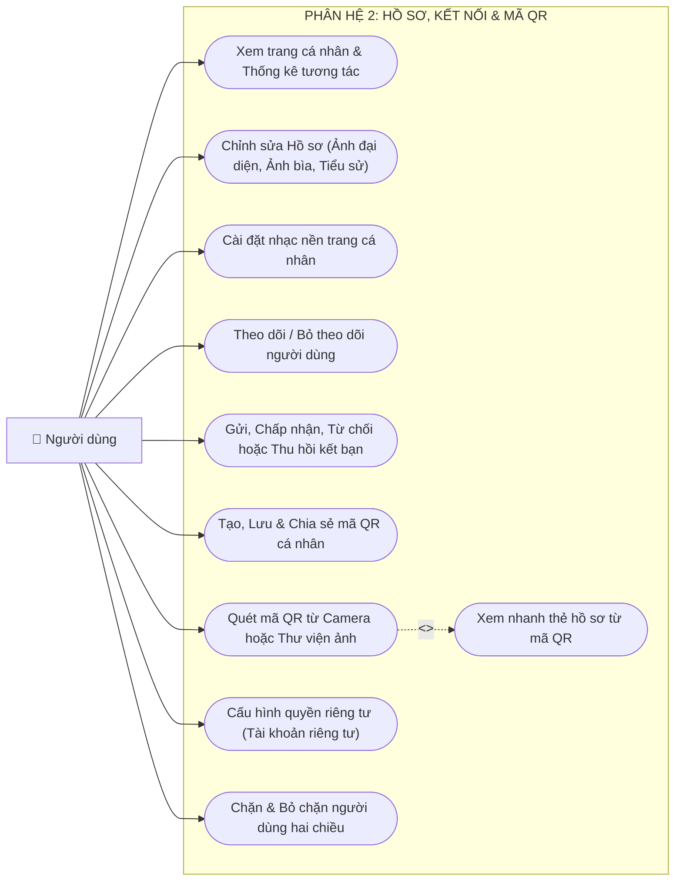

---

### 2.6 Use Case Phân hệ 3A: Soạn thảo, Xuất bản Bài viết & Thùng rác

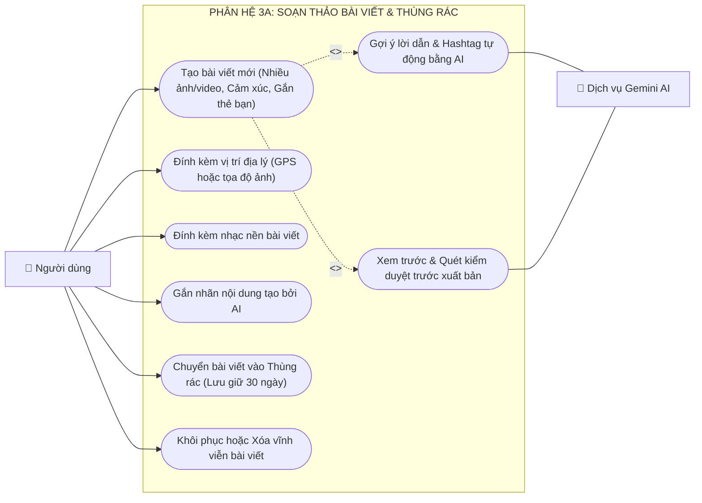

---

### 2.7 Use Case Phân hệ 3B: Bảng tin Đề xuất & Tương tác Bài viết

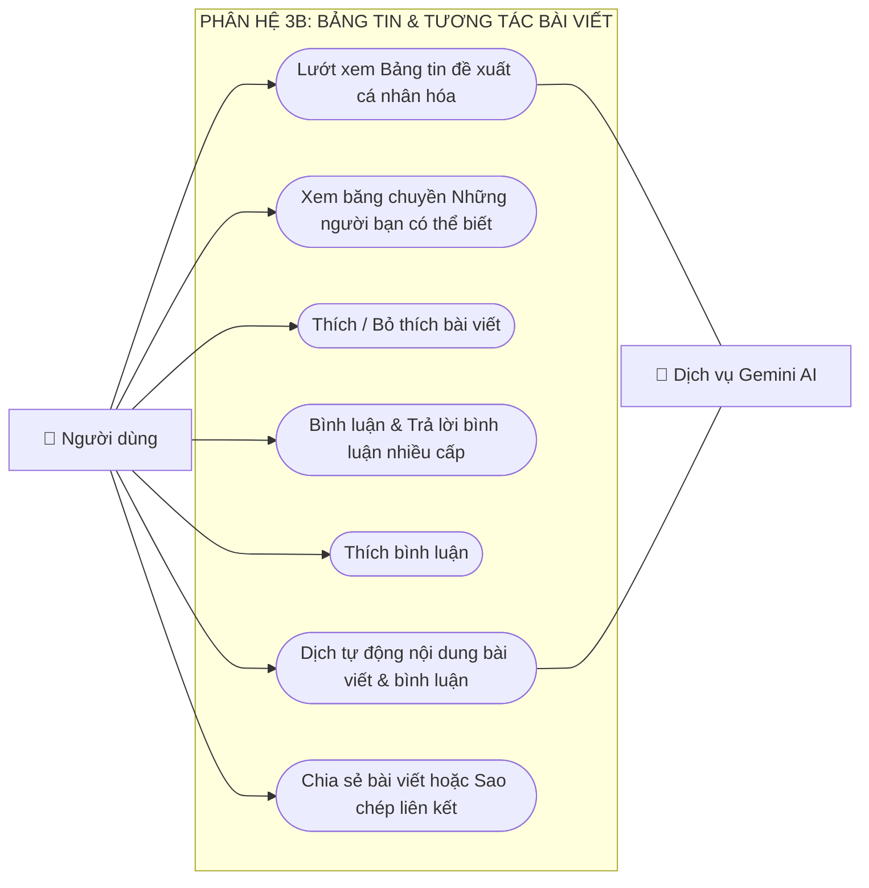

---

### 2.8 Use Case Phân hệ 4: Tin ngắn 24 Giờ (Stories) & Kho Lưu trữ

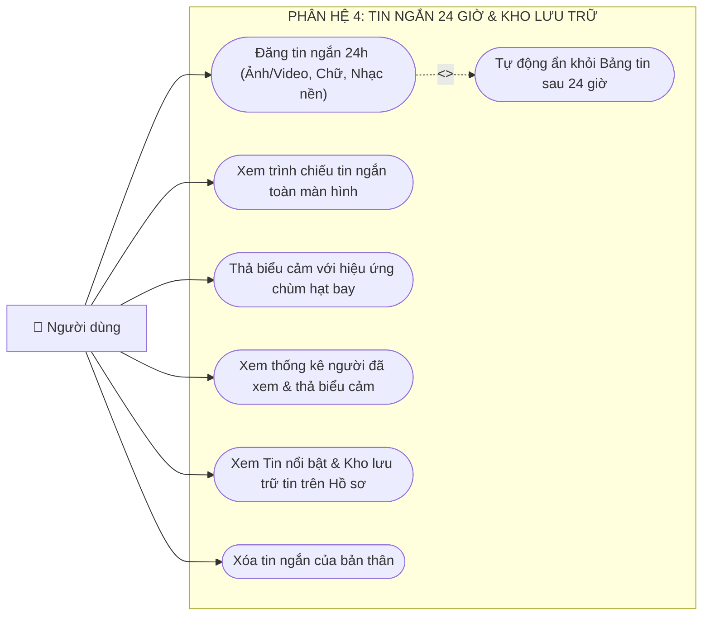

---

### 2.9 Use Case Phân hệ 5A: Nhắn tin Thời gian thực & Tiện ích Phòng Chat


---

### 2.10 Use Case Phân hệ 5B: Bảo mật Hộp thư & Quản trị Nhóm Chat

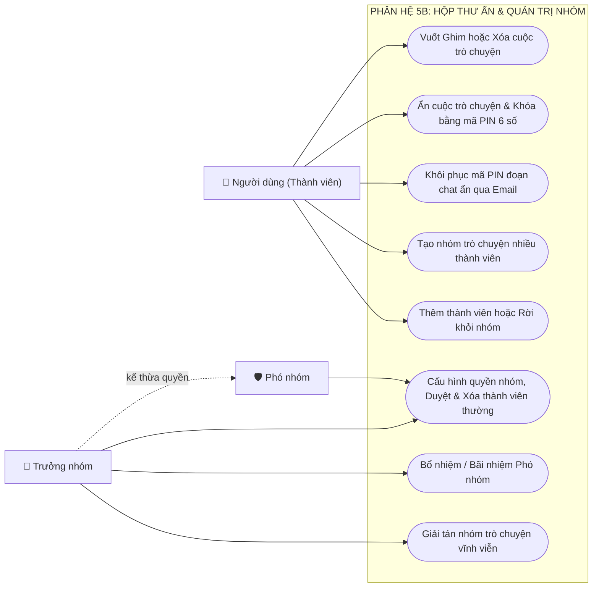

#### Bảng Ma trận Phân cấp Quyền hạn Quản trị Nhóm Chat:

| Quyền hạn & Thao tác nghiệp vụ | Thành viên (`member`) | Phó nhóm (`admin`) | Trưởng nhóm (`owner`) |
|:---|:---:|:---:|:---:|
| Gửi tin nhắn, ảnh, tệp âm thanh trong nhóm | ✅ *(Mặc định)* | ✅ | ✅ |
| Mời bạn bè tham gia nhóm | ✅ *(Nếu nhóm cho phép)*| ✅ | ✅ |
| Rời khỏi nhóm trò chuyện | ✅ | ✅ | ⚠️ *(Phải chuyển quyền trước)* |
| Chỉnh sửa tên nhóm & Đổi ảnh đại diện nhóm | ⚙️ *(Nếu bật quyền)* | ✅ | ✅ |
| Phê duyệt yêu cầu tham gia của thành viên mới | ❌ | ✅ | ✅ |
| Ghim / Bỏ ghim tin nhắn trong phòng chat | ❌ | ✅ | ✅ |
| Cấu hình quyền gửi tin (Chỉ Quản trị viên gửi) | ❌ | ✅ | ✅ |
| Xóa thành viên thường khỏi nhóm | ❌ | ✅ | ✅ |
| Bổ nhiệm thành viên thường lên làm Phó nhóm | ❌ | ❌ | ✅ |
| Bãi nhiệm vai trò Phó nhóm trở lại thành viên | ❌ | ❌ | ✅ |
| Chuyển giao toàn quyền Trưởng nhóm | ❌ | ❌ | ✅ |
| Giải tán nhóm trò chuyện (Xóa vĩnh viễn nhóm) | ❌ | ❌ | ✅ |

---

### 2.11 Use Case Phân hệ 6: Cuộc gọi Thoại & Video Call WebRTC


---

### 2.12 Use Case Phân hệ 7: Tìm kiếm & Khám phá Trí tuệ Nhân tạo

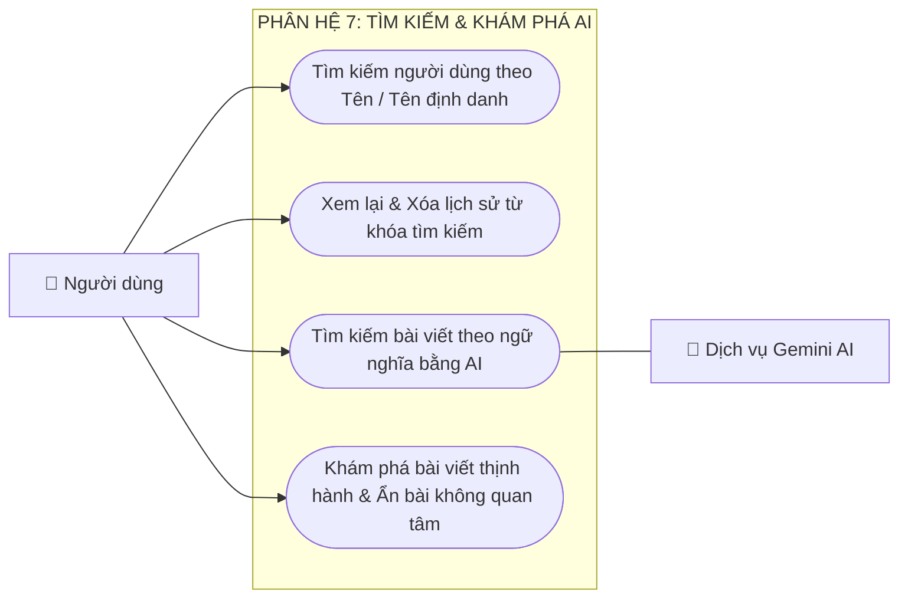

---

### 2.13 Use Case Phân hệ 8: Thông báo Thời gian thực & Điều hướng

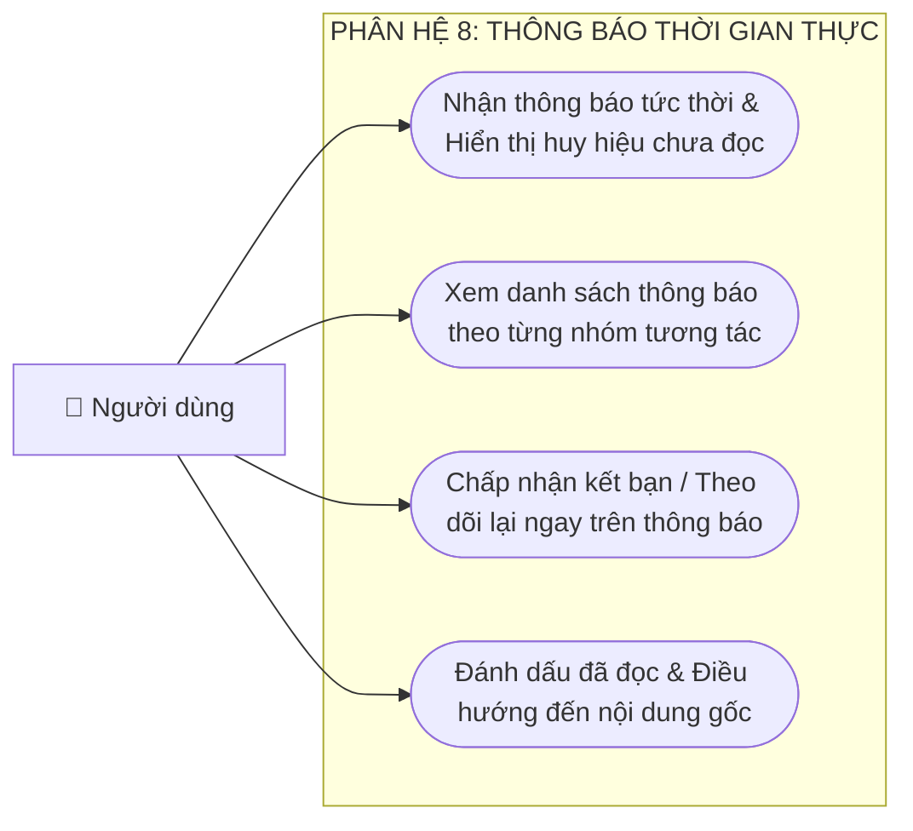

---

### 2.14 Use Case Phân hệ 9: Kiểm duyệt An toàn Cộng đồng & Kháng cáo


---

### 2.15 Use Case Phân hệ 10: Cài đặt Hệ thống, Giao diện & Đa ngôn ngữ


---

## 3. SƠ ĐỒ LUỒNG DỮ LIỆU (DATA FLOW DIAGRAMS - DFD)

### 3.1 Sơ đồ DFD Mức Ngữ cảnh (Mức 0)

Sơ đồ biểu diễn luồng thông tin tổng thể giữa người dùng đã xác thực, quản trị viên, các dịch vụ đám mây và hệ thống trung tâm Viora:

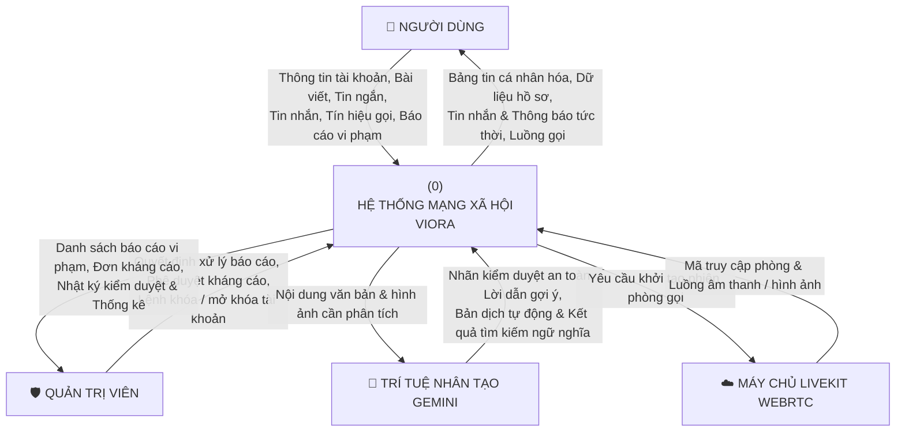

---

### 3.2 Sơ đồ DFD Mức 1: Phân rã Các Tiến trình Hệ thống

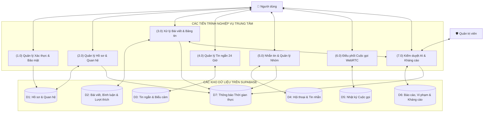

---

### 3.3 Sơ đồ DFD Mức 2.1: Luồng Đăng bài, Xử lý Đa phương tiện & Kiểm duyệt AI

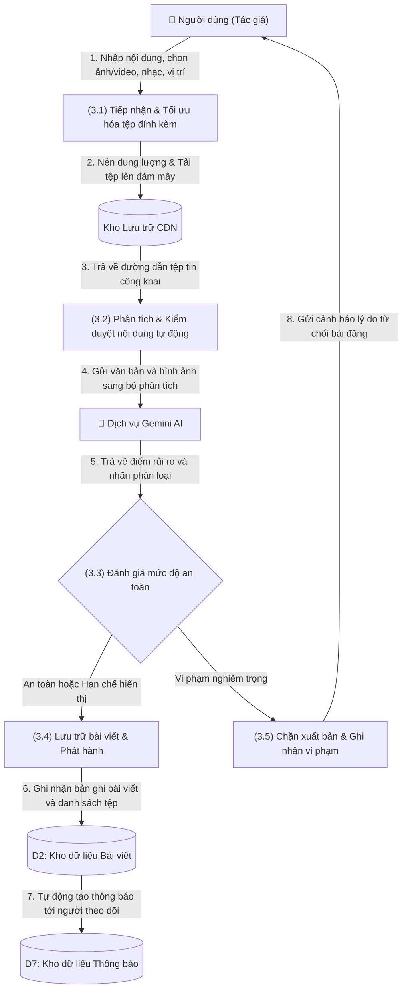

---

### 3.4 Sơ đồ DFD Mức 2.2: Luồng Nhắn tin Thời gian thực & Xác nhận Đã xem

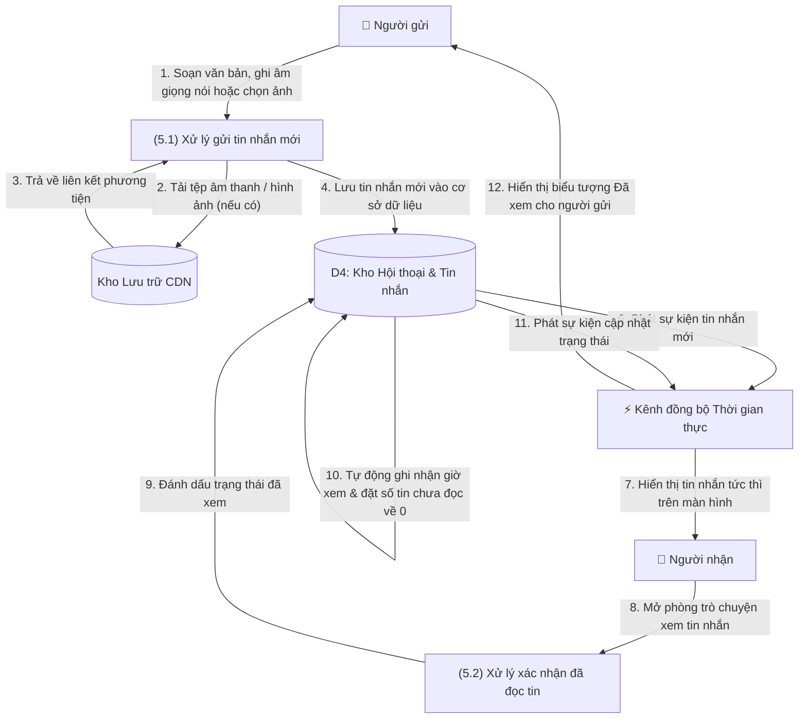

---

### 3.5 Sơ đồ DFD Mức 2.3: Luồng Tín hiệu & Đàm thoại Cuộc gọi WebRTC

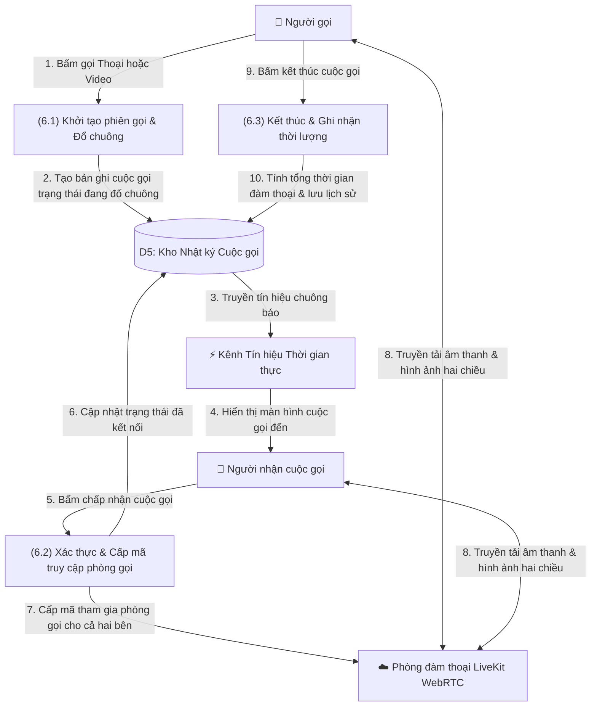

---

### 3.6 Sơ đồ DFD Mức 2.4: Luồng Báo cáo Vi phạm, Đánh giá Rủi ro & Kháng cáo

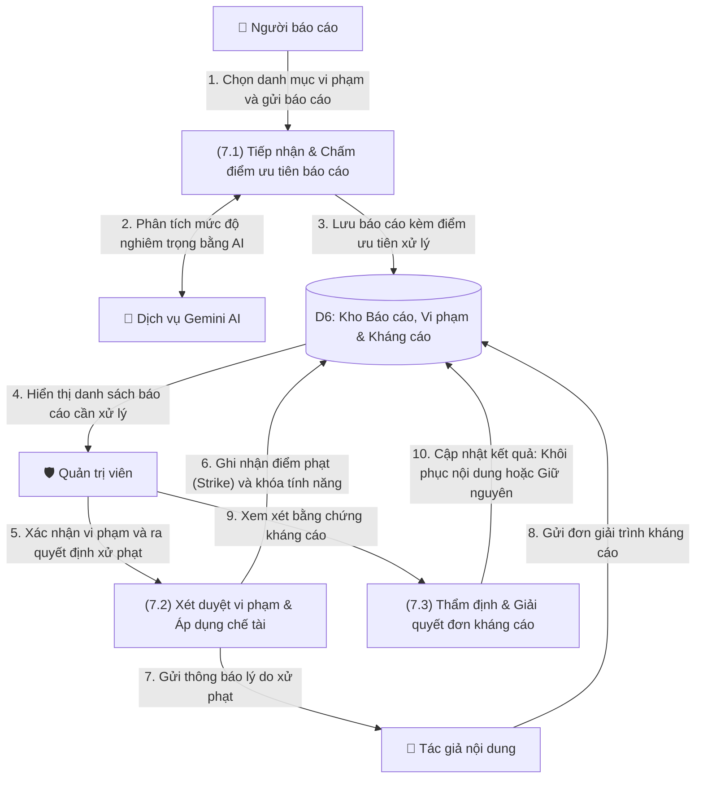

---

## 4. SƠ ĐỒ HOẠT ĐỘNG (ACTIVITY DIAGRAMS)

### 4.1 Hoạt động: Đăng ký, Đăng nhập & Xác thực Bảo mật Hai lớp (2FA)

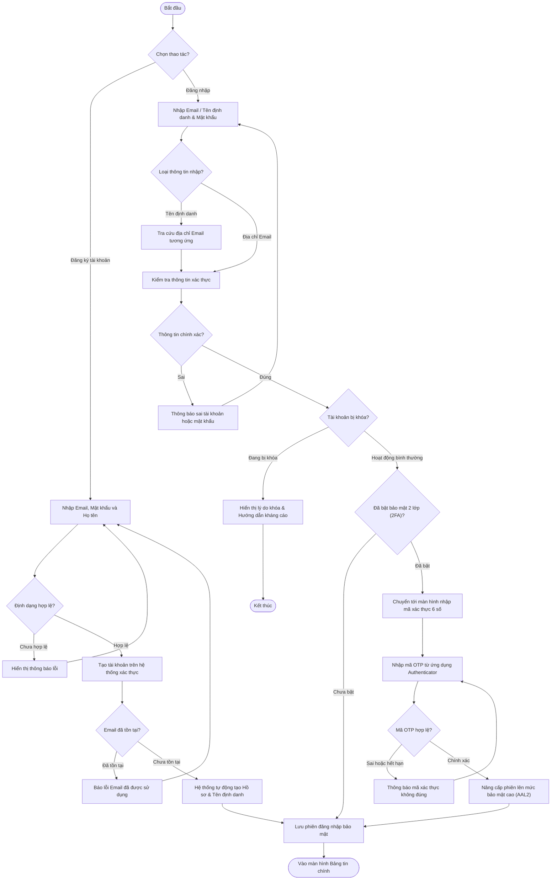

---

### 4.2 Hoạt động: Soạn thảo Bài viết, Gợi ý Caption AI & Kiểm duyệt Xuất bản

```mermaid
flowchart TD
    Start(["Bắt đầu tạo bài viết"]) --> PickMedia["Chọn ảnh / video từ thiết bị hoặc chụp mới"]
    PickMedia --> UseAI{"Sử dụng gợi ý lời dẫn bằng AI?"}

    UseAI -- "Có" --> AnalyzeImage["Gửi ảnh lên dịch vụ Gemini AI phân tích bối cảnh"]
    AnalyzeImage --> ShowOptions["Hiển thị 3 gợi ý lời dẫn kèm Hashtag thịnh hành"]
    ShowOptions --> EditCaption["Chọn và chỉnh sửa lại nội dung bài viết"]
    UseAI -- "Không" --> EditCaption

    EditCaption --> AddMetadata["Tùy chọn: Gắn thẻ bạn bè, Vị trí địa lý, Nhạc nền"]
    AddMetadata --> PreviewPost["Mở màn hình xem trước & Chọn quyền riêng tư"]
    PreviewPost --> ClickPublish["Nhấn nút Đăng bài"]
    ClickPublish --> CompressUpload["Nén tối ưu dung lượng & Tải tệp lên đám mây"]
    CompressUpload --> RunModeration["Quét kiểm duyệt tự động qua đường ống AI"]
    RunModeration --> CheckModResult{"Kết quả đánh giá an toàn?"}

    CheckModResult -- "Vi phạm nghiêm trọng" --> BlockPublish["Chặn đăng bài & Hiển thị cảnh báo tiêu chuẩn cộng đồng"]
    BlockPublish --> EndCancel(["Hủy xuất bản"])

    CheckModResult -- "Nội dung nhạy cảm" --> SaveRestricted["Lưu bài viết kèm lớp phủ cảnh báo che mờ"]
    CheckModResult -- "Nội dung an toàn" --> SaveNormal["Lưu bài viết hiển thị công khai bình thường"]

    SaveRestricted --> NotifyFollowers["Tự động gửi thông báo tới người theo dõi"]
    SaveNormal --> NotifyFollowers
    NotifyFollowers --> EndSuccess(["Hoàn tất & Hiển thị trên Bảng tin"])
```

---

### 4.3 Hoạt động: Thiết lập & Đàm thoại Cuộc gọi Thoại / Video WebRTC

```mermaid
flowchart TD
    Start(["Người gọi nhấn nút Gọi"]) --> InitCall["Khởi tạo mã phòng duy nhất & Lưu trạng thái Đang đổ chuông"]
    InitCall --> PlayDialTone["Mở màn hình chờ cuộc gọi đi & Phát âm báo chờ"]
    InitCall --> SendSignal["Truyền tín hiệu cuộc gọi tức thời tới Người nhận"]
    SendSignal --> ShowIncoming["Người nhận hiển thị màn hình cuộc gọi đến & Đổ nhạc chuông"]

    ShowIncoming --> WaitResponse{"Phản hồi trong vòng 60 giây?"}
    WaitResponse -- "Quá 60 giây không bắt máy" --> MarkMissed["Cập nhật trạng thái Cuộc gọi nhỡ"]
    WaitResponse -- "Người gọi chủ động hủy" --> MarkCancelled["Cập nhật trạng thái Đã hủy"]
    WaitResponse -- "Người nhận bấm Từ chối" --> MarkDeclined["Cập nhật trạng thái Từ chối"]

    MarkMissed --> LogChatEnd["Đóng màn hình & Ghi nhận lịch sử vào phòng trò chuyện"]
    MarkCancelled --> LogChatEnd
    MarkDeclined --> LogChatEnd
    LogChatEnd --> EndCall(["Kết thúc"])

    WaitResponse -- "Người nhận bấm Nhấc máy" --> IssueTokens["Cấp mã truy cập phòng LiveKit cho cả hai bên"]
    IssueTokens --> ConnectWebRTC["Kết nối vào phòng đàm thoại & Truyền luồng âm thanh / hình ảnh"]
    ConnectWebRTC --> ActiveControls["Đàm thoại trực tiếp (Hỗ trợ tắt mic, tắt/đổi camera, bật loa ngoài)"]
    ActiveControls --> Hangup["Một trong hai bên nhấn nút Kết thúc cuộc gọi"]
    Hangup --> CalcDuration["Ngắt kết nối phòng & Tính tổng thời lượng cuộc gọi"]
    CalcDuration --> LogChatEnd
```

---

### 4.4 Hoạt động: Đăng Tin ngắn 24h, Thả Biểu cảm Hạt bay & Lưu trữ Trang cá nhân

```mermaid
flowchart TD
    Start(["Bắt đầu tạo Tin ngắn"]) --> SelectStoryMedia["Chọn ảnh hoặc video tỷ lệ dọc 9:16"]
    SelectStoryMedia --> DecorateStory["Chèn văn bản, nhãn dán và chọn nhạc nền"]
    DecorateStory --> PublishStory["Tải tệp lên đám mây & Thiết lập thời hạn 24 giờ"]
    PublishStory --> ShowOnFeed["Hiển thị ảnh đại diện viền sáng trên đầu Bảng tin"]

    ShowOnFeed --> ViewerOpens["Bạn bè nhấn vào xem toàn màn hình (Trình chiếu 25 giây)"]
    ViewerOpens --> SaveViewLog["Tự động ghi nhận vào danh sách người đã xem"]
    SaveViewLog --> CheckReaction{"Người xem chạm vào biểu cảm?"}

    CheckReaction -- "Có" --> TriggerParticles["Kích hoạt hiệu ứng chùm hạt biểu cảm bay lên & Rung phản hồi"]
    TriggerParticles --> SaveReaction["Lưu biểu cảm của người xem vào cơ sở dữ liệu"]
    CheckReaction -- "Không" --> CheckExpiry

    SaveReaction --> CheckExpiry{"Đã qua 24 giờ kể từ lúc đăng?"}
    CheckExpiry -- "Chưa qua 24 giờ" --> KeepOnFeed["Tiếp tục hiển thị trên thanh Tin ngắn ở Bảng tin"]
    CheckExpiry -- "Đã qua 24 giờ" --> HideFromFeed["Tự động ẩn khỏi Bảng tin chính"]
    HideFromFeed --> MoveToArchive["Chuyển vào mục Tin nổi bật & Kho lưu trữ trên Trang cá nhân"]
    MoveToArchive --> EndStory(["Lưu giữ kỷ niệm lâu dài"])
```

---

### 4.5 Hoạt động: Kiểm duyệt Nội dung Đa tầng, Xử phạt & Giải quyết Kháng cáo

```mermaid
flowchart TD
    Start(["Tiếp nhận nội dung mới hoặc Báo cáo vi phạm"]) --> Step1["Bước 1: Quét bộ lọc từ khóa cấm và mẫu câu vi phạm"]
    Step1 --> IsBlacklisted{"Vi phạm từ khóa nghiêm trọng?"}
    IsBlacklisted -- "Có" --> ActionRemove["Gỡ bỏ nội dung ngay lập tức"]
    IsBlacklisted -- "Không" --> Step2["Bước 2: Phân tích ngữ cảnh văn bản & hình ảnh bằng Gemini AI"]

    Step2 --> CalcRisk["Chấm điểm rủi ro vi phạm (Từ 0.0 đến 1.0)"]
    CalcRisk --> ClassifyRisk{"Phân loại theo ngưỡng rủi ro?"}

    ClassifyRisk -- "Dưới 0.20" --> ActionAllow["Cho phép hiển thị bình thường"] --> EndSafe(["Hoàn tất"])
    ClassifyRisk -- "Từ 0.20 đến 0.50" --> ActionWarn["Gửi thông báo nhắc nhở nhẹ tới tác giả"] --> EndSafe
    ClassifyRisk -- "Từ 0.50 đến 0.80" --> ActionBlur["Áp dụng lớp che mờ cảnh báo nội dung nhạy cảm"] --> EndSafe
    ClassifyRisk -- "Từ 0.80 trở lên" --> ActionRemove

    ActionRemove --> RecordStrike["Cộng 1 điểm phạt (Strike) vào hồ sơ vi phạm của người dùng"]
    RecordStrike --> ApplyRestriction["Áp dụng chế tài tương ứng (Hạn chế đăng bài, nhắn tin hoặc khóa tài khoản)"]
    ApplyRestriction --> SendNotice["Gửi thông báo chi tiết nguyên nhân xử phạt cho tác giả"]
    SendNotice --> WantAppeal{"Tác giả gửi đơn kháng cáo?"}

    WantAppeal -- "Không" --> EndPenalty(["Giữ nguyên quyết định xử phạt"])
    WantAppeal -- "Có" --> AdminReview["Quản trị viên thẩm định đơn giải trình và bằng chứng"]
    AdminReview --> AppealResult{"Kết quả xét duyệt?"}
    AppealResult -- "Chấp thuận" --> RestoreContent["Gỡ bỏ điểm phạt & Khôi phục lại nội dung"] --> EndSafe
    AppealResult -- "Bác bỏ" --> NotifyReject["Thông báo từ chối kháng cáo & Giữ nguyên chế tài"] --> EndPenalty
```

---

### 4.6 Hoạt động: Thuật toán Xếp hạng Bảng tin Cá nhân hóa (Recommendation v2)

```mermaid
flowchart TD
    Start(["Người dùng mở hoặc làm mới Bảng tin"]) --> FetchPool["Tập hợp các bài viết công khai và bài viết từ bạn bè gần nhất"]
    FetchPool --> ExcludeBlocked["Loại bỏ hoàn toàn bài viết từ các tài khoản đã chặn hai chiều"]
    ExcludeBlocked --> CalcScores["Tính điểm xếp hạng cho từng bài viết theo 5 tiêu chí"]

    CalcScores --> Factor1["1. Điểm kết nối: Bạn bè (+32), Đang theo dõi (+24), Khám phá (+6)"]
    Factor1 --> Factor2["2. Độ thân thiết tác giả: Tần suất thích, bình luận trong 90 ngày qua"]
    Factor2 --> Factor3["3. Độ khớp sở thích: Tương đồng chủ đề và thẻ Hashtag (+14)"]
    Factor3 --> Factor4["4. Chất lượng tương tác: Tính theo hàm logarit lượt thích và bình luận"]
    Factor4 --> Factor5["5. Độ tươi mới: Ưu tiên bài mới đăng và giảm dần theo thời gian"]

    Factor5 --> SortPosts["Sắp xếp danh sách bài viết theo tổng điểm từ cao xuống thấp"]
    SortPosts --> InsertSuggestions["Đan xen khung gợi ý Những người bạn có thể biết"]
    InsertSuggestions --> DisplayFeed(["Hiển thị danh sách bài viết lên giao diện người dùng"])
```

---

## 5. SƠ ĐỒ THỰC THỂ LIÊN KẾT (ENTITY RELATIONSHIP DIAGRAM - ERD)

### 5.1 Biểu đồ ERD Tổng thể Cơ sở dữ liệu

```mermaid
erDiagram
    PROFILES ||--o{ POSTS : "đăng bài"
    PROFILES ||--o{ LIKES : "thích bài"
    PROFILES ||--o{ COMMENTS : "bình luận"
    PROFILES ||--o{ COMMENT_LIKES : "thích bình luận"
    PROFILES ||--o{ FOLLOWS : "theo dõi"
    PROFILES ||--o{ FRIEND_REQUESTS : "kết bạn"
    PROFILES ||--o{ STORIES : "đăng story"
    PROFILES ||--o{ STORY_VIEWS : "xem story"
    PROFILES ||--o{ STORY_REACTIONS : "thả biểu cảm"
    PROFILES ||--o{ GROUP_MEMBERS : "tham gia nhóm"
    PROFILES ||--o{ MESSAGES : "gửi tin nhắn"
    PROFILES ||--o{ PINNED_MESSAGES : "ghim tin"
    PROFILES ||--o{ CONVERSATION_SETTINGS : "cài đặt hội thoại"
    PROFILES ||--o{ CALLS : "tham gia cuộc gọi"
    PROFILES ||--o{ NOTIFICATIONS : "nhận thông báo"
    PROFILES ||--o{ REPORTS : "gửi báo cáo"
    PROFILES ||--o{ USER_VIOLATIONS : "vi phạm"
    PROFILES ||--o{ APPEALS : "kháng cáo"

    POSTS ||--o{ POST_MEDIA : "đính kèm media"
    POSTS ||--o{ LIKES : "có lượt thích"
    POSTS ||--o{ COMMENTS : "có bình luận"
    POSTS ||--o{ NOTIFICATIONS : "tạo thông báo"

    COMMENTS ||--o{ COMMENTS : "trả lời bình luận"
    COMMENTS ||--o{ COMMENT_LIKES : "có lượt thích"

    STORIES ||--o{ STORY_VIEWS : "có lượt xem"
    STORIES ||--o{ STORY_REACTIONS : "có biểu cảm"

    CONVERSATIONS ||--o{ GROUP_MEMBERS : "có thành viên"
    CONVERSATIONS ||--o{ MESSAGES : "chứa tin nhắn"
    CONVERSATIONS ||--o{ PINNED_MESSAGES : "chứa tin ghim"
    CONVERSATIONS ||--o{ CONVERSATION_SETTINGS : "có cài đặt"
    CONVERSATIONS ||--o{ CALLS : "có cuộc gọi"

    MESSAGES ||--o{ MESSAGES : "trích dẫn trả lời"
    MESSAGES ||--o{ PINNED_MESSAGES : "được ghim"

    USER_VIOLATIONS ||--o| APPEALS : "được kháng cáo"

    PROFILES {
        uuid id PK
        text email
        text username UK
        text full_name
        text bio
        text avatar_url
        text cover_url
        boolean is_private
        timestamptz created_at
    }

    POSTS {
        uuid id PK
        uuid user_id FK
        text caption
        int likes_count
        int comments_count
        text privacy
        text moderation_status
        boolean is_ai_generated
        timestamptz deleted_at
        timestamptz created_at
    }

    POST_MEDIA {
        uuid id PK
        uuid post_id FK
        text url
        text type
        int order_index
        timestamptz created_at
    }

    LIKES {
        uuid id PK
        uuid post_id FK
        uuid user_id FK
        timestamptz created_at
    }

    COMMENTS {
        uuid id PK
        uuid post_id FK
        uuid user_id FK
        uuid parent_id FK
        text content
        int likes_count
        timestamptz created_at
    }

    COMMENT_LIKES {
        uuid id PK
        uuid comment_id FK
        uuid user_id FK
        timestamptz created_at
    }

    FOLLOWS {
        uuid id PK
        uuid follower_id FK
        uuid following_id FK
        timestamptz created_at
    }

    FRIEND_REQUESTS {
        uuid id PK
        uuid sender_id FK
        uuid receiver_id FK
        enum status
        timestamptz created_at
        timestamptz updated_at
    }

    STORIES {
        uuid id PK
        uuid user_id FK
        text media_url
        text media_type
        text caption
        jsonb music_track
        timestamptz expires_at
        timestamptz created_at
    }

    STORY_VIEWS {
        uuid id PK
        uuid story_id FK
        uuid user_id FK
        timestamptz viewed_at
    }

    STORY_REACTIONS {
        uuid id PK
        uuid story_id FK
        uuid user_id FK
        text reaction
        timestamptz created_at
    }

    CONVERSATIONS {
        uuid id PK
        text type
        text name
        text avatar_url
        uuid participant_1 FK
        uuid participant_2 FK
        text last_message
        timestamptz last_message_at
        uuid last_message_id FK
        int p1_unread_count
        int p2_unread_count
        timestamptz created_at
    }

    GROUP_MEMBERS {
        uuid id PK
        uuid conversation_id FK
        uuid user_id FK
        text role
        timestamptz joined_at
    }

    MESSAGES {
        uuid id PK
        uuid conversation_id FK
        uuid sender_id FK
        text content
        text media_url
        text message_type
        boolean is_seen
        timestamptz seen_at
        boolean is_recalled
        uuid reply_to_message_id FK
        timestamptz created_at
    }

    PINNED_MESSAGES {
        uuid id PK
        uuid conversation_id FK
        uuid message_id FK
        uuid pinned_by FK
        timestamptz pinned_at
    }

    CONVERSATION_SETTINGS {
        uuid user_id PK "FK"
        uuid conversation_id PK "FK"
        boolean is_pinned
        boolean is_hidden
        timestamptz pinned_at
    }

    CALLS {
        uuid id PK
        uuid conversation_id FK
        uuid caller_id FK
        uuid callee_id FK
        enum type
        enum status
        text room_name
        timestamptz started_at
        timestamptz connected_at
        timestamptz ended_at
        int duration_sec
    }

    NOTIFICATIONS {
        uuid id PK
        uuid receiver_id FK
        uuid sender_id FK
        enum type
        uuid post_id FK
        uuid comment_id FK
        text content
        boolean is_read
        timestamptz created_at
    }

    REPORTS {
        uuid id PK
        uuid reporter_id FK
        text target_type
        uuid target_id
        text reason
        text status
        timestamptz created_at
    }

    USER_VIOLATIONS {
        uuid id PK
        uuid user_id FK
        text violation_type
        int strike_count
        text penalty_action
        timestamptz expires_at
        timestamptz created_at
    }

    APPEALS {
        uuid id PK
        uuid violation_id FK
        uuid user_id FK
        text reason
        text status
        timestamptz created_at
    }
```

---

### 5.2 Bảng Đặc tả Quan hệ & Bản số (Cardinality)

| Thực thể nguồn | Thực thể đích | Bản số | Mô tả mối quan hệ nghiệp vụ |
|:---|:---|:---:|:---|
| `PROFILES` | `POSTS` | **1 : N** | Một người dùng có thể đăng nhiều bài viết; mỗi bài viết thuộc về một tác giả duy nhất. |
| `POSTS` | `POST_MEDIA` | **1 : N** | Một bài viết chứa một hoặc nhiều tệp ảnh/video được sắp xếp theo thứ tự hiển thị. |
| `POSTS` | `LIKES` | **1 : N** | Một bài viết có nhiều lượt thích; mỗi người dùng chỉ thích tối đa 1 lần trên mỗi bài. |
| `POSTS` | `COMMENTS` | **1 : N** | Một bài viết có nhiều bình luận; các bình luận trả lời tham chiếu về bình luận gốc. |
| `COMMENTS` | `COMMENT_LIKES`| **1 : N** | Mỗi bình luận có thể nhận nhiều lượt thích từ các người dùng khác nhau. |
| `PROFILES` | `FOLLOWS` | **N : M** | Quan hệ theo dõi một chiều giữa người theo dõi và người được theo dõi. |
| `PROFILES` | `FRIEND_REQUESTS`| **N : M** | Quan hệ kết bạn hai chiều kèm trạng thái (Đang chờ, Đã chấp nhận, Đã từ chối, Đã hủy). |
| `PROFILES` | `STORIES` | **1 : N** | Một người dùng có thể đăng nhiều tin ngắn 24 giờ. |
| `STORIES` | `STORY_VIEWS` | **1 : N** | Lưu danh sách người dùng đã xem tin ngắn và thời điểm xem. |
| `STORIES` | `STORY_REACTIONS`| **1 : N** | Lưu các biểu cảm mà người xem đã thả vào tin ngắn. |
| `CONVERSATIONS` | `GROUP_MEMBERS`| **1 : N** | Phòng trò chuyện nhóm bao gồm nhiều thành viên với phân cấp vai trò: Trưởng nhóm (`owner`), Phó nhóm (`admin`), Thành viên thường (`member`). |
| `CONVERSATIONS` | `MESSAGES` | **1 : N** | Một cuộc trò chuyện chứa danh sách lịch sử các tin nhắn. |
| `CONVERSATIONS` | `CALLS` | **1 : N** | Một cuộc trò chuyện lưu trữ lịch sử các cuộc gọi thoại và video giữa các thành viên. |
| `PROFILES` | `NOTIFICATIONS`| **1 : N** | Người dùng nhận danh sách các thông báo tương tác theo thời gian thực. |
| `PROFILES` | `REPORTS` | **1 : N** | Người dùng gửi các báo cáo vi phạm tiêu chuẩn cộng đồng. |
| `PROFILES` | `USER_VIOLATIONS`| **1 : N** | Lưu lịch sử các lần vi phạm và điểm phạt (Strike) của tài khoản. |
| `USER_VIOLATIONS` | `APPEALS` | **1 : 1** | Mỗi quyết định xử phạt vi phạm có thể gắn với một đơn kháng cáo từ người dùng. |

---

## 6. MÔ HÌNH QUAN HỆ DỮ LIỆU (RELATIONAL DATA MODEL - 3NF)

### 6.1 Đặc tả Chi tiết 20 Bảng Cơ sở dữ liệu PostgreSQL

Toàn bộ lược đồ cơ sở dữ liệu đạt **Dạng chuẩn 3 (3NF)**: mọi thuộc tính đều nguyên tố, phụ thuộc hoàn toàn vào khóa chính và không có phụ thuộc bắc cầu.

#### 1. Bảng `profiles` (Hồ sơ người dùng)
| Tên cột | Kiểu dữ liệu | Ràng buộc | Mô tả ý nghĩa |
|:---|:---|:---|:---|
| `id` | `uuid` | **PK, FK** | Mã định danh người dùng (liên kết tài khoản xác thực) |
| `email` | `text` | NOT NULL | Địa chỉ thư điện tử đăng ký |
| `username` | `text` | UNIQUE, NOT NULL | Tên định danh duy nhất (chữ thường, số, dấu chấm, gạch dưới) |
| `full_name` | `text` | NULLABLE | Tên hiển thị đầy đủ của người dùng |
| `bio` | `text` | NULLABLE | Tiểu sử giới thiệu bản thân (tối đa 150 ký tự) |
| `avatar_url` | `text` | NULLABLE | Đường dẫn ảnh đại diện trên kho lưu trữ đám mây |
| `cover_url` | `text` | NULLABLE | Đường dẫn ảnh bìa trang cá nhân |
| `is_private` | `boolean` | DEFAULT `false` | Cờ chế độ tài khoản riêng tư |
| `created_at` | `timestamptz` | DEFAULT `now()` | Thời điểm khởi tạo hồ sơ |

#### 2. Bảng `posts` (Bài viết)
| Tên cột | Kiểu dữ liệu | Ràng buộc | Mô tả ý nghĩa |
|:---|:---|:---|:---|
| `id` | `uuid` | **PK** | Mã định danh bài viết |
| `user_id` | `uuid` | **FK**, NOT NULL | Mã tác giả bài viết (tham chiếu `profiles.id`) |
| `caption` | `text` | NULLABLE | Nội dung văn bản của bài viết |
| `likes_count` | `integer` | DEFAULT `0` | Tổng số lượt thích (tự động cập nhật) |
| `comments_count` | `integer` | DEFAULT `0` | Tổng số bình luận (tự động cập nhật) |
| `privacy` | `text` | DEFAULT `'public'` | Phạm vi hiển thị (`public`, `friends`, `private`) |
| `moderation_status`| `text` | DEFAULT `'published'`| Trạng thái kiểm duyệt (`published`, `shadow_limited`, `removed`) |
| `is_ai_generated` | `boolean` | DEFAULT `false` | Nhãn đánh dấu nội dung có sử dụng trí tuệ nhân tạo |
| `deleted_at` | `timestamptz` | NULLABLE | Thời điểm xóa vào thùng rác (`null` nếu đang hiển thị) |
| `created_at` | `timestamptz` | DEFAULT `now()` | Thời điểm đăng bài |

#### 3. Bảng `post_media` (Phương tiện đính kèm bài viết)
| Tên cột | Kiểu dữ liệu | Ràng buộc | Mô tả ý nghĩa |
|:---|:---|:---|:---|
| `id` | `uuid` | **PK** | Mã định danh tệp phương tiện |
| `post_id` | `uuid` | **FK**, NOT NULL | Mã bài viết sở hữu (tham chiếu `posts.id`) |
| `url` | `text` | NOT NULL | Đường dẫn tệp ảnh hoặc video trên CDN |
| `type` | `text` | DEFAULT `'image'` | Phân loại tệp (`image` hoặc `video`) |
| `order_index` | `integer` | DEFAULT `0` | Thứ tự hiển thị trong băng chuyền ảnh (bắt đầu từ 0) |
| `created_at` | `timestamptz` | DEFAULT `now()` | Thời điểm tải tệp lên |

#### 4. Bảng `likes` (Lượt thích bài viết)
| Tên cột | Kiểu dữ liệu | Ràng buộc | Mô tả ý nghĩa |
|:---|:---|:---|:---|
| `id` | `uuid` | **PK** | Mã định danh lượt thích |
| `post_id` | `uuid` | **FK**, NOT NULL | Bài viết được thích (tham chiếu `posts.id`) |
| `user_id` | `uuid` | **FK**, NOT NULL | Người dùng nhấn thích (tham chiếu `profiles.id`) |
| `created_at` | `timestamptz` | DEFAULT `now()` | Thời điểm thích (Ràng buộc duy nhất cặp `post_id, user_id`) |

#### 5. Bảng `comments` (Bình luận bài viết)
| Tên cột | Kiểu dữ liệu | Ràng buộc | Mô tả ý nghĩa |
|:---|:---|:---|:---|
| `id` | `uuid` | **PK** | Mã định danh bình luận |
| `post_id` | `uuid` | **FK**, NOT NULL | Bài viết chứa bình luận (tham chiếu `posts.id`) |
| `user_id` | `uuid` | **FK**, NOT NULL | Người viết bình luận (tham chiếu `profiles.id`) |
| `parent_id` | `uuid` | **FK**, NULLABLE | Mã bình luận cha nếu là câu trả lời (tự tham chiếu `comments.id`) |
| `content` | `text` | NOT NULL | Nội dung văn bản bình luận |
| `likes_count` | `integer` | DEFAULT `0` | Tổng số lượt thích bình luận |
| `created_at` | `timestamptz` | DEFAULT `now()` | Thời điểm gửi bình luận |

#### 6. Bảng `comment_likes` (Lượt thích bình luận)
| Tên cột | Kiểu dữ liệu | Ràng buộc | Mô tả ý nghĩa |
|:---|:---|:---|:---|
| `id` | `uuid` | **PK** | Mã định danh lượt thích bình luận |
| `comment_id` | `uuid` | **FK**, NOT NULL | Bình luận được thích (tham chiếu `comments.id`) |
| `user_id` | `uuid` | **FK**, NOT NULL | Người thích bình luận (tham chiếu `profiles.id`) |
| `created_at` | `timestamptz` | DEFAULT `now()` | Thời điểm thích (Duy nhất cặp `comment_id, user_id`) |

#### 7. Bảng `follows` (Quan hệ theo dõi một chiều)
| Tên cột | Kiểu dữ liệu | Ràng buộc | Mô tả ý nghĩa |
|:---|:---|:---|:---|
| `id` | `uuid` | **PK** | Mã định danh lượt theo dõi |
| `follower_id` | `uuid` | **FK**, NOT NULL | Người đi theo dõi (tham chiếu `profiles.id`) |
| `following_id` | `uuid` | **FK**, NOT NULL | Người được theo dõi (tham chiếu `profiles.id`) |
| `created_at` | `timestamptz` | DEFAULT `now()` | Thời điểm bắt đầu theo dõi |

#### 8. Bảng `friend_requests` (Quan hệ kết bạn hai chiều)
| Tên cột | Kiểu dữ liệu | Ràng buộc | Mô tả ý nghĩa |
|:---|:---|:---|:---|
| `id` | `uuid` | **PK** | Mã định danh yêu cầu kết bạn |
| `sender_id` | `uuid` | **FK**, NOT NULL | Người gửi lời mời kết bạn (tham chiếu `profiles.id`) |
| `receiver_id` | `uuid` | **FK**, NOT NULL | Người nhận lời mời kết bạn (tham chiếu `profiles.id`) |
| `status` | `enum` | DEFAULT `'pending'` | Trạng thái (`pending`, `accepted`, `rejected`, `cancelled`) |
| `created_at` | `timestamptz` | DEFAULT `now()` | Thời điểm gửi lời mời |
| `updated_at` | `timestamptz` | DEFAULT `now()` | Thời điểm cập nhật trạng thái gần nhất |

#### 9. Bảng `stories` (Tin ngắn 24 giờ)
| Tên cột | Kiểu dữ liệu | Ràng buộc | Mô tả ý nghĩa |
|:---|:---|:---|:---|
| `id` | `uuid` | **PK** | Mã định danh tin ngắn |
| `user_id` | `uuid` | **FK**, NOT NULL | Tác giả đăng tin (tham chiếu `profiles.id`) |
| `media_url` | `text` | NOT NULL | Đường dẫn ảnh hoặc video của tin ngắn |
| `media_type` | `text` | DEFAULT `'image'` | Loại phương tiện (`image` hoặc `video`) |
| `caption` | `text` | NULLABLE | Văn bản đính kèm trên tin ngắn |
| `music_track` | `jsonb` | NULLABLE | Thông tin bài hát nhạc nền đính kèm |
| `expires_at` | `timestamptz` | NOT NULL | Thời điểm hết hạn trên Bảng tin (24 giờ sau khi tạo) |
| `created_at` | `timestamptz` | DEFAULT `now()` | Thời điểm đăng tin |

#### 10. Bảng `story_views` & 11. Bảng `story_reactions` (Lượt xem & Biểu cảm Story)
| Bảng | Tên cột | Kiểu dữ liệu | Ràng buộc | Mô tả ý nghĩa |
|:---|:---|:---|:---|:---|
| `story_views` | `id` | `uuid` | **PK** | Mã định danh lượt xem |
| `story_views` | `story_id` | `uuid` | **FK**, NOT NULL | Tin ngắn được xem (tham chiếu `stories.id`) |
| `story_views` | `user_id` | `uuid` | **FK**, NOT NULL | Người đã xem tin (tham chiếu `profiles.id`) |
| `story_views` | `viewed_at` | `timestamptz` | DEFAULT `now()` | Thời điểm mở xem tin |
| `story_reactions`| `id` | `uuid` | **PK** | Mã định danh biểu cảm |
| `story_reactions`| `story_id` | `uuid` | **FK**, NOT NULL | Tin ngắn nhận biểu cảm (tham chiếu `stories.id`) |
| `story_reactions`| `user_id` | `uuid` | **FK**, NOT NULL | Người thả biểu cảm (tham chiếu `profiles.id`) |
| `story_reactions`| `reaction` | `text` | NOT NULL | Ký tự biểu cảm (ví dụ: `❤️`, `🔥`, `😂`, `😮`) |

#### 12. Bảng `conversations` (Cuộc trò chuyện)
| Tên cột | Kiểu dữ liệu | Ràng buộc | Mô tả ý nghĩa |
|:---|:---|:---|:---|
| `id` | `uuid` | **PK** | Mã định danh cuộc trò chuyện |
| `type` | `text` | DEFAULT `'direct'` | Loại phòng chat (`direct` 1-1 hoặc `group` nhiều người) |
| `name` | `text` | NULLABLE | Tên nhóm trò chuyện (dành cho nhóm) |
| `avatar_url` | `text` | NULLABLE | Ảnh đại diện của nhóm trò chuyện |
| `participant_1` | `uuid` | **FK**, NULLABLE | Thành viên thứ nhất (dành cho chat 1-1) |
| `participant_2` | `uuid` | **FK**, NULLABLE | Thành viên thứ hai (dành cho chat 1-1) |
| `last_message` | `text` | NULLABLE | Nội dung tóm tắt của tin nhắn cuối cùng |
| `last_message_at` | `timestamptz` | NULLABLE | Thời gian gửi tin nhắn cuối cùng |
| `last_message_id` | `uuid` | **FK**, NULLABLE | Tham chiếu đến tin nhắn cuối (`messages.id`) |
| `p1_unread_count` | `integer` | DEFAULT `0` | Số tin chưa đọc của thành viên 1 |
| `p2_unread_count` | `integer` | DEFAULT `0` | Số tin chưa đọc của thành viên 2 |
| `created_at` | `timestamptz` | DEFAULT `now()` | Thời điểm tạo cuộc trò chuyện |

#### 13. Bảng `group_members` (Thành viên nhóm chat)
| Tên cột | Kiểu dữ liệu | Ràng buộc | Mô tả ý nghĩa |
|:---|:---|:---|:---|
| `id` | `uuid` | **PK** | Mã định danh bản ghi thành viên |
| `conversation_id`| `uuid` | **FK**, NOT NULL | Mã phòng chat nhóm (tham chiếu `conversations.id`) |
| `user_id` | `uuid` | **FK**, NOT NULL | Mã thành viên (tham chiếu `profiles.id`) |
| `role` | `text` | DEFAULT `'member'` | Phân cấp vai trò: `'owner'` (Trưởng nhóm), `'admin'` (Phó nhóm), `'member'` (Thành viên thường) |
| `joined_at` | `timestamptz` | DEFAULT `now()` | Thời điểm tham gia nhóm |

#### 14. Bảng `messages` (Tin nhắn)
| Tên cột | Kiểu dữ liệu | Ràng buộc | Mô tả ý nghĩa |
|:---|:---|:---|:---|
| `id` | `uuid` | **PK** | Mã định danh tin nhắn |
| `conversation_id` | `uuid` | **FK**, NOT NULL | Thuộc cuộc trò chuyện (tham chiếu `conversations.id`) |
| `sender_id` | `uuid` | **FK**, NOT NULL | Người gửi tin nhắn (tham chiếu `profiles.id`) |
| `content` | `text` | NULLABLE | Nội dung văn bản hoặc chú thích ảnh |
| `media_url` | `text` | NULLABLE | Đường dẫn tệp hình ảnh hoặc tệp âm thanh giọng nói |
| `message_type` | `text` | DEFAULT `'text'` | Phân loại (`text`, `image`, `voice`, `system`) |
| `is_seen` | `boolean` | DEFAULT `false` | Trạng thái người nhận đã xem hay chưa |
| `seen_at` | `timestamptz` | NULLABLE | Thời điểm người nhận đọc tin nhắn |
| `is_recalled` | `boolean` | DEFAULT `false` | Cờ đánh dấu tin nhắn đã bị thu hồi hai chiều |
| `reply_to_message_id`| `uuid` | **FK**, NULLABLE | Mã tin nhắn gốc được trích dẫn trả lời |
| `created_at` | `timestamptz` | DEFAULT `now()` | Thời điểm gửi tin nhắn |

#### 15. Bảng `pinned_messages` & 16. Bảng `conversation_settings`
| Bảng | Tên cột | Kiểu dữ liệu | Ràng buộc | Mô tả ý nghĩa |
|:---|:---|:---|:---|:---|
| `pinned_messages` | `id` | `uuid` | **PK** | Mã định danh lượt ghim tin nhắn |
| `pinned_messages` | `conversation_id`| `uuid` | **FK**, NOT NULL | Phòng chat có tin ghim |
| `pinned_messages` | `message_id` | `uuid` | **FK**, NOT NULL | Tin nhắn được ghim |
| `pinned_messages` | `pinned_by` | `uuid` | **FK**, NOT NULL | Người thực hiện ghim tin |
| `conversation_settings`| `user_id` | `uuid` | **PK, FK** | Người dùng cài đặt |
| `conversation_settings`| `conversation_id`| `uuid` | **PK, FK** | Cuộc trò chuyện được cài đặt |
| `conversation_settings`| `is_pinned` | `boolean` | DEFAULT `false` | Ghim cuộc trò chuyện lên đầu danh sách |
| `conversation_settings`| `is_hidden` | `boolean` | DEFAULT `false` | Ẩn cuộc trò chuyện vào mục bảo mật bằng mã PIN |

#### 17. Bảng `calls` (Nhật ký cuộc gọi WebRTC)
| Tên cột | Kiểu dữ liệu | Ràng buộc | Mô tả ý nghĩa |
|:---|:---|:---|:---|
| `id` | `uuid` | **PK** | Mã định danh cuộc gọi |
| `conversation_id`| `uuid` | **FK**, NOT NULL | Phòng trò chuyện diễn ra cuộc gọi |
| `caller_id` | `uuid` | **FK**, NOT NULL | Người khởi tạo cuộc gọi (tham chiếu `profiles.id`) |
| `callee_id` | `uuid` | **FK**, NOT NULL | Người nhận cuộc gọi (tham chiếu `profiles.id`) |
| `type` | `enum` | DEFAULT `'voice'` | Loại cuộc gọi (`voice` hoặc `video`) |
| `status` | `enum` | DEFAULT `'ringing'`| Trạng thái (`ringing`, `accepted`, `declined`, `ended`, `missed`, `cancelled`) |
| `room_name` | `text` | NOT NULL | Mã định danh phòng LiveKit duy nhất |
| `started_at` | `timestamptz` | DEFAULT `now()` | Thời điểm bắt đầu đổ chuông |
| `connected_at` | `timestamptz` | NULLABLE | Thời điểm người nhận nhấc máy kết nối |
| `ended_at` | `timestamptz` | NULLABLE | Thời điểm kết thúc cuộc gọi |
| `duration_sec` | `integer` | NULLABLE | Tổng thời lượng đàm thoại tính bằng giây |

#### 18. Bảng `notifications` (Thông báo thời gian thực)
| Tên cột | Kiểu dữ liệu | Ràng buộc | Mô tả ý nghĩa |
|:---|:---|:---|:---|
| `id` | `uuid` | **PK** | Mã định danh thông báo |
| `receiver_id` | `uuid` | **FK**, NOT NULL | Người nhận thông báo (tham chiếu `profiles.id`) |
| `sender_id` | `uuid` | **FK**, NOT NULL | Người tạo tương tác (tham chiếu `profiles.id`) |
| `type` | `enum` | NOT NULL | Phân loại (`like`, `comment`, `reply`, `follow`, `friend_request`, `friend_accept`) |
| `post_id` | `uuid` | **FK**, NULLABLE | Bài viết liên quan (để điều hướng khi nhấn thông báo) |
| `comment_id` | `uuid` | **FK**, NULLABLE | Bình luận liên quan |
| `content` | `text` | NULLABLE | Nội dung trích dẫn ngắn gọn |
| `is_read` | `boolean` | DEFAULT `false` | Trạng thái đã đọc thông báo |
| `created_at` | `timestamptz` | DEFAULT `now()` | Thời điểm phát sinh thông báo |

#### 19. Bảng `reports`, 20. Bảng `user_violations` & `appeals` (An toàn & Kiểm duyệt)
| Bảng | Tên cột | Kiểu dữ liệu | Ràng buộc | Mô tả ý nghĩa |
|:---|:---|:---|:---|:---|
| `reports` | `id` | `uuid` | **PK** | Mã báo cáo vi phạm |
| `reports` | `reporter_id` | `uuid` | **FK**, NOT NULL | Người gửi báo cáo |
| `reports` | `target_type` | `text` | NOT NULL | Đối tượng bị báo cáo (`post`, `comment`, `message`, `profile`) |
| `reports` | `target_id` | `uuid` | NOT NULL | Mã định danh của đối tượng bị báo cáo |
| `reports` | `reason` | `text` | NOT NULL | Lý do báo cáo vi phạm |
| `reports` | `status` | `text` | DEFAULT `'pending'` | Trạng thái xử lý (`pending`, `resolved`, `dismissed`) |
| `user_violations` | `id` | `uuid` | **PK** | Mã bản ghi vi phạm |
| `user_violations` | `user_id` | `uuid` | **FK**, NOT NULL | Tài khoản bị ghi nhận vi phạm |
| `user_violations` | `strike_count` | `integer` | DEFAULT `1` | Số điểm phạt tích lũy |
| `user_violations` | `penalty_action`| `text` | NOT NULL | Hình thức chế tài áp dụng |
| `appeals` | `id` | `uuid` | **PK** | Mã đơn kháng cáo |
| `appeals` | `violation_id` | `uuid` | **FK**, NOT NULL | Tham chiếu bản ghi vi phạm bị khiếu nại |
| `appeals` | `user_id` | `uuid` | **FK**, NOT NULL | Người dùng gửi đơn kháng cáo |
| `appeals` | `reason` | `text` | NOT NULL | Nội dung giải trình khiếu nại |
| `appeals` | `status` | `text` | DEFAULT `'pending'` | Kết quả duyệt (`pending`, `approved`, `rejected`) |

---

### 6.2 Ma trận Ràng buộc Khóa Ngoại & Toàn vẹn Tham chiếu

| Bảng chứa khóa ngoại | Cột khóa ngoại | Bảng đích tham chiếu | Quy tắc khi xóa | Ý nghĩa bảo toàn dữ liệu |
|:---|:---|:---|:---:|:---|
| `profiles` | `id` | `auth.users(id)` | **CASCADE** | Xóa hồ sơ cá nhân khi tài khoản gốc bị hủy. |
| `posts` | `user_id` | `profiles(id)` | **CASCADE** | Tự động xóa các bài viết khi tài khoản tác giả bị xóa. |
| `post_media` | `post_id` | `posts(id)` | **CASCADE** | Xóa danh sách tệp đính kèm khi bài viết bị xóa vĩnh viễn. |
| `likes` | `post_id` | `posts(id)` | **CASCADE** | Xóa các lượt thích khi bài viết không còn tồn tại. |
| `comments` | `post_id` | `posts(id)` | **CASCADE** | Xóa toàn bộ bình luận thuộc về bài viết bị xóa. |
| `comments` | `parent_id` | `comments(id)` | **CASCADE** | Xóa các câu trả lời con khi bình luận cha bị xóa. |
| `stories` | `user_id` | `profiles(id)` | **CASCADE** | Xóa các tin ngắn của người dùng khi xóa tài khoản. |
| `story_views` | `story_id` | `stories(id)` | **CASCADE** | Xóa lịch sử người xem khi tin ngắn bị xóa. |
| `story_reactions` | `story_id` | `stories(id)` | **CASCADE** | Xóa các biểu cảm khi tin ngắn bị xóa. |
| `conversations` | `last_message_id` | `messages(id)` | **SET NULL** | Giữ nguyên cuộc trò chuyện nếu tin nhắn cuối cùng bị xóa. |
| `group_members` | `conversation_id` | `conversations(id)` | **CASCADE** | Giải phóng danh sách thành viên khi nhóm trò chuyện bị giải tán. |
| `messages` | `conversation_id` | `conversations(id)` | **CASCADE** | Xóa lịch sử tin nhắn khi cuộc trò chuyện bị xóa. |
| `messages` | `reply_to_message_id`| `messages(id)` | **SET NULL** | Giữ lại tin nhắn trả lời ngay cả khi tin nhắn gốc được trích dẫn bị xóa. |
| `calls` | `conversation_id` | `conversations(id)` | **CASCADE** | Xóa nhật ký cuộc gọi khi cuộc trò chuyện bị xóa. |
| `notifications` | `post_id` | `posts(id)` | **CASCADE** | Thu hồi thông báo tương tác nếu bài viết gốc đã bị xóa. |

---

### 6.3 Phụ lục: Mô hình Lưu trữ Cục bộ (Định hướng Offline-First Tương lai)

Để chuẩn bị cho giai đoạn nâng cấp tính năng hoạt động ngoại tuyến trong tương lai, dự án định nghĩa sẵn các cấu trúc lưu trữ cục bộ trên thiết bị:

| Tên bảng cục bộ | Mục đích lưu trữ trong lộ trình tương lai |
|:---|:---|
| `LocalPosts` | Lưu đệm danh sách bài viết trên Bảng tin để đọc nhanh khi mất kết nối mạng. |
| `LocalMessages` | Lưu đệm lịch sử tin nhắn gần nhất và các tin nhắn đang chờ gửi. |
| `LocalConversations`| Lưu danh sách cuộc trò chuyện, trạng thái ghim và ẩn. |
| `LocalProfiles` | Lưu thông tin hồ sơ cá nhân của bản thân và bạn bè thường xuyên tương tác. |
| `LocalPostDrafts` | Lưu bản nháp bài viết đang soạn dở (văn bản, đường dẫn ảnh trên máy, vị trí). |
| `LocalSearchHistory`| Lưu danh sách các từ khóa tìm kiếm gần đây trên thiết bị. |
| `LocalSyncQueue` | Hàng đợi lưu các thao tác phát sinh khi mất mạng để tự động đồng bộ lên máy chủ khi có mạng trở lại. |

---
*Tài liệu thiết kế hệ thống Viora (MiniSocial) — Design_System_V2 — Chuẩn hóa phục vụ báo cáo kỹ thuật và phát triển sản phẩm.*
