# 📐 TÀI LIỆU THIẾT KẾ KIẾN TRÚC & HỆ THỐNG VIORA (MINISOCIAL)
### SƠ ĐỒ USE CASE, SƠ ĐỒ LUỒNG DỮ LIỆU (DFD), SƠ ĐỒ HOẠT ĐỘNG, SƠ ĐỒ ERD & MÔ HÌNH QUAN HỆ DỮ LIỆU

> **Dự án:** Viora (Tiền thân: MiniSocial)  
> **Phiên bản tài liệu:** Design_System_V2  
> **Mô hình vận hành thực tế:** Kiến trúc Client-Server thời gian thực dựa trên **Flutter + Supabase BaaS** (Cơ sở dữ liệu PostgreSQL 15, Xác thực đa yếu tố, Lưu trữ đám mây CDN, Kênh WebSocket Realtime), kết hợp **LiveKit Cloud WebRTC** và **Supabase Edge Functions** (Trí tuệ nhân tạo Gemini, Thuật toán đề xuất v2).  
> **Định hướng mở rộng tương lai:** Kiến trúc ngoại tuyến (**Offline-First** với cơ sở dữ liệu cục bộ Isar/Hive và hàng đợi đồng bộ Outbox) là kế hoạch nâng cấp cho giai đoạn phát triển tiếp theo.  
> **Tài liệu tham chiếu phiên bản mới nhất:**
> - [`DANH_SACH_CHUC_NANG_VIORA.md`](file:///c:/cross_platform/mini_social/DANH_SACH_CHUC_NANG_VIORA.md) (Phiên bản 2.1.1 — Đặc tả toàn bộ 11 phân hệ & 55+ chức năng)
> - [`RECOMMENDATION_V2.md`](file:///c:/cross_platform/mini_social/RECOMMENDATION_V2.md) (Thuật toán đề xuất bảng tin thông minh thế hệ 2)
> - [`DATABASE_SCHEMA.md`](file:///c:/cross_platform/mini_social/DATABASE_SCHEMA.md) (Thiết kế cơ sở dữ liệu v2 và các bản cập nhật mới nhất)
> - [`Offline_First_plan.md`](file:///c:/cross_platform/mini_social/Offline_First_plan.md) (Kế hoạch phát triển tính năng ngoại tuyến trong tương lai)

---

## 📑 MỤC LỤC TỔNG QUAN

1. [TỔNG QUAN KIẾN TRÚC HỆ THỐNG](#1-tổng-quan-kiến-trúc-hệ-thống)
   - [1.1 Kiến trúc Vận hành Thực tế (Client-Server Realtime)](#11-kiến-trúc-vận-hành-thực-tế-client-server-realtime)
   - [1.2 Định hướng Nâng cấp Ngoại tuyến (Kế hoạch Tương lai)](#12-định-hướng-nâng-cấp-ngoại-tuyến-kế-hoạch-tương-lai)
   - [1.3 Bảng Ngăn xếp Công nghệ (Tech Stack)](#13-bảng-ngăn-xếp-công-nghệ-tech-stack)
2. [SƠ ĐỒ USE CASE TOÀN DIỆN (USE CASE DIAGRAMS)](#2-sơ-đồ-use-case-toàn-diện-use-case-diagrams)
   - [2.1 Danh sách Tác nhân (Actors)](#21-danh-sách-tác-nhân-actors)
   - [2.2 Bảng Đối soát Tổng hợp 60 Use Case theo 10 Phân hệ](#22-bảng-đối-soát-tổng-hợp-60-use-case-theo-10-phân-hệ)
   - [2.3 Sơ đồ Use Case Tổng quan Hệ thống](#23-sơ-đồ-use-case-tổng-quan-hệ-thống)
   - [2.4 Use Case Phân hệ 1: Xác thực, Bảo mật 2FA & Quản lý Phiên](#24-use-case-phân-hệ-1-xác-thực-bảo-mật-2fa--quản-lý-phiên)
   - [2.5 Use Case Phân hệ 2: Hồ sơ Cá nhân, Kết nối Xã hội & Mã QR](#25-use-case-phân-hệ-2-hồ-sơ-cá-nhân-kết-nối-xã-hội--mã-qr)
   - [2.6 Use Case Phân hệ 3A: Soạn thảo, Xuất bản Bài viết & Thùng rác](#26-use-case-phân-hệ-3a-soạn-thảo-xuất-bản-bài-viết--thùng-rác)
   - [2.7 Use Case Phân hệ 3B: Bảng tin Đề xuất & Tương tác Bài viết](#27-use-case-phân-hệ-3b-bảng-tin-đề-xuất--tương-tác-bài-viết)
   - [2.8 Use Case Phân hệ 4: Tin ngắn 24 Giờ (Stories) & Kho Lưu trữ](#28-use-case-phân-hệ-4-tin-ngắn-24-giờ-stories--kho-lưu-trữ)
   - [2.9 Use Case Phân hệ 5A: Nhắn tin Thời gian thực & Tiện ích Phòng Chat](#29-use-case-phân-hệ-5a-nhắn-tin-thời-gian-thực--tiện-ích-phòng-chat)
   - [2.10 Use Case Phân hệ 5B: Bảo mật Hộp thư & Quản trị Nhóm Chat](#210-use-case-phân-hệ-5b-bảo-mật-hộp-thư--quản-trị-nhóm-chat)
   - [2.11 Use Case Phân hệ 6: Cuộc gọi Thoại & Video Call WebRTC](#211-use-case-phân-hệ-6-cuộc-gọi-thoại--video-call-webrtc)
   - [2.12 Use Case Phân hệ 7: Tìm kiếm & Khám phá Trí tuệ Nhân tạo](#212-use-case-phân-hệ-7-tìm-kiếm--khám-phá-trí-tuệ-nhân-tạo)
   - [2.13 Use Case Phân hệ 8: Thông báo Thời gian thực & Điều hướng](#213-use-case-phân-hệ-8-thông-báo-thời-gian-thực--điều-hướng)
   - [2.14 Use Case Phân hệ 9: Kiểm duyệt An toàn Cộng đồng & Kháng cáo](#214-use-case-phân-hệ-9-kiểm-duyệt-an-toàn-cộng-đồng--kháng-cáo)
   - [2.15 Use Case Phân hệ 10: Cài đặt Hệ thống, Giao diện & Đa ngôn ngữ](#215-use-case-phân-hệ-10-cài-đặt-hệ-thống-giao-diện--đa-ngôn-ngữ)
3. [SƠ ĐỒ LUỒNG DỮ LIỆU (DATA FLOW DIAGRAMS - DFD)](#3-sơ-đồ-luồng-dữ-liệu-data-flow-diagrams---dfd)
   - [3.1 Sơ đồ DFD Mức Ngữ cảnh (Mức 0)](#31-sơ-đồ-dfd-mức-ngữ-cảnh-mức-0)
   - [3.2 Sơ đồ DFD Mức 1: Phân rã Các Tiến trình Hệ thống](#32-sơ-đồ-dfd-mức-1-phân-rã-các-tiến-trình-hệ-thống)
   - [3.3 Sơ đồ DFD Mức 2.1: Luồng Đăng bài, Xử lý Đa phương tiện & Kiểm duyệt AI](#33-sơ-đồ-dfd-mức-21-luồng-đăng-bài-xử-lý-đa-phương-tiện--kiểm-duyệt-ai)
   - [3.4 Sơ đồ DFD Mức 2.2: Luồng Nhắn tin Thời gian thực & Xác nhận Đã xem](#34-sơ-đồ-dfd-mức-22-luồng-nhắn-tin-thời-gian-thực--xác-nhận-đã-xem)
   - [3.5 Sơ đồ DFD Mức 2.3: Luồng Tín hiệu & Đàm thoại Cuộc gọi WebRTC](#35-sơ-đồ-dfd-mức-23-luồng-tín-hiệu--đàm-thoại-cuộc-gọi-webrtc)
   - [3.6 Sơ đồ DFD Mức 2.4: Luồng Báo cáo Vi phạm, Đánh giá Rủi ro & Kháng cáo](#36-sơ-đồ-dfd-mức-24-luồng-báo-cáo-vi-phạm-đánh-giá-rủi-ro--kháng-cáo)
4. [SƠ ĐỒ HOẠT ĐỘNG (ACTIVITY DIAGRAMS)](#4-sơ-đồ-hoạt-động-activity-diagrams)
   - [4.1 Hoạt động: Đăng ký, Đăng nhập & Xác thực Bảo mật Hai lớp (2FA)](#41-hoạt-động-đăng-ký-đăng-nhập--xác-thực-bảo-mật-hai-lớp-2fa)
   - [4.2 Hoạt động: Soạn thảo Bài viết, Gợi ý Caption AI & Kiểm duyệt Xuất bản](#42-hoạt-động-soạn-thảo-bài-viết-gợi-ý-caption-ai--kiểm-duyệt-xuất-bản)
   - [4.3 Hoạt động: Thiết lập & Đàm thoại Cuộc gọi Thoại / Video WebRTC](#43-hoạt-động-thiết-lập--đàm-thoại-cuộc-gọi-thoại--video-webrtc)
   - [4.4 Hoạt động: Đăng Tin ngắn 24h, Thả Biểu cảm Hạt bay & Lưu trữ Trang cá nhân](#44-hoạt-động-đăng-tin-ngắn-24h-thả-biểu-cảm-hạt-bay--lưu-trữ-trang-cá-nhân)
   - [4.5 Hoạt động: Kiểm duyệt Nội dung Đa tầng, Xử phạt & Giải quyết Kháng cáo](#45-hoạt-động-kiểm-duyệt-nội-dung-đa-tầng-xử-phạt--giải-quyết-kháng-cáo)
   - [4.6 Hoạt động: Thuật toán Xếp hạng Bảng tin Cá nhân hóa (Recommendation v2)](#46-hoạt-động-thuật-toán-xếp-hạng-bảng-tin-cá-nhân-hóa-recommendation-v2)
5. [SƠ ĐỒ THỰC THỂ LIÊN KẾT (ENTITY RELATIONSHIP DIAGRAM - ERD)](#5-sơ-đồ-thực-thể-liên-kết-entity-relationship-diagram---erd)
   - [5.1 Biểu đồ ERD Tổng thể Cơ sở dữ liệu](#51-biểu-đồ-erd-tổng-thể-cơ-sở-dữ-liệu)
   - [5.2 Bảng Đặc tả Quan hệ & Bản số (Cardinality)](#52-bảng-đặc-tả-quan-hệ--bản-số-cardinality)
6. [MÔ HÌNH QUAN HỆ DỮ LIỆU (RELATIONAL DATA MODEL - 3NF)](#6-mô-hình-quan-hệ-dữ-liệu-relational-data-model---3nf)
   - [6.1 Đặc tả Chi tiết 20 Bảng Cơ sở dữ liệu PostgreSQL](#61-đặc-tả-chi-tiết-20-bảng-cơ-sở-dữ-liệu-postgresql)
   - [6.2 Ma trận Ràng buộc Khóa Ngoại & Toàn vẹn Tham chiếu](#62-ma-trận-ràng-buộc-khóa-ngoại--toàn-vẹn-tham-chiếu)
   - [6.3 Phụ lục: Mô hình Lưu trữ Cục bộ (Định hướng Offline-First Tương lai)](#63-phụ-lục-mô-hình-lưu-trữ-cục-bộ-định-hướng-offline-first-tương-lai)

---

## 1. TỔNG QUAN KIẾN TRÚC HỆ THỐNG

### 1.1 Kiến trúc Vận hành Thực tế (Client-Server Realtime)

Hệ thống mạng xã hội **Viora** bắt buộc người dùng phải đăng ký hoặc đăng nhập để truy cập các chức năng. Ứng dụng được tổ chức theo kiến trúc phân lớp trực tuyến kết nối thời gian thực:

```
┌────────────────────────────────────────────────────────────────────────┐
│                      TẦNG GIAO DIỆN (PRESENTATION)                     │
│       Giao diện Flutter Cupertino - Điều hướng GoRouter 5 Tabs         │
└───────────────────────────────────▲────────────────────────────────────┘
                                    │ Lắng nghe trạng thái / Phát sự kiện
┌───────────────────────────────────┴────────────────────────────────────┐
│                  TẦNG NGHIỆP VỤ & QUẢN LÝ TRẠNG THÁI                   │
│       Riverpod Notifiers - Các dịch vụ Âm thanh, Vị trí, Cuộc gọi      │
└───────────────────────────────────▲────────────────────────────────────┘
                                    │ Gọi truy vấn / Nhận luồng dữ liệu
┌───────────────────────────────────┴────────────────────────────────────┐
│                     TẦNG TRUY XUẤT DỮ LIỆU (REPOSITORY)                │
│        Quản lý Bài viết, Hồ sơ, Trò chuyện, Cuộc gọi, Thông báo        │
└──────────────────┬─────────────────────────────────▲───────────────────┘
                   │ Lưu cấu hình & Token            │ Giao tiếp REST & WS
┌──────────────────▼─────────────────┐    ┌──────────┴───────────────────┐
│        BỘ NHỚ THIẾT BỊ CỤC BỘ      │    │     NỀN TẢNG SUPABASE CLOUD  │
│  • Bộ nhớ bảo mật (Token phiên)    │    │  • Hệ quản trị PostgreSQL 15 │
│  • Tùy chọn giao diện & Ngôn ngữ   │    │  • Xác thực & Bảo mật 2FA    │
│  • Lưu đệm phương tiện & Bản nháp  │    │  • Lưu trữ tệp tin CDN       │
└────────────────────────────────────┘    │  • Kênh đồng bộ WebSocket    │
                                          └──────────┬───────────────────┘
                                                     │
                                          ┌──────────┴───────────────────┐
                                          │    DỊCH VỤ ĐÁM MÂY & AI      │
                                          │  • Máy chủ WebRTC LiveKit    │
                                          │  • Các hàm máy chủ Edge      │
                                          │  • Trí tuệ nhân tạo Gemini   │
                                          └──────────────────────────────┘
```

### 1.2 Định hướng Nâng cấp Ngoại tuyến (Kế hoạch Tương lai)

Dự án đã thiết lập một số cấu trúc cơ sở ban đầu (các bảng cục bộ Isar trên thiết bị di động và Hive trên trình duyệt Web) để làm tiền đề cho kiến trúc **Offline-First** trong tương lai. Ở giai đoạn hiện tại, toàn bộ luồng nghiệp vụ chính hoạt động trực tiếp với máy chủ đám mây Supabase theo thời gian thực.

### 1.3 Bảng Ngăn xếp Công nghệ (Tech Stack)

| Thành phần | Công nghệ sử dụng | Vai trò trong hệ thống |
|:---|:---|:---|
| **Ứng dụng Khách** | Flutter 3.3+ / Dart SDK | Đa nền tảng (Android, iOS, Web) phong cách iOS Cupertino |
| **Quản lý Trạng thái** | Riverpod 2.5 | Quản lý trạng thái phản ứng (Reactive) và tiêm phụ thuộc |
| **Điều hướng** | GoRouter 14.0 | Điều hướng khai báo, duy trì trạng thái 5 nhánh màn hình chính |
| **Cơ sở dữ liệu** | Supabase PostgreSQL 15 | Lưu trữ 20 bảng dữ liệu quan hệ chuẩn 3NF, phân quyền dòng (RLS) |
| **Xác thực** | Supabase Auth & TOTP | Đăng nhập Email/Username, bảo mật hai lớp (2FA), quản lý thiết bị |
| **Thời gian thực** | Supabase Realtime | Đồng bộ tức thời tin nhắn, thông báo, lượt thích và tín hiệu gọi |
| **Lưu trữ Đám mây** | Supabase Storage CDN | Lưu trữ ảnh đại diện, ảnh bài viết, video ngắn, tin nhắn thoại |
| **Đàm thoại WebRTC** | LiveKit Cloud SFU | Truyền tải âm thanh và hình ảnh cuộc gọi thời gian thực đa nền tảng |
| **Trí tuệ Nhân tạo** | Google Gemini AI | Sinh lời dẫn ảnh tự động, kiểm duyệt nội dung 6 cấp độ, tìm kiếm ngữ nghĩa |
| **Dịch vụ Tích hợp** | Apple iTunes, OpenStreetMap | Phát nhạc nền 30 giây và gắn thẻ tọa độ địa danh cho bài viết |

---

## 2. SƠ ĐỒ USE CASE TOÀN DIỆN (USE CASE DIAGRAMS)

### 2.1 Danh sách Tác nhân (Actors)

| Tên tác nhân | Ký hiệu | Vai trò & Phạm vi tương tác |
|:---|:---:|:---|
| **Người dùng (User / Member)** | `Người dùng` | Tác nhân chính của hệ thống (bắt buộc Đăng ký / Đăng nhập). Thực hiện toàn bộ các chức năng mạng xã hội cá nhân, bảng tin, bài viết, tin ngắn, kết bạn, nhắn tin và là thành viên tham gia các phòng trò chuyện nhóm. |
| **Phó nhóm (Group Admin / Deputy)** | `Phó nhóm` | Thành viên nhóm được Trưởng nhóm bổ nhiệm quyền quản trị để hỗ trợ điều hành: phê duyệt thành viên mới, xóa thành viên thường, cấu hình quyền trò chuyện (chế độ chỉ quản trị viên gửi tin, đổi tên / ảnh nhóm), ghim tin nhắn. |
| **Trưởng nhóm (Group Owner)** | `Trưởng nhóm` | Người tạo nhóm trò chuyện, sở hữu quyền hạn tối cao trong nhóm (kế thừa toàn bộ quyền của Phó nhóm): bổ nhiệm / bãi nhiệm Phó nhóm, chuyển giao quyền Trưởng nhóm và giải tán nhóm trò chuyện vĩnh viễn. |
| **Quản trị viên (System Admin)** | `Quản trị viên` | Người vận hành hệ thống: thẩm định báo cáo vi phạm, xét duyệt đơn kháng cáo, áp dụng/gỡ bỏ điểm phạt (Strike) và khóa/mở khóa tài khoản. |
| **Dịch vụ AI & Đám mây** | `Hệ thống AI / Cloud` | Các dịch vụ tự động hóa phía máy chủ: Gemini AI (kiểm duyệt đa tầng, gợi ý caption, dịch thuật, tìm kiếm ngữ nghĩa), LiveKit Cloud (phòng gọi WebRTC). |

---

### 2.2 Bảng Đối soát Tổng hợp 60 Use Case theo 10 Phân hệ

Bảng dưới đây đối soát đầy đủ 100% các chức năng của dự án Viora tương ứng với từng sơ đồ Use Case:

| Phân hệ | Mã UC | Tên Use Case | Tác nhân chính |
|:---|:---:|:---|:---|
| **1. Xác thực & Bảo mật** | UC1.1 → UC1.8 | Đăng ký tài khoản; Tự động tạo hồ sơ; Đăng nhập (Email/Tên định danh); Quên mật khẩu; Đổi mật khẩu; Bật/Tắt bảo mật 2FA; Xác minh mã OTP 6 số; Quản lý thiết bị & Đăng xuất từ xa; Đăng xuất tài khoản. | Người dùng |
| **2. Hồ sơ & Kết nối** | UC2.1 → UC2.9 | Xem trang cá nhân; Chỉnh sửa hồ sơ (Avatar, Ảnh bìa, Tiểu sử); Cài đặt nhạc nền hồ sơ; Theo dõi / Bỏ theo dõi; Gửi / Chấp nhận / Từ chối / Thu hồi lời mời kết bạn; Tạo & Chia sẻ mã QR cá nhân; Quét mã QR (Camera/Thư viện ảnh) & Xem nhanh hồ sơ; Cài đặt quyền riêng tư; Chặn / Bỏ chặn người dùng. | Người dùng |
| **3A. Soạn & Quản lý Bài viết** | UC3.1 → UC3.8 | Tạo bài viết mới (Ảnh/Video, Cảm xúc, Tag bạn bè); Gợi ý lời dẫn & Hashtag bằng AI; Gắn vị trí địa lý (GPS/EXIF); Đính kèm nhạc nền bài viết; Gắn nhãn nội dung tạo bởi AI; Xem trước & Kiểm duyệt trước xuất bản; Chuyển bài viết vào Thùng rác (30 ngày); Khôi phục hoặc Xóa vĩnh viễn bài viết. | Người dùng, Gemini AI |
| **3B. Bảng tin & Tương tác** | UC3.9 → UC3.15 | Xem Bảng tin đề xuất cá nhân hóa; Xem gợi ý "Những người bạn có thể biết"; Thích / Bỏ thích bài viết; Bình luận & Trả lời bình luận nhiều cấp; Thích bình luận; Dịch tự động bài viết & bình luận; Chia sẻ bài viết ra nền tảng khác. | Người dùng, Gemini AI |
| **4. Tin ngắn 24 Giờ** | UC4.1 → UC4.6 | Đăng tin ngắn 24h (Ảnh/Video, Chữ, Nhạc); Xem trình chiếu tin ngắn toàn màn hình; Thả biểu cảm hạt bay sống động; Xem danh sách người đã xem & thả biểu cảm; Xem Tin nổi bật & Kho lưu trữ tin trên trang cá nhân; Xóa tin ngắn. | Người dùng |
| **5A. Nhắn tin Thời gian thực** | UC5.1 → UC5.8 | Xem danh sách hội thoại & Trạng thái trực tuyến; Nhắn tin văn bản & Nhắc tên `@mention`; Gửi ảnh kèm chú thích; Ghi âm & Gửi tin nhắn thoại; Thả cảm xúc, Trả lời, Sao chép & Chuyển tiếp tin nhắn; Thu hồi tin nhắn hai chiều; Ghim tin nhắn trong phòng chat; Đổi hình nền chat & Xem kho phương tiện chung. | Người dùng |
| **5B. Hộp thư Ẩn & Nhóm Chat** | UC5.9 → UC5.15 | Ghim / Xóa cuộc trò chuyện; Ẩn cuộc trò chuyện & Khóa bằng mã PIN 6 số; Khôi phục mã PIN đoạn chat ẩn qua Email; Tạo nhóm chat mới; Thêm / Rời nhóm; Cấu hình quyền nhóm, Duyệt & Xóa thành viên thường; Bổ nhiệm Phó nhóm & Giải tán nhóm. | Người dùng, Phó nhóm, Trưởng nhóm |
| **6. Cuộc gọi WebRTC** | UC6.1 → UC6.5 | Khởi tạo cuộc gọi Thoại / Video; Tiếp nhận / Từ chối cuộc gọi đến; Điều khiển Micrô, Camera, Loa ngoài trong cuộc gọi; Kết thúc cuộc gọi & Tự động lưu nhật ký vào phòng chat; Cấp phát mã truy cập & Điều phối phòng LiveKit. | Người dùng, LiveKit Cloud |
| **7. Tìm kiếm & Khám phá AI** | UC7.1 → UC7.4 | Tìm kiếm người dùng theo tên / tên định danh; Quản lý lịch sử tìm kiếm (Xem lại, Xóa); Tìm kiếm bài viết theo ngữ nghĩa bằng AI (Hybrid RRF); Khám phá bài viết mới & Đánh dấu không quan tâm. | Người dùng, Gemini AI |
| **8. Thông báo Thời gian thực** | UC8.1 → UC8.4 | Nhận thông báo thời gian thực & Hiển thị số chưa đọc; Xem danh sách thông báo theo phân loại; Phản hồi nhanh kết bạn / Theo dõi lại trên thông báo; Đánh dấu đã đọc & Điều hướng thông minh đến nội dung gốc. | Người dùng |
| **9. Kiểm duyệt & Kháng cáo** | UC9.1 → UC9.6 | Gửi báo cáo vi phạm nội dung / tài khoản; Mở xem nội dung nhạy cảm sau lớp cảnh báo che mờ; Xem chi tiết lý do xử phạt & Điểm phạt (Strike); Gửi đơn kháng cáo quyết định xử phạt; Thẩm định báo cáo & Duyệt đơn kháng cáo; Khóa / Mở khóa tài khoản vi phạm. | Người dùng, Quản trị viên, Gemini AI |
| **10. Cài đặt & Giao diện** | UC10.1 → UC10.4| Chuyển đổi chế độ giao diện Sáng / Tối; Chuyển đổi ngôn ngữ hiển thị (Tiếng Việt / Tiếng Anh); Xem trung tâm tài khoản & Mã QR nhanh; Tự động ghi nhận và báo cáo lỗi hệ thống. | Người dùng |

---

### 2.3 Sơ đồ Use Case Tổng quan Hệ thống

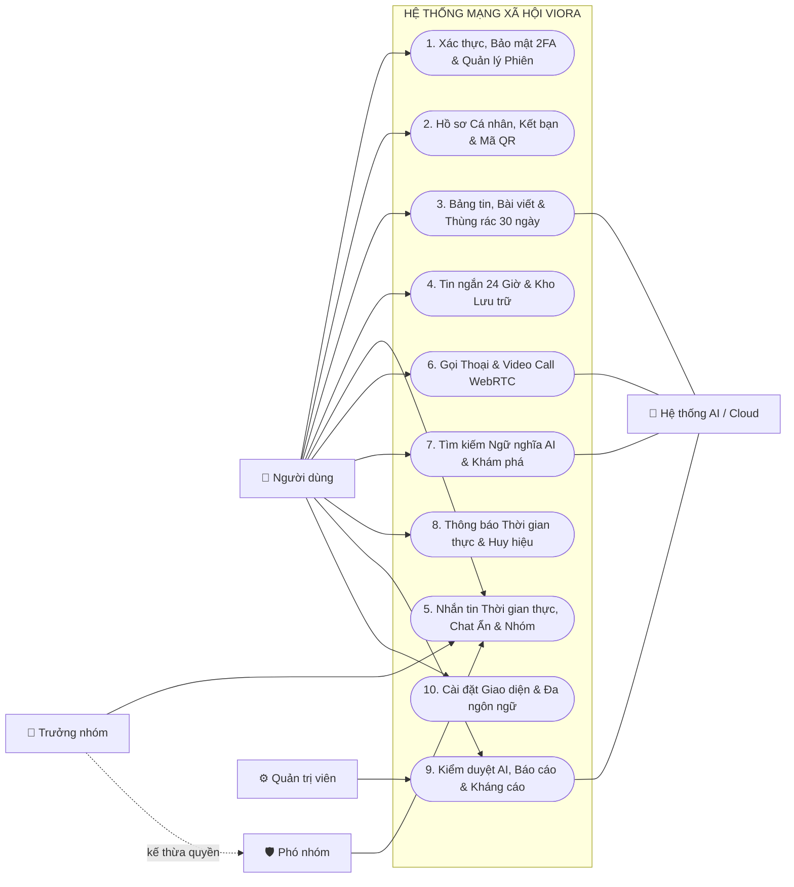

---

### 2.4 Use Case Phân hệ 1: Xác thực, Bảo mật 2FA & Quản lý Phiên

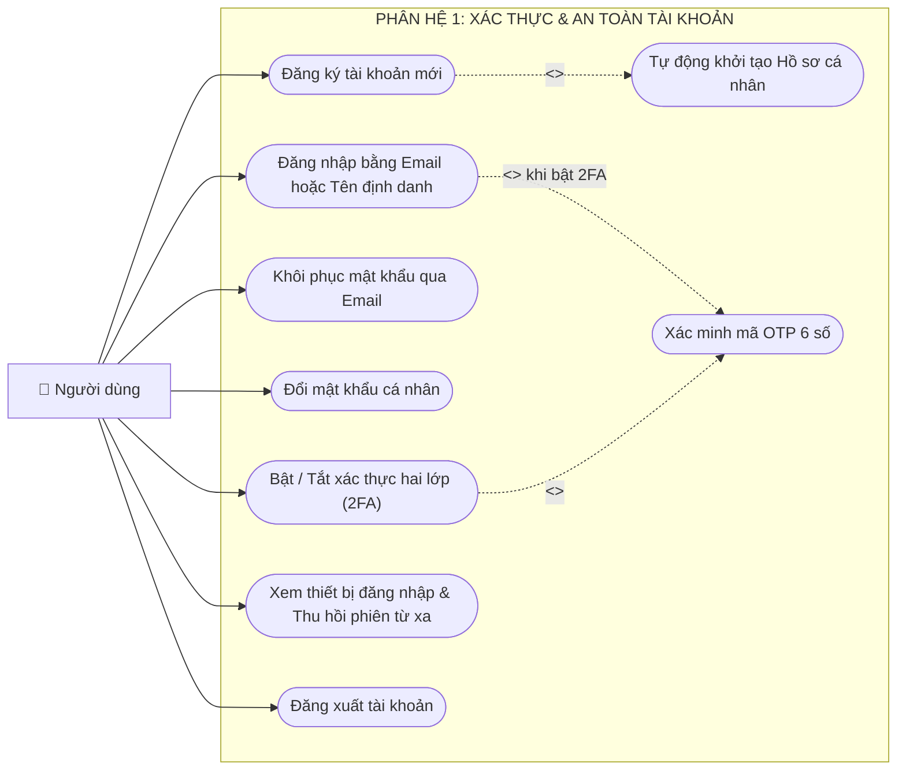

#### 🎯 Mục đích & Ý nghĩa Sơ đồ Phân hệ 1
Sơ đồ biểu diễn toàn bộ vòng đời tài khoản và các cơ chế bảo vệ danh tính của người dùng trên nền tảng Viora. Hệ thống áp dụng nguyên tắc **100% người dùng định danh (No Guest)** — mọi người dùng đều phải có tài khoản hợp lệ để đảm bảo an toàn không gian mạng và truy vết trách nhiệm cộng đồng.

#### 📋 Chi tiết Chức năng các Use Case:
- **`UC1.1 - Đăng ký tài khoản mới`:** Người dùng nhập Email, Mật khẩu và Tên hiển thị. Quan hệ `<<include>>` tự động kích hoạt `UC1_Sub1 - Tự động khởi tạo Hồ sơ cá nhân` thông qua Database Trigger PostgreSQL để tạo ngay bản ghi thông tin tương ứng trong bảng `profiles`.
- **`UC1.2 - Đăng nhập bằng Email hoặc Tên định danh`:** Hỗ trợ đăng nhập linh hoạt. Nếu người dùng nhập Tên định danh (Username), hệ thống sẽ phân giải sang Email qua hàm máy chủ RPC trước khi xác thực với Supabase Auth. Khi tài khoản đã kích hoạt bảo vệ 2FA, quan hệ `<<extend>>` sẽ bắt buộc chuyển sang `UC1_Sub2 - Xác minh mã OTP 6 số`.
- **`UC1.3 - Khôi phục mật khẩu qua Email`:** Gửi thư điện tử chứa đường dẫn an toàn (Magic Link/Token) để người dùng đặt lại mật khẩu mới khi quên.
- **`UC1.4 - Đổi mật khẩu cá nhân`:** Dành cho người dùng đang đăng nhập muốn cập nhật mật khẩu định kỳ, yêu cầu kiểm tra mật khẩu hiện tại trước khi lưu mật khẩu mới.
- **`UC1.5 - Bật / Tắt xác thực hai lớp (2FA)`:** Tích hợp phương thức bảo mật chuẩn TOTP (Google Authenticator, Apple Keychain, Authy). Quan hệ `<<include>>` đòi hỏi người dùng phải quét mã QR và nhập đúng mã OTP 6 số (`UC1_Sub2`) để nâng cấp cấp độ đảm bảo từ `aal1` lên `aal2`.
- **`UC1.6 - Xem thiết bị đăng nhập & Thu hồi phiên từ xa`:** Liệt kê các phiên làm việc (Tên thiết bị, Hệ điều hành, Trình duyệt, Địa chỉ IP, Thời điểm hoạt động). Cho phép bấm "Đăng xuất" từng thiết bị lạ hoặc "Đăng xuất khỏi tất cả thiết bị khác".
- **`UC1.7 - Đăng xuất tài khoản`:** Hủy phiên làm việc hiện tại, thu hồi JWT token, đóng tất cả các kênh WebSocket Realtime và xóa dữ liệu cache phiên tạm thời.

#### ⚙️ Cơ chế Hoạt động & Luồng xử lý Kỹ thuật (How it works):
1. **Khởi tạo dữ liệu tức thì (Database Trigger):** Khi người dùng gọi API đăng ký `supabase.auth.signUp()`, bản ghi được tạo trong schema riêng biệt `auth.users`. Ngay lập tức, Trigger máy chủ `on_auth_user_created` được kích hoạt tự động sinh bản ghi trong bảng công khai `public.profiles` chứa mã định danh người dùng (`user_id`), tên đầy đủ và trạng thái khởi tạo.
2. **Đăng nhập phân giải Username (Server-side RPC):** Nếu chuỗi nhập liệu tại màn hình đăng nhập không chứa ký tự `@`, ứng dụng hiểu đây là Username và gọi hàm RPC `get_email_by_username` được bảo mật bằng `SECURITY DEFINER` để truy vấn địa chỉ email đích, sau đó tiến hành xác thực `signInWithPassword()`.
3. **Bộ lọc Điều hướng Đa tầng (Router Guards & 2FA Enforcement):** Trình điều hướng `GoRouter` liên tục lắng nghe `authSubscription`. Khi người dùng đăng nhập tài khoản có 2FA, hệ thống nhận diện cấp độ đảm bảo hiện thời là `aal1`. Router Guard sẽ ngay lập tức chuyển hướng bắt buộc về màn hình `/mfa-verify`. Chỉ khi người dùng nhập đúng mã TOTP qua hàm `supabase.auth.mfa.challengeAndVerify()`, phiên làm việc mới nâng lên `aal2` và mở quyền truy cập ứng dụng.
4. **Bảo mật phiên cục bộ:** Token phiên (JWT và Refresh Token) được lưu trữ an toàn trong vùng nhớ mã hóa phần cứng của thiết bị thông qua `flutter_secure_storage` (Keystore trên Android và Keychain trên iOS).

#### 🔒 Quy tắc Nghiệp vụ & Ràng buộc:
- Mật khẩu phải có độ dài tối thiểu 6 ký tự; Email phải tuân thủ chuẩn RFC 5322.
- Tài khoản đang chịu án phạt vi phạm (bị Quản trị viên khóa tạm thời hoặc vĩnh viễn) sẽ bị chặn ngay tại bước đăng nhập kèm thông báo lý do xử phạt và thời hạn mở khóa.

---

### 2.5 Use Case Phân hệ 2: Hồ sơ Cá nhân, Kết nối Xã hội & Mã QR


#### 🎯 Mục đích & Ý nghĩa Sơ đồ Phân hệ 2
Sơ đồ quản lý toàn bộ không gian danh tính kỹ thuật số, mạng lưới liên kết xã hội đa chiều (Theo dõi 1 chiều & Bạn bè 2 chiều), thiết lập ranh giới riêng tư và tính năng quét định danh kết nối siêu tốc thông qua Mã QR.

#### 📋 Chi tiết Chức năng các Use Case:
- **`UC2.1 - Xem trang cá nhân & Thống kê tương tác`:** Trình diễn ảnh đại diện, ảnh bìa gradient, tiểu sử, nhạc nền cá nhân và thanh số liệu (Bài viết, Người theo dõi, Đang theo dõi, Bạn bè). Trang cá nhân tích hợp cấu trúc Header cố định cùng hệ thống **Tab kép độc đáo**: Tab 1 là Lưới bài viết (Lưới 3 cột) và Tab 2 là Kho lưu trữ tin ngắn cá nhân (Lưới 9:16).
- **`UC2.2 - Chỉnh sửa Hồ sơ`:** Cho phép cập nhật ảnh đại diện, ảnh bìa (tải lên Supabase Storage CDN), thay đổi tên hiển thị và viết tiểu sử cá nhân.
- **`UC2.3 - Cài đặt nhạc nền trang cá nhân`:** Tìm kiếm bài hát qua iTunes API và chọn đoạn phát thử (Preview 30 giây) làm giai điệu đại diện cho trang cá nhân.
- **`UC2.4 - Theo dõi / Bỏ theo dõi người dùng`:** Thiết lập liên kết quan tâm một chiều được lưu trong bảng `follows`.
- **`UC2.5 - Gửi, Chấp nhận, Từ chối hoặc Thu hồi kết bạn`:** Quản lý mối quan hệ bạn bè hai chiều với vòng đời trạng thái (`pending`, `accepted`, `rejected`) trong bảng `friend_requests`.
- **`UC2.6 - Tạo, Lưu & Chia sẻ mã QR cá nhân`:** Sinh mã QR vector định danh động chứa đường dẫn liên kết sâu (`viora://profile/:userId`) kèm biểu tượng Viora trung tâm, hỗ trợ lưu ảnh vào máy hoặc chia sẻ qua ứng dụng khác.
- **`UC2.7 - Quét mã QR từ Camera hoặc Thư viện ảnh`:** Sử dụng camera thời gian thực hoặc tải tệp ảnh từ bộ sưu tập để giải mã QR; quan hệ `<<include>>` tự động mở `UC2_Sub - Xem nhanh thẻ hồ sơ từ mã QR` dưới dạng Modal BottomSheet mà không cần chuyển màn hình.
- **`UC2.8 - Cấu hình quyền riêng tư (Tài khoản riêng tư)`:** Bật/tắt chế độ `is_private`. Khi kích hoạt, chỉ những người theo dõi đã được chủ tài khoản phê duyệt mới được quyền xem bài viết và tin ngắn.
- **`UC2.9 - Chặn & Bỏ chặn người dùng hai chiều`:** Cắt đứt hoàn toàn mọi tương tác qua lại giữa hai tài khoản, bảo vệ người dùng khỏi quấy rối.

#### ⚙️ Cơ chế Hoạt động & Luồng xử lý Kỹ thuật (How it works):
1. **Tải và Đồng bộ Dữ liệu Hồ sơ:** Ứng dụng truy vấn bảng `profiles` thông qua Riverpod StateNotifier. Các chỉ số thống kê (Followers, Following, Friends) được tính toán tức thì bằng các truy vấn đếm có đánh chỉ mục (Indexed Count Queries).
2. **Xử lý Kết bạn Hai chiều & Cập nhật Xã hội:** Khi gửi lời mời kết bạn, bản ghi mới được thêm vào `friend_requests` với trạng thái `pending`. Một thông báo thời gian thực được tự động gửi đến người nhận. Khi người nhận bấm "Chấp nhận", trạng thái cập nhật thành `accepted` và quan hệ bạn bè có hiệu lực ngay lập tức, tác động trực tiếp lên thuật toán gợi ý bảng tin.
3. **Nhận diện Mã QR Đa nguồn:** Sử dụng thư viện `mobile_scanner` để xử lý luồng khung hình từ camera và `google_mlkit_barcode_scanning` để xử lý quét ảnh tĩnh. Khi trích xuất được `userId`, hệ thống gọi hàm tải nhanh thông tin tóm tắt và hiển thị thẻ Profile Card tương tác (cho phép bấm Theo dõi / Nhắn tin trực tiếp).
4. **Cơ chế Chặn Hai chiều (Bidirectional Blocking):** Khi kích hoạt chặn trong bảng `blocked_users`, hệ thống tự động: hủy kết bạn, hủy theo dõi giữa hai bên, và áp dụng bộ lọc loại trừ (`NOT IN`) trên toàn bộ các truy vấn Bảng tin, Khám phá, Tìm kiếm và Phòng chat.

#### 🔒 Quy tắc Nghiệp vụ & Ràng buộc:
- Người dùng không thể tự gửi kết bạn hoặc tự theo dõi chính mình (`CHECK (follower_id != following_id)`).
- Khi tài khoản ở chế độ Riêng tư (`is_private = true`), người lạ truy cập trang cá nhân chỉ nhìn thấy thông tin cơ bản và số liệu, toàn bộ danh sách bài viết và tin ngắn đều bị ẩn.

---

### 2.6 Use Case Phân hệ 3A: Soạn thảo, Xuất bản Bài viết & Thùng rác


#### 🎯 Mục đích & Ý nghĩa Sơ đồ Phân hệ 3A
Sơ đồ biểu diễn toàn bộ tiến trình sáng tạo và xuất bản nội dung của người dùng, tích hợp sâu trí tuệ nhân tạo (Google Gemini AI) hỗ trợ người sáng tạo, cơ chế gắn nhãn minh bạch nội dung và quy trình bảo vệ dữ liệu với Thùng rác 30 ngày (Soft Delete).

#### 📋 Chi tiết Chức năng các Use Case:
- **`UC3.1 - Tạo bài viết mới`:** Người dùng soạn thảo nội dung văn bản, đính kèm tối đa 10 tệp ảnh hoặc video (lưu vào Supabase Storage), lựa chọn trạng thái cảm xúc (Mood/Activity) và gắn thẻ bạn bè (@tag).
- **`UC3.2 - Đính kèm vị trí địa lý`:** Tự động lấy tọa độ GPS từ cảm biến vị trí thiết bị (`geolocator`) hoặc trích xuất siêu dữ liệu địa lý lưu trong thẻ EXIF của ảnh chụp (`exif`) để gắn thẻ địa điểm check-in.
- **`UC3.3 - Đính kèm nhạc nền bài viết`:** Tìm kiếm kho nhạc trực tuyến và nhúng đoạn nghe thử 30 giây làm giai điệu nền phát khi người khác xem bài viết.
- **`UC3.4 - Gắn nhãn nội dung tạo bởi AI`:** Bật công tắc khai báo bắt buộc (`is_ai_generated = true`) khi sử dụng hình ảnh hoặc văn bản do các công cụ Generative AI tạo ra, đảm bảo tính minh bạch cộng đồng.
- **`UC3.5 - Chuyển bài viết vào Thùng rác (Lưu giữ 30 ngày)`:** Cơ chế xóa an toàn (Soft Delete). Hệ thống cập nhật trường `deleted_at = now()`, bài viết ngay lập tức ẩn khỏi Bảng tin và Hồ sơ cá nhân nhưng được lưu trữ an toàn trong giao diện Thùng rác.
- **`UC3.6 - Khôi phục hoặc Xóa vĩnh viễn bài viết`:** Trong vòng 30 ngày, người dùng có thể khôi phục lại bài viết về trạng thái ban đầu (`deleted_at = null`) hoặc chọn xóa vĩnh viễn (xóa sạch bản ghi cơ sở dữ liệu và tệp media trên Storage CDN).
- **`UC3_Sub1 - Gợi ý lời dẫn & Hashtag tự động bằng AI (<<extend>>)`:** Người dùng chạm vào nút "Gợi ý AI", hệ thống gửi ảnh sang Gemini Vision phân tích bối cảnh để tự động sinh 3 phiên bản Caption giàu cảm xúc kèm bộ Hashtag thịnh hành.
- **`UC3_Sub2 - Xem trước & Quét kiểm duyệt trước xuất bản (<<include>>)`:** Trước khi bài viết được công bố, hệ thống tự động quét kiểm duyệt nội dung văn bản và ảnh qua bộ lọc an toàn để ngăn chặn phát tán hình ảnh bạo lực, phản cảm hoặc mã độc.

#### ⚙️ Cơ chế Hoạt động & Luồng xử lý Kỹ thuật (How it works):
1. **Nén Đa phương tiện & Lưu trữ Phân tán:** Trước khi tải lên, hình ảnh được nén tối ưu dung lượng phía Client. Ứng dụng tải media trực tiếp lên Supabase Storage CDN qua Presigned URL, sau đó lưu danh sách URL vào bảng `post_media` kèm số thứ tự hiển thị `order_index`.
2. **Xử lý AI với Supabase Edge Functions:** Khi người dùng yêu cầu gợi ý caption, Edge Function `generate-caption` được gọi với ảnh định dạng Base64. Mô hình Gemini 1.5 Flash nhận diện các chủ thể chính trong ảnh, phân tích tâm trạng và trả về chuỗi JSON gồm: tiêu đề đề xuất, nội dung chi tiết và 5 hashtag phù hợp nhất.
3. **Vòng đời Thùng rác & Cron Job Tự động:** Các câu lệnh truy vấn dữ liệu thông thường luôn gắn điều kiện ràng buộc `WHERE deleted_at IS NULL`. Một tác vụ tự động Cron Job trên máy chủ cơ sở dữ liệu sẽ chạy định kỳ hàng đêm, thực thi lệnh quét các bài viết có `deleted_at < now() - INTERVAL '30 days'` để xóa cứng vĩnh viễn khỏi hệ thống.

#### 🔒 Quy tắc Nghiệp vụ & Ràng buộc:
- Mỗi bài viết cho phép đính kèm tối đa 10 ảnh/video. Dung lượng ảnh tối đa 15MB, video tối đa 50MB và thời lượng không quá 60 giây.
- Sau thời hạn 30 ngày trong Thùng rác, bài viết cùng toàn bộ lượt thích, bình luận liên đới sẽ bị xóa vĩnh viễn và không thể khôi phục.

---

### 2.7 Use Case Phân hệ 3B: Bảng tin Đề xuất & Tương tác Bài viết


#### 🎯 Mục đích & Ý nghĩa Sơ đồ Phân hệ 3B
Sơ đồ biểu diễn trung tâm phân phối nội dung của mạng xã hội Viora: vận hành Thuật toán Gợi ý Bảng tin v2 thông minh nhằm giữ chân người dùng, kết hợp đầy đủ các kênh tương tác xã hội tức thì (Thích, Bình luận đa tầng, Dịch thuật đa ngôn ngữ và Lan tỏa nội dung).

#### 📋 Chi tiết Chức năng các Use Case:
- **`UC3.9 - Lướt xem Bảng tin đề xuất cá nhân hóa`:** Tải dòng thời gian bài viết kết hợp hài hòa giữa bạn bè, người theo dõi và các bài viết khám phá được chấm điểm cao bởi thuật toán đề xuất.
- **`UC3.10 - Xem băng chuyền Những người bạn có thể biết`:** Thanh cuộn ngang xen kẽ giữa bảng tin gợi ý các tài khoản có khả năng quen biết dựa trên mạng lưới bạn chung (Friends-of-Friends) và tương đồng sở thích.
- **`UC3.11 - Thích / Bỏ thích bài viết`:** Thả tim bài viết với hoạt ảnh nảy tim Cupertino sống động, tự động cập nhật số lượng thích và gửi tín hiệu phản hồi đến thuật toán gợi ý.
- **`UC3.12 - Bình luận & Trả lời bình luận nhiều cấp`:** Bình luận dạng chuỗi phân nhánh hình cây (Threaded Comments) với trường `parent_id`, hỗ trợ nhắc tên thành viên `@username` và hiển thị ảnh đại diện người phản hồi.
- **`UC3.13 - Thích bình luận`:** Cho phép thả tim tương tác cho từng câu bình luận cụ thể, lưu vào bảng `comment_likes`.
- **`UC3.14 - Dịch tự động nội dung bài viết & bình luận`:** Bấm nút "Xem bản dịch" để kích hoạt Gemini AI dịch tức thì bài viết hoặc bình luận từ ngôn ngữ nước ngoài sang tiếng Việt hoặc ngược lại.
- **`UC3.15 - Chia sẻ bài viết hoặc Sao chép liên kết`:** Sinh liên kết sâu (Deep Link) hoặc tạo ảnh chia sẻ để gửi nhanh qua Zalo, Messenger, Facebook hoặc sao chép vào bộ nhớ tạm.

#### ⚙️ Cơ chế Hoạt động & Luồng xử lý Kỹ thuật (How it works):
1. **Thuật toán Đề xuất Bảng tin v2 (5 Trọng số Động):** Thứ tự bài viết được máy chủ tính toán dựa trên công thức chấm điểm đa nhân tố:
   $$\text{FinalScore} = (w_1 \cdot \text{Connection}) + (w_2 \cdot \text{Affinity}_{90d}) + (w_3 \cdot \text{Topic}) + (w_4 \cdot \text{Quality}) \times \text{Decay}(t)$$
   - *Mức độ kết nối:* Bạn bè thân thiết (trọng số 1.0), Đang theo dõi (0.8), Người lạ trong cộng đồng (0.2).
   - *Mức độ thân thiết (Affinity 90 ngày):* Tổng hợp tần suất thả tim, bình luận và xem hồ sơ giữa người dùng và tác giả trong 3 tháng gần nhất.
   - *Chủ đề quan tâm (Topic Affinity):* Đối chiếu thể loại bài viết với các chủ đề người dùng thường xuyên tương tác.
   - *Chất lượng bài viết (Quality):* Đánh giá tỷ lệ bài viết nhận được nhiều bình luận dài và lưu trữ.
   - *Hàm suy giảm thời gian (Half-life Decay 24h):* Điểm số bài viết giảm dần theo hàm số mũ thời gian, giúp bảng tin luôn tràn ngập nội dung mới.
2. **Cập nhật Giao diện Lạc quan (Optimistic UI Updates):** Khi bấm Thích, giao diện đổi trạng thái tim đỏ và tăng biến đếm tức thời (độ trễ 0ms) để mang lại cảm giác mượt mà tuyệt đối. Sau đó, ứng dụng gửi lệnh ghi bất đồng bộ (Debounced Network Request) vào bảng `likes`. Database Trigger trên Supabase sẽ tự động cập nhật lại trường `likes_count` trong bảng `posts`.
3. **Bình luận Cấu trúc Cây Đệ quy:** Bảng `comments` sử dụng kỹ thuật Adjacency List với cột `parent_id` trỏ về khóa chính của bình luận cha. Ứng dụng Flutter tổ chức dữ liệu thành cây phân cấp và hiển thị dạng thụt đầu dòng Cupertino thanh lịch.

#### 🔒 Quy tắc Nghiệp vụ & Ràng buộc:
- Ràng buộc duy nhất `UNIQUE(post_id, user_id)` và `UNIQUE(comment_id, user_id)` ngăn chặn hoàn toàn tình trạng một người dùng thích trùng lặp nhiều lần cho một bài viết hoặc bình luận.
- Chủ bài viết có toàn quyền xóa mọi bình luận nằm dưới bài viết của mình; người bình luận chỉ có quyền xóa bình luận do chính mình viết.

---

### 2.8 Use Case Phân hệ 4: Tin ngắn 24 Giờ (Stories) & Kho Lưu trữ


#### 🎯 Mục đích & Ý nghĩa Sơ đồ Phân hệ 4
Sơ đồ quản lý tính năng chia sẻ khoảnh khắc tạm thời (Stories 24 giờ) — định dạng nội dung ngắn thịnh hành, trực quan và giàu cảm xúc. Sơ đồ kết hợp giữa trải nghiệm trình chiếu toàn màn hình tức thì, cơ chế tương tác thả biểu cảm chùm hạt bay (Particle Burst) và mô hình lưu trữ vĩnh viễn trên trang cá nhân (Profile Archive).

#### 📋 Chi tiết Chức năng các Use Case:
- **`UC4.1 - Đăng tin ngắn 24h`:** Chọn ảnh hoặc quay video ngắn (dưới 15 giây), tự do chèn văn bản đa dạng kiểu chữ/màu sắc và lồng ghép nhạc nền iTunes. Quan hệ `<<include>>` tự động kích hoạt `UC4_Sub - Tự động ẩn khỏi Bảng tin sau 24 giờ` bằng cách thiết lập mốc thời gian hết hạn `expires_at = created_at + interval '24 hours'`.
- **`UC4.2 - Xem trình chiếu tin ngắn toàn màn hình`:** Trình xem Story toàn màn hình tỷ lệ 9:16 có thanh thời gian chạy tự động (5 giây cho ảnh, hoặc khớp thời lượng video). Hỗ trợ chạm nửa trái/phải để lùi/tiến tin, và chạm giữ màn hình để tạm dừng khung hình.
- **`UC4.3 - Thả biểu cảm với hiệu ứng chùm hạt bay`:** Khi xem tin, người dùng chạm vào các biểu tượng cảm xúc để kích hoạt hiệu ứng hoạt họa `StoryReactionBurstOverlay` phun hạt emoji bay tràn ngập màn hình và lưu biểu cảm vào bảng `story_reactions`.
- **`UC4.4 - Xem thống kê người đã xem & thả biểu cảm`:** Dành riêng cho chủ nhân tin ngắn: vuốt mở bảng điều khiển phía dưới để theo dõi chi tiết danh sách tài khoản đã xem tin (`story_views`), thời điểm xem và danh sách emoji mà từng người đã thả.
- **`UC4.5 - Xem Tin nổi bật & Kho lưu trữ tin trên Hồ sơ`:** Người dùng có thể xem lại toàn bộ các tin ngắn mình từng đăng từ trước đến nay trong Tab Kho lưu trữ (Archive Grid) trên trang cá nhân, đồng thời gom các tin đặc sắc vào thanh "Tin nổi bật" (Story Highlights).
- **`UC4.6 - Xóa tin ngắn của bản thân`:** Chủ nhân tin ngắn có quyền chủ động xóa tin bất kỳ lúc nào mà không cần đợi hết thời hạn 24 giờ.

#### ⚙️ Cơ chế Hoạt động & Luồng xử lý Kỹ thuật (How it works):
1. **Truy vấn Tin Đang Hoạt động (Active Stories Feed):** Trên Bảng tin chính, ứng dụng thực thi truy vấn có điều kiện lọc thời gian thực: `WHERE expires_at > now()`, nhóm theo từng người dùng và xếp theo tin mới nhất.
2. **Kiến trúc Không Mất Dữ Liệu (Zero Data Loss Archive):** Khác với tư duy xóa cứng thông thường, Viora **không bao giờ xóa bản ghi Story khi hết hạn 24 giờ**. Khi thời gian `expires_at` trôi qua, tin ngắn chỉ tự động biến mất khỏi Bảng tin chung, nhưng bản ghi vẫn tồn tại nguyên vẹn trong cơ sở dữ liệu để phục vụ Tab Kho lưu trữ (Archive) của chính tác giả.
3. **Chống Trùng lặp Lượt Xem (Unique Viewer Tracking):** Bảng `story_views` áp dụng ràng buộc `UNIQUE(story_id, user_id)`. Khi người dùng xem một Story, ứng dụng gọi lệnh ghi nhận `viewed_at`. Nhờ ràng buộc này, một người xem lại nhiều lần chỉ được tính là 1 lượt xem duy nhất.
4. **Hỗ trợ Đa Biểu cảm Linh hoạt:** Bảng `story_reactions` áp dụng ràng buộc `UNIQUE(story_id, user_id, reaction)`. Nhờ vậy, một người xem có thể thả nhiều loại cảm xúc khác nhau trên cùng một tin (vừa thả Tim ❤️ vừa thả Cười 😂) nhưng hệ thống không cho phép spam trùng lặp cùng một biểu cảm.

#### 🔒 Quy tắc Nghiệp vụ & Ràng buộc:
- Tin ngắn chỉ xuất hiện công khai trên Bảng tin trong đúng 24 giờ tính từ thời điểm đăng bài.
- Danh sách người xem tin và biểu cảm là dữ liệu riêng tư tuyệt đối, chỉ hiển thị cho chính tác giả đăng tin (được kiểm soát chặt chẽ bởi Row Level Security - RLS).

---

### 2.9 Use Case Phân hệ 5A: Nhắn tin Thời gian thực & Tiện ích Phòng Chat

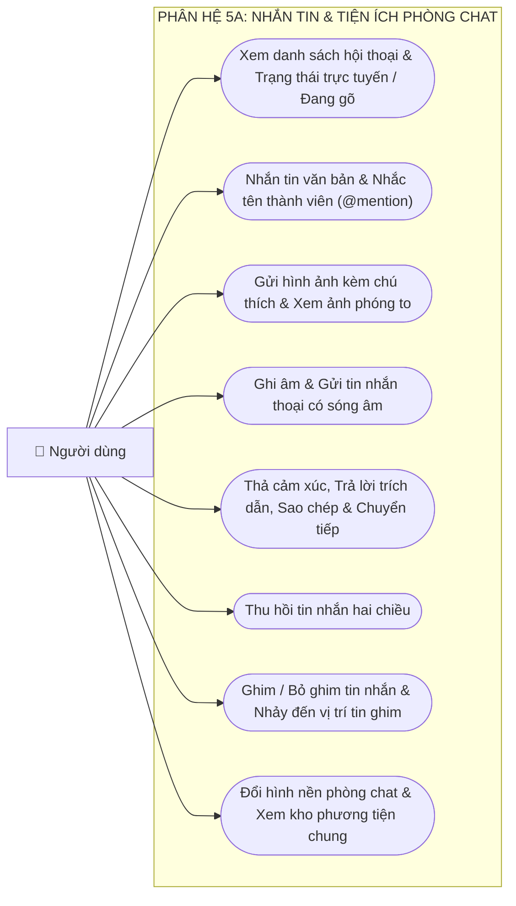

#### 🎯 Mục đích & Ý nghĩa Sơ đồ Phân hệ 5A
Sơ đồ biểu diễn không gian hội thoại cá nhân và nhóm thời gian thực với độ trễ cực thấp. Đáp ứng nhu cầu giao tiếp đa phương tiện phong phú (Chữ, Hình ảnh chất lượng cao, Tin nhắn thoại có dạng sóng âm) cùng các tiện ích tương tác hiện đại như trích dẫn, thả biểu cảm, ghim tin nhắn và thu hồi tin hai chiều.

#### 📋 Chi tiết Chức năng các Use Case:
- **`UC5.1 - Xem danh sách hội thoại & Trạng thái trực tuyến / Đang gõ`:** Hiển thị danh sách các cuộc trò chuyện sắp xếp theo tin mới nhất, huy hiệu đếm tin chưa đọc, dấu chấm xanh hiển thị trạng thái Online (Presence) và chỉ báo "đang soạn tin..." tức thì.
- **`UC5.2 - Nhắn tin văn bản & Nhắc tên thành viên (@mention)`:** Gửi tin nhắn văn bản tức thời, gõ ký tự `@` để mở danh sách thành viên trong nhóm và gắn thẻ nhắc tên.
- **`UC5.3 - Gửi hình ảnh kèm chú thích & Xem ảnh phóng to`:** Chọn nhiều ảnh từ bộ sưu tập hoặc camera, thêm chú thích và gửi; hỗ trợ trình xem ảnh toàn màn hình có thể phóng to / thu nhỏ linh hoạt.
- **`UC5.4 - Ghi âm & Gửi tin nhắn thoại có sóng âm`:** Nhấn giữ phím ghi âm để thu giọng nói với hiển thị biểu đồ sóng âm dao động thời gian thực (`record`), hỗ trợ nghe lại và điều chỉnh tốc độ phát lại.
- **`UC5.5 - Thả cảm xúc, Trả lời trích dẫn, Sao chép & Chuyển tiếp`:** Nhấn giữ bóng tin nhắn để mở menu tương tác: thả 6 loại biểu cảm emoji, trích dẫn nội dung để trả lời, sao chép văn bản hoặc chuyển tiếp tin nhắn sang phòng chat khác.
- **`UC5.6 - Thu hồi tin nhắn hai chiều`:** Cho phép người gửi thu hồi tin nhắn đã gửi nhầm; giao diện của cả hai bên lập tức chuyển thành *"Tin nhắn đã bị thu hồi"* và xóa bỏ tệp đính kèm.
- **`UC5.7 - Ghim / Bỏ ghim tin nhắn & Nhảy đến vị trí tin ghim`:** Ghim tối đa 3 tin nhắn quan trọng lên đầu cuộc trò chuyện; chạm vào thanh ghim sẽ tự động cuộn màn hình đến đúng vị trí tin nhắn gốc trong lịch sử trò chuyện.
- **`UC5.8 - Đổi hình nền phòng chat & Xem kho phương tiện chung`:** Tùy biến hình nền riêng biệt cho từng phòng trò chuyện; mở kho lưu trữ chung phân loại thành 4 mục: Hình ảnh, Video, Tệp tin và Liên kết đã gửi.

#### ⚙️ Cơ chế Hoạt động & Luồng xử lý Kỹ thuật (How it works):
1. **Kênh WebSocket Thời gian thực (Supabase Realtime):** Mỗi cuộc trò chuyện lắng nghe một kênh Realtime riêng biệt `conversation:{id}`. Khi một tin nhắn được chèn vào bảng `messages`, Supabase Realtime broadcast ngay lập tức payload tin nhắn đến tất cả các thành viên tham gia với độ trễ dưới 100ms.
2. **Tự động Cập nhật Trạng thái Hội thoại (Database Triggers):** Ngay khi một dòng dữ liệu mới xuất hiện trong bảng `messages`, Trigger máy chủ `update_last_message` sẽ tự động:
   - Cập nhật trường `last_message` và `last_message_at` của bảng `conversations`.
   - Tự động tăng bộ đếm số tin chưa đọc (`p1_unread_count` hoặc `p2_unread_count`) cho thành viên nhận tin.
3. **Cơ chế Đánh dấu Đã xem (Read Receipts):** Khi người dùng mở phòng chat, ứng dụng gọi lệnh cập nhật `is_seen = true` và `seen_at = now()` cho các tin nhắn của đối phương. Sự kiện cập nhật này kích hoạt tín hiệu Realtime hiển thị trạng thái "Đã xem" bên cạnh tin nhắn của người gửi.
4. **Presence & Chỉ báo Đang gõ Không tốn Tài nguyên:** Trạng thái trực tuyến và chỉ báo "đang gõ..." hoạt động hoàn toàn trên bộ nhớ đệm RAM thông qua kênh Supabase Presence, không thực hiện ghi xuống ổ đĩa cơ sở dữ liệu, đảm bảo tốc độ tối đa và tối ưu chi phí hạ tầng.

#### 🔒 Quy tắc Nghiệp vụ & Ràng buộc:
- Ràng buộc chống tạo phòng chat 1-1 trùng lặp: Bảng `conversations` áp dụng quy tắc chuẩn hóa `CHECK (participant_1 < participant_2)`, ngăn ngừa hoàn toàn tình trạng sinh ra hai phòng chat riêng biệt giữa cặp người dùng (A, B) và (B, A).
- Chỉ người gửi mới có quyền thực hiện thu hồi tin nhắn của mình. Tin nhắn sau khi thu hồi sẽ không thể xem lại nội dung cũ.

---

### 2.10 Use Case Phân hệ 5B: Bảo mật Hộp thư & Quản trị Nhóm Chat


#### Bảng Ma trận Phân cấp Quyền hạn Quản trị Nhóm Chat:

| Quyền hạn & Thao tác nghiệp vụ | Thành viên (`member`) | Phó nhóm (`admin`) | Trưởng nhóm (`owner`) |
|:---|:---:|:---:|:---:|
| Gửi tin nhắn, ảnh, tệp âm thanh trong nhóm | ✅ *(Mặc định)* | ✅ | ✅ |
| Mời bạn bè tham gia nhóm | ✅ *(Nếu nhóm cho phép)*| ✅ | ✅ |
| Rời khỏi nhóm trò chuyện | ✅ | ✅ | ⚠️ *(Phải chuyển quyền trước)* |
| Chỉnh sửa tên nhóm & Đổi ảnh đại diện nhóm | ⚙️ *(Nếu bật quyền)* | ✅ | ✅ |
| Phê duyệt yêu cầu tham gia của thành viên mới | ❌ | ✅ | ✅ |
| Ghim / Bỏ ghim tin nhắn trong phòng chat | ❌ | ✅ | ✅ |
| Cấu hình quyền gửi tin (Chỉ Quản trị viên gửi) | ❌ | ✅ | ✅ |
| Xóa thành viên thường khỏi nhóm | ❌ | ✅ | ✅ |
| Bổ nhiệm thành viên thường lên làm Phó nhóm | ❌ | ❌ | ✅ |
| Bãi nhiệm vai trò Phó nhóm trở lại thành viên | ❌ | ❌ | ✅ |
| Chuyển giao toàn quyền Trưởng nhóm | ❌ | ❌ | ✅ |
| Giải tán nhóm trò chuyện (Xóa vĩnh viễn nhóm) | ❌ | ❌ | ✅ |

#### 🎯 Mục đích & Ý nghĩa Sơ đồ Phân hệ 5B
Sơ đồ quản lý giải pháp bảo mật hộp thư cá nhân (Ẩn đoạn chat nhạy cảm bằng mã PIN) và quy chế vận hành phòng trò chuyện nhóm đa thành viên. Mô hình phân cấp 3 bậc: **Thành viên (`member`)**, **Phó nhóm (`admin`)** và **Trưởng nhóm (`owner`)** đảm bảo nhóm hoạt động có kỷ luật, ngăn chặn phá hoại và phân quyền quản trị mạch lạc.

#### 📋 Chi tiết Chức năng các Use Case:
- **`UC5.9 - Vuốt Ghim hoặc Xóa cuộc trò chuyện`:** Thao tác vuốt ngón tay nhanh (Cupertino Swipe Actions) trên danh sách: vuốt phải để Ghim cuộc trò chuyện quan trọng lên đầu, vuốt trái để hiển thị nút Xóa hoặc Đánh dấu chưa đọc.
- **`UC5.10 - Ẩn cuộc trò chuyện & Khóa bằng mã PIN 6 số`:** Tách cuộc trò chuyện ra khỏi danh sách hiển thị thông thường và đưa vào khu vực ẩn. Người dùng chỉ có thể mở ra khi nhập đúng mã PIN bí mật 6 số trên thanh tìm kiếm.
- **`UC5.11 - Khôi phục mã PIN đoạn chat ẩn qua Email`:** Cung cấp cơ chế dự phòng khi quên mã PIN: hệ thống gửi mã xác thực OTP về hòm thư điện tử chính chủ để thiết lập lại mã PIN mới mà không làm mất dữ liệu hội thoại.
- **`UC5.12 - Tạo nhóm trò chuyện nhiều thành viên`:** Chọn bạn bè (tối thiểu 2 người), đặt tên nhóm và tải lên ảnh đại diện để lập phòng chat nhóm mới. Người tạo nhóm tự động được gán vai trò Trưởng nhóm (`owner`).
- **`UC5.13 - Thêm thành viên hoặc Rời khỏi nhóm`:** Thành viên được quyền mời thêm bạn bè vào nhóm (nếu nhóm cho phép) hoặc tự ý rời khỏi nhóm khi không còn nhu cầu tham gia.
- **`UC5.14 - Cấu hình quyền nhóm, Duyệt & Xóa thành viên thường`:** Quyền quản trị dùng chung cho Phó nhóm và Trưởng nhóm: bật/tắt chế độ chỉ Quản trị viên gửi tin (chế độ nhóm thông báo), phân quyền ai được đổi tên/ảnh nhóm, xét duyệt thành viên mới xin gia nhập và xóa thành viên vi phạm khỏi nhóm.
- **`UC5.15A - Bổ nhiệm / Bãi nhiệm Phó nhóm`:** Quyền tối cao dành riêng cho Trưởng nhóm: phong chức Phó nhóm cho thành viên tích cực hoặc giáng chức Phó nhóm trở lại làm thành viên thường.
- **`UC5.15B - Giải tán nhóm trò chuyện vĩnh viễn`:** Quyền tối cao dành riêng cho Trưởng nhóm: xóa sổ vĩnh viễn nhóm chat, xóa toàn bộ lịch sử tin nhắn và tệp tin phương tiện của nhóm khỏi cơ sở dữ liệu máy chủ.

#### ⚙️ Cơ chế Hoạt động & Luồng xử lý Kỹ thuật (How it works):
1. **Kiến trúc Hộp thư Ẩn (Hidden Chat Engine):** Bảng `conversation_settings` lưu trữ trạng thái `is_hidden = true` riêng cho từng tài khoản người dùng và từng phòng chat. Truy vấn danh sách chat thông thường luôn có điều kiện `WHERE is_hidden = false`. Khi người dùng nhập chuỗi mã PIN 6 số trên thanh tìm kiếm, ứng dụng mới kích hoạt truy vấn lấy danh sách các cuộc trò chuyện bị ẩn này.
2. **Bảo mật Mã PIN Cục bộ:** Mã PIN không bao giờ lưu dưới dạng văn bản thô (Plain Text). Mã được băm một chiều (Salted Hash) và lưu trong vùng nhớ an toàn phần cứng `flutter_secure_storage`.
3. **Phân quyền Nghiệp vụ Đa tầng (Row Level Security & RPC):** Quyền hạn nhóm được bảo vệ 2 lớp: Client kiểm tra vai trò để ẩn/hiện nút bấm, và Backend kiểm tra bằng Supabase RLS Policies kết hợp các hàm RPC máy chủ `admin-group-management`. Nếu một người dùng không phải Owner cố tình gửi lệnh giải tán nhóm, Database sẽ lập tức trả về lỗi từ chối quyền truy cập (Permission Denied).

#### 🔒 Quy tắc Nghiệp vụ & Ràng buộc:
- Trưởng nhóm (`owner`) muốn rời khỏi nhóm bắt buộc phải thực hiện thủ tục chuyển giao vai trò Trưởng nhóm cho một thành viên khác trước.
- Phó nhóm (`admin`) không có quyền xóa hoặc bãi nhiệm Trưởng nhóm, và không có quyền giải tán nhóm trò chuyện.

---

### 2.11 Use Case Phân hệ 6: Cuộc gọi Thoại & Video Call WebRTC

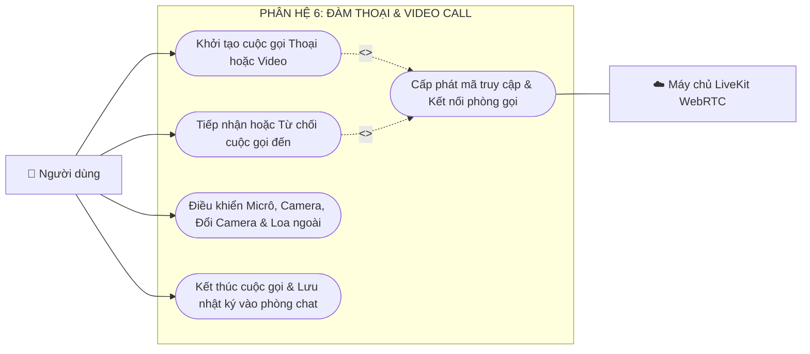

#### 🎯 Mục đích & Ý nghĩa Sơ đồ Phân hệ 6
Sơ đồ quản lý toàn bộ quy trình liên lạc thoại (Voice Call) và hình ảnh (Video Call) thời gian thực chất lượng cao theo chuẩn WebRTC, vận hành trên nền tảng máy chủ LiveKit Cloud SFU. Đảm bảo kết nối thông suốt giữa các nền tảng khác nhau (Web ↔ Android ↔ iOS), xử lý đầy đủ các kịch bản đổ chuông, từ chối, đàm thoại và ghi nhận nhật ký cuộc gọi.

#### 📋 Chi tiết Chức năng các Use Case:
- **`UC6.1 - Khởi tạo cuộc gọi Thoại hoặc Video`:** Người gọi bấm biểu tượng gọi trong phòng chat. Hệ thống tạo bản ghi cuộc gọi mới trong bảng `calls` với trạng thái `calling`, tạo mã phòng hội nghị ngẫu nhiên (UUID) và kích hoạt quan hệ `<<include>> UC6_Sub - Cấp phát mã truy cập & Kết nối phòng gọi`.
- **`UC6.2 - Tiếp nhận hoặc Từ chối cuộc gọi đến`:** Phía người nhận hiển thị màn hình chuông cuộc gọi đến (`IncomingCallOverlay`) kèm nhạc chuông và hiệu ứng rung. Người dùng có thể bấm "Từ chối" (cập nhật trạng thái cuộc gọi thành `rejected`) hoặc "Trả lời" (kích hoạt `<<include>> UC6_Sub`) để bắt đầu đàm thoại.
- **`UC6.3 - Điều khiển Micrô, Camera, Đổi Camera & Loa ngoài`:** Trong phòng gọi, người dùng tùy ý bật/tắt mic (Mute), bật/tắt camera, đảo chiều camera trước/sau, chuyển đổi đầu ra âm thanh giữa Loa thoại và Loa ngoài (Speakerphone), hoặc thu nhỏ cuộc gọi thành cửa sổ nổi (Picture-in-Picture).
- **`UC6.4 - Kết thúc cuộc gọi & Lưu nhật ký vào phòng chat`:** Khi một trong hai bên cúp máy, hệ thống tính toán thời lượng đàm thoại (`duration_sec`), cập nhật trạng thái `ended` và tự động ghi một tin nhắn nhật ký cuộc gọi vào phòng chat.
- **`UC6_Sub - Cấp phát mã truy cập & Kết nối phòng gọi`:** Gọi Supabase Edge Function `livekit-token` để sinh chuỗi mã truy cập JWT an toàn và kết nối thiết bị vào phòng họp đám mây LiveKit SFU.

#### ⚙️ Cơ chế Hoạt động & Luồng xử lý Kỹ thuật (How it works):
1. **Báo hiệu Cuộc gọi Thời gian thực (WebRTC Signaling):** Khi cuộc gọi được khởi tạo, một sự kiện Realtime Event được bắn qua kênh Supabase WebSocket đến thiết bị người nhận. Giao diện nhận cuộc gọi lập tức xuất hiện ngay cả khi người dùng đang lướt Bảng tin hay xem Story.
2. **Cấp Token LiveKit An Toàn (Secure JWT Generation):** Client Flutter không trực tiếp lưu trữ khóa bí mật của LiveKit. Thay vào đó, Client gọi hàm Edge Function `livekit-token`. Hàm này xác thực token người dùng, khởi tạo mã phòng họp trên LiveKit Cloud và cấp quyền truy cập âm thanh/video với thời hạn cụ thể.
3. **Truyền dẫn Đa phương tiện qua SFU (Selective Forwarding Unit):** Giao thức WebRTC truyền dữ liệu trực tiếp qua LiveKit SFU server. Server này thực hiện định tuyến các gói tin âm thanh (Opus Codec) và video (VP8/H.264 Codec) với khả năng tự động thích ứng băng thông (Adaptive Bitrate), đảm bảo chất lượng cuộc gọi luôn mượt mà ngay cả khi mạng yếu.
4. **Xử lý Cuộc gọi Nhỡ Tự động (Timeout 60 giây):** Nếu sau 60 giây đổ chuông mà người nhận không nhấc máy, hệ thống tự động ngắt chuông, chuyển trạng thái cuộc gọi thành `missed` và tạo thông báo cuộc gọi nhỡ trên thiết bị người nhận.

#### 🔒 Quy tắc Nghiệp vụ & Ràng buộc:
- Người dùng đang trong một cuộc gọi không thể thực hiện thêm cuộc gọi mới hoặc nhận cuộc gọi khác (báo máy bận).
- Tin nhắn nhật ký cuộc gọi được lưu vĩnh viễn trong phòng chat để làm bằng chứng lịch sử liên lạc, thể hiện rõ: thời lượng gọi hoặc trạng thái cuộc gọi nhỡ.

---

### 2.12 Use Case Phân hệ 7: Tìm kiếm & Khám phá Trí tuệ Nhân tạo


#### 🎯 Mục đích & Ý nghĩa Sơ đồ Phân hệ 7
Sơ đồ biểu diễn công cụ tìm kiếm hợp nhất thông minh (Hybrid Search Engine) kết hợp giữa tìm kiếm từ khóa truyền thống và tìm kiếm ngữ nghĩa theo ngữ cảnh bằng mô hình ngôn ngữ lớn (Gemini AI Embeddings qua giải thuật RRF), cùng không gian Khám phá (Explore Grid) bài viết thịnh hành với cơ chế phản hồi sở thích người dùng.

#### 📋 Chi tiết Chức năng các Use Case:
- **`UC7.1 - Tìm kiếm người dùng theo Tên / Tên định danh`:** Nhập ký tự để tìm kiếm tài khoản theo Full Name hoặc `@username`. Tự động ưu tiên hiển thị bạn bè, người đang theo dõi và các tài khoản có lượng tương tác cao.
- **`UC7.2 - Xem lại & Xóa lịch sử từ khóa tìm kiếm`:** Hiển thị danh sách các từ khóa vừa tìm gần đây, cho phép xóa từng từ khóa riêng lẻ hoặc bấm "Xóa tất cả".
- **`UC7.3 - Tìm kiếm bài viết theo ngữ nghĩa bằng AI`:** Cho phép người dùng tìm kiếm bài viết bằng câu văn tự nhiên (ví dụ: *"những chuyến du lịch biển mùa hè"* hay *"quán cà phê yên tĩnh đọc sách"*), hệ thống hiểu được ý nghĩa câu hỏi mà không bắt buộc bài viết phải chứa đúng từng từ khóa.
- **`UC7.4 - Khám phá bài viết thịnh hành & Ẩn bài không quan tâm`:** Lưới ảnh/video thịnh hành (Explore Grid); người dùng có thể chạm giữ bài viết và chọn "Không quan tâm" để hệ thống ghi nhận và giảm gợi ý các chủ đề tương tự.

#### ⚙️ Cơ chế Hoạt động & Luồng xử lý Kỹ thuật (How it works):
1. **Tìm kiếm Lai Hợp (Hybrid RRF Search):** Kết hợp giữa hai cơ chế tìm kiếm trong PostgreSQL:
   - *Full-Text Search (tsvector / tsquery):* Tìm kiếm chính xác từ khóa và cụm từ ngữ pháp tiếng Việt.
   - *Semantic Vector Search (pgvector):* Chuyển câu truy vấn thành Vector Embeddings qua Gemini Text Embedding API và tính toán khoảng cách cosine với vector ngữ nghĩa của bài viết.
   - *Thuật toán RRF (Reciprocal Rank Fusion):* Tổng hợp thứ hạng từ hai nguồn theo công thức chuẩn:
     $$RRF\_Score(d) = \sum_{m \in M} \frac{1}{k + r_m(d)} \quad (\text{với } k = 60)$$
     Nhờ vậy, bài viết vừa khớp từ khóa vừa đúng ngữ cảnh sẽ được ưu tiên đưa lên hàng đầu.
2. **Bộ nhớ đệm Lịch sử Cục bộ:** Danh sách lịch sử tìm kiếm được lưu trữ an toàn trong cơ sở dữ liệu cục bộ của thiết bị, giúp tốc độ phản hồi tức thì (0ms) và không phụ thuộc vào kết nối mạng.

#### 🔒 Quy tắc Nghiệp vụ & Ràng buộc:
- Kết quả tìm kiếm tự động loại bỏ các tài khoản nằm trong danh sách chặn hai chiều.
- Bài viết bị đánh dấu vi phạm hoặc đang ở chế độ Riêng tư (Private) sẽ không xuất hiện trên kết quả tìm kiếm công cộng.

---

### 2.13 Use Case Phân hệ 8: Thông báo Thời gian thực & Điều hướng


#### 🎯 Mục đích & Ý nghĩa Sơ đồ Phân hệ 8
Sơ đồ quản lý trung tâm tiếp nhận thông tin phản hồi của người dùng: cập nhật tức thì mọi biến động tương tác (Lượt thích, Bình luận mới, Lời mời kết bạn, Lượt nhắc tên `@mention`, Cảnh báo hệ thống) thông qua kênh WebSocket Realtime, đồng thời cung cấp các nút tương tác nhanh và cơ chế điều hướng sâu (Deep Linking).

#### 📋 Chi tiết Chức năng các Use Case:
- **`UC8.1 - Nhận thông báo tức thời & Hiển thị huy hiệu chưa đọc`:** Thông báo xuất hiện ngay lập tức khi có tương tác mới; cập nhật số lượng thông báo chưa đọc (Badge count) trên biểu tượng quả chuông và thanh điều hướng dưới đáy màn hình.
- **`UC8.2 - Xem danh sách thông báo theo từng nhóm tương tác`:** Bộ lọc tab thông minh: "Tất cả", "Tương tác" (thích, bình luận), "Kết bạn" (lời mời, theo dõi), và "Hệ thống" (cảnh báo bảo mật, kiểm duyệt).
- **`UC8.3 - Chấp nhận kết bạn / Theo dõi lại ngay trên thông báo`:** Cho phép người dùng bấm trực tiếp nút "Chấp nhận" hoặc "Theo dõi lại" ngay trên thẻ thông báo mà không cần phải truy cập vào trang cá nhân của đối phương.
- **`UC8.4 - Đánh dấu đã đọc & Điều hướng đến nội dung gốc`:** Bấm vào thông báo sẽ tự động cập nhật trường `is_read = true`, đồng thời điều hướng chính xác đến vị trí bài viết, cuộn đến đúng bình luận hoặc mở trang cá nhân liên quan.

#### ⚙️ Cơ chế Hoạt động & Luồng xử lý Kỹ thuật (How it works):
1. **Lắng nghe Kênh Thông báo Cá nhân (Supabase CDC):** Mỗi khi có một hành động tương tác thành công (ví dụ một người khác bình luận vào bài viết của bạn), Database Trigger máy chủ tự động chèn một bản ghi vào bảng `notifications`. Sự kiện `INSERT` này lập tức được Supabase Realtime đẩy qua WebSocket đến thiết bị đang mở ứng dụng.
2. **Điều hướng Sâu (Smart Deep Linking):** Mỗi bản ghi thông báo lưu trữ kèm các trường tham chiếu (`post_id`, `comment_id`, `sender_id`). Khi người dùng chạm vào thông báo, bộ định tuyến `GoRouter` giải mã các khóa ngoại này và điều hướng chính xác đến màn hình chi tiết đích tương ứng.

#### 🔒 Quy tắc Nghiệp vụ & Ràng buộc:
- Hệ thống không gửi thông báo nếu người thực hiện hành động chính là chủ bài viết/bình luận (tự thích bài của mình thì không gửi thông báo cho chính mình).
- Tự động gom nhóm thông báo (Aggregation) nếu có nhiều người cùng thích một bài viết trong khoảng thời gian ngắn (ví dụ: *"Nguyễn Văn A và 5 người khác đã thích bài viết của bạn"*).

---

### 2.14 Use Case Phân hệ 9: Kiểm duyệt An toàn Cộng đồng & Kháng cáo

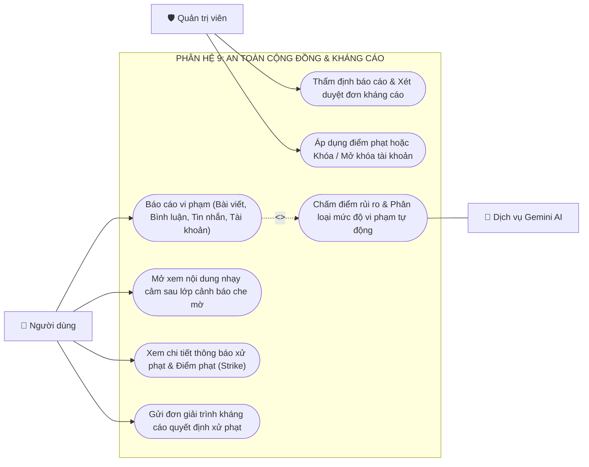

#### 🎯 Mục đích & Ý nghĩa Sơ đồ Phân hệ 9
Sơ đồ quản lý hệ sinh thái bảo vệ cộng đồng Viora: kết hợp giữa quy trình báo cáo chủ động từ người dùng, hàng rào kiểm duyệt tự động 6 tầng của Gemini AI, cơ chế cảnh báo làm mờ (Blur Warning Overlay), hệ thống xử phạt lũy tiến 3 gậy (3 Strikes Penalty System) và quy trình xét duyệt đơn kháng cáo công bằng bởi Quản trị viên.

#### 📋 Chi tiết Chức năng các Use Case:
- **`UC9.1 - Báo cáo vi phạm`:** Người dùng gắn cờ báo cáo bài viết, bình luận, tin nhắn hoặc tài khoản với các lý do cụ thể: Khiêu dâm, Bạo lực, Quấy rối/Đe dọa, Lừa đảo, Thông tin sai lệch, Bản quyền.
- **`UC9.2 - Mở xem nội dung nhạy cảm sau lớp cảnh báo che mờ`:** Đối với các nội dung bị xếp loại nhạy cảm nhẹ hoặc bạo lực vừa phải, hệ thống áp một lớp kính mờ che khuất hình ảnh kèm cảnh báo; người dùng có thể chủ động bấm "Xem nội dung" nếu vẫn muốn tiếp tục xem.
- **`UC9.3 - Xem chi tiết thông báo xử phạt & Điểm phạt (Strike)`:** Khi bị kỷ luật, người dùng nhận được thông báo rõ ràng về: bài viết vi phạm, điều khoản tiêu chuẩn cộng đồng bị vi phạm, số điểm phạt hiện tại (Strike 1, 2 hoặc 3) và thời hạn áp dụng chế tài.
- **`UC9.4 - Gửi đơn giải trình kháng cáo quyết định xử phạt`:** Người dùng có quyền viết đơn giải trình kèm hình ảnh/bằng chứng chứng minh mình không vi phạm để yêu cầu xem xét lại án phạt trong bảng `appeals`.
- **`UC9.5 - Thẩm định báo cáo & Xét duyệt đơn kháng cáo`:** Dành cho Quản trị viên (`System Admin`) tại trang quản trị: xem xét hồ sơ báo cáo, đối soát nội dung gốc, phân tích điểm rủi ro AI và phê duyệt hoặc bác bỏ đơn kháng cáo.
- **`UC9.6 - Áp dụng điểm phạt hoặc Khóa / Mở khóa tài khoản`:** Quản trị viên ra quyết định gỡ bài viết vi phạm, tăng số gậy phạt, hoặc kích hoạt lệnh mở khóa tài khoản khi đơn kháng cáo được chấp thuận.
- **`UC9_Sub - Chấm điểm rủi ro & Phân loại mức độ vi phạm tự động`:** Pipeline AI 6 tầng tự động phân tích văn bản và hình ảnh để chấm chỉ số Risk Score từ 0.0 đến 1.0.

#### ⚙️ Cơ chế Hoạt động & Luồng xử lý Kỹ thuật (How it works):
1. **Quy trình Kiểm duyệt Đa tầng Gemini 6 Cấp (Risk Scoring Pipeline):**
   - *Mức 1 ($\text{Score} < 0.20$):* **ALLOW** — Nội dung an toàn, xuất bản bình thường.
   - *Mức 2 ($0.20 \le \text{Score} < 0.50$):* **FLAG_WARNING** — Cảnh báo nhẹ, gắn lớp kính che mờ (Blur Overlay).
   - *Mức 3 ($0.50 \le \text{Score} < 0.80$):* **SHADOW_LIMIT** — Giảm phân phối ngầm, loại bỏ khỏi Bảng tin Khám phá.
   - *Mức 4 ($0.80 \le \text{Score} < 0.95$):* **UNDER_REVIEW** — Tạm ẩn bài viết, đưa vào hàng đợi chờ Quản trị viên duyệt thủ công.
   - *Mức 5 ($\text{Score} \ge 0.95$):* **REMOVE** — Gỡ bỏ tự động lập tức, tự động ghi nhận 1 gậy vi phạm cho tác giả.
2. **Hệ thống Chế tài 3 Gậy (3 Strikes Escalation):**
   - *Gậy 1:* Cảnh cáo bằng thông báo trong 7 ngày, bài viết vi phạm bị gỡ.
   - *Gậy 2:* Cấm đăng bài viết, cấm đăng tin ngắn và cấm bình luận trong 14 ngày.
   - *Gậy 3:* Khóa tài khoản tạm thời 30 ngày hoặc khóa vĩnh viễn tùy theo mức độ nghiêm trọng do Admin quyết định.

#### 🔒 Quy tắc Nghiệp vụ & Ràng buộc:
- Mỗi biên bản vi phạm chỉ được gửi duy nhất 1 đơn kháng cáo giải trình (`UNIQUE(violation_id)`).
- Quyết định của Quản trị viên sau khi xét duyệt đơn kháng cáo là phán quyết cuối cùng của hệ thống.

---

### 2.15 Use Case Phân hệ 10: Cài đặt Hệ thống, Giao diện & Đa ngôn ngữ

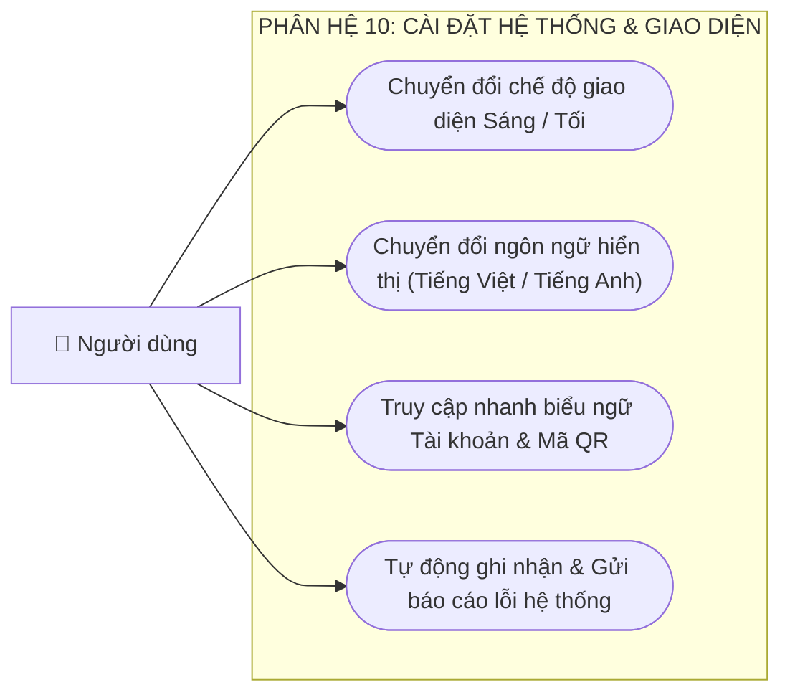

#### 🎯 Mục đích & Ý nghĩa Sơ đồ Phân hệ 10
Sơ đồ quản lý trung tâm cấu hình trải nghiệm cá nhân hóa của người dùng (Chế độ giao diện Cupertino Sáng/Tối, Ngôn ngữ hiển thị Tiếng Việt/Tiếng Anh), truy cập nhanh thông tin bảo mật và cơ chế tự động ghi nhận báo cáo sự cố (Crash Analytics) bảo vệ sự ổn định của hệ thống.

#### 📋 Chi tiết Chức năng các Use Case:
- **`UC10.1 - Chuyển đổi chế độ giao diện Sáng / Tối`:** Lựa chọn Giao diện Sáng (Light Mode), Giao diện Tối (Dark Mode) hoặc Tự động theo cài đặt hệ điều hành thiết bị (System Default). Toàn bộ bảng màu tuân thủ chuẩn bảng màu động Cupertino iOS.
- **`UC10.2 - Chuyển đổi ngôn ngữ hiển thị`:** Hỗ trợ đầy đủ hai ngôn ngữ chính: Tiếng Việt và Tiếng Anh (English). Chuyển đổi tức thì toàn bộ nhãn giao diện, thông báo lỗi và định dạng ngày tháng mà không cần khởi động lại ứng dụng.
- **`UC10.3 - Truy cập nhanh biểu ngữ Tài khoản & Mã QR`:** Phần đầu trang Cài đặt hiển thị thẻ danh thiếp thu nhỏ (Ảnh đại diện, Tên, Username) kèm nút bấm 1 chạm để mở ngay mã QR định danh cá nhân phục vụ kết bạn ngoài đời thực.
- **`UC10.4 - Tự động ghi nhận & Gửi báo cáo lỗi hệ thống`:** Tích hợp Sentry SDK (`sentry_flutter`) tự động bắt các lỗi crash, lỗi ngoại lệ mạng hoặc lỗi tràn giao diện (UI overflow), đóng gói thông tin thiết bị và gửi về trung tâm giám sát kỹ thuật mà không làm gián đoạn người dùng.

#### ⚙️ Cơ chế Hoạt động & Luồng xử lý Kỹ thuật (How it works):
1. **Quản trị Trạng thái Toàn cục (Riverpod SettingsNotifier):** Cấu hình giao diện và ngôn ngữ được quản lý bằng StateNotifier của Riverpod. Mỗi khi người dùng đổi tùy chọn, giá trị mới được lưu vào `SharedPreferences` cục bộ để duy trì trạng thái cho các lần mở ứng dụng tiếp theo.
2. **Quốc tế hóa Ứng dụng (Flutter i18n):** Sử dụng tệp định nghĩa tài nguyên ngôn ngữ `.arb`. Toàn bộ văn bản trên giao diện đều được gọi qua `AppLocalizations.of(context)` giúp việc mở rộng thêm ngôn ngữ mới trong tương lai cực kỳ đơn giản và đồng bộ.
3. **Giám sát Ngoại lệ Tự động (Crash Analytics):** Sentry SDK chạy dưới dạng một `Zone` bao bọc toàn bộ hàm `runApp()`. Bất kỳ lỗi bất đồng bộ nào phát sinh trong quá trình sử dụng đều được ghi lại vết ngăn xếp (Stacktrace) kèm mã định danh phiên người dùng (đã ẩn danh thông tin nhạy cảm) để đội ngũ kỹ sư xử lý kịp thời.

#### 🔒 Quy tắc Nghiệp vụ & Ràng buộc:
- Cấu hình giao diện và ngôn ngữ có hiệu lực ngay lập tức (Hot Re-render) trên tất cả các màn hình đang mở.

---

## 3. SƠ ĐỒ LUỒNG DỮ LIỆU (DATA FLOW DIAGRAMS - DFD)

### 3.1 Sơ đồ DFD Mức Ngữ cảnh (Mức 0)

Sơ đồ biểu diễn luồng thông tin tổng thể giữa người dùng đã xác thực, quản trị viên, các dịch vụ đám mây và hệ thống trung tâm Viora:

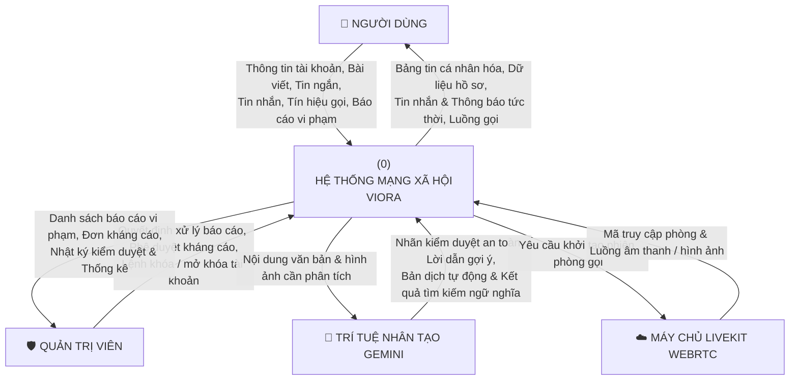

#### 🎯 Mục đích & Ý nghĩa Sơ đồ DFD Mức 0
Sơ đồ DFD Mức Ngữ cảnh (Context Diagram) xác lập ranh giới cao nhất của toàn bộ hệ thống phần mềm Viora. Sơ đồ làm rõ: hệ thống tiếp nhận những nguồn dữ liệu nào từ bên ngoài, chuyển giao những thông tin gì ra môi trường xung quanh, và tương tác với những thực thể ngoại vi (External Entities) nào để hoàn thành sứ mệnh mạng xã hội an toàn, tức thì và thông minh.

#### 🔄 Các Thực thể Ngoại vi & Luồng Dữ liệu Trao đổi:
1. **Người dùng (`User` - Thành viên đã xác thực):**
   - *Luồng dữ liệu đưa vào hệ thống:* Thông tin đăng ký/đăng nhập, dữ liệu bài viết (văn bản, ảnh/video, nhạc nền, vị trí check-in), tin ngắn Story 24h, tin nhắn tức thời, tín hiệu yêu cầu cuộc gọi thoại/video, tương tác thích/bình luận, và các báo cáo vi phạm tiêu chuẩn cộng đồng.
   - *Luồng dữ liệu nhận về từ hệ thống:* Dòng thời gian Bảng tin được cá nhân hóa theo thuật toán đề xuất v2, thông tin hồ sơ cá nhân và bạn bè, tin nhắn thời gian thực kèm trạng thái đã xem, các thông báo tương tác tức thời (Push/Realtime Notifications), kết quả tìm kiếm ngữ nghĩa, và luồng âm thanh/video cuộc gọi.
2. **Quản trị viên (`System Admin`):**
   - *Luồng dữ liệu đưa vào hệ thống:* Phán quyết phê duyệt/từ chối báo cáo vi phạm, kết quả xét duyệt đơn kháng cáo giải trình, lệnh áp dụng điểm phạt (Strike), và quyết định khóa hoặc mở khóa tài khoản người dùng.
   - *Luồng dữ liệu nhận về từ hệ thống:* Hàng đợi danh sách bài viết/bình luận bị báo cáo đã được AI chấm điểm ưu tiên, hồ sơ chi tiết các đơn kháng cáo, nhật ký kiểm duyệt hệ thống, và các báo cáo thống kê chỉ số an toàn cộng đồng.
3. **Dịch vụ Trí tuệ Nhân tạo Google Gemini (`AI Cloud`):**
   - *Luồng dữ liệu gửi sang AI:* Nội dung văn bản bài viết/bình luận, tệp tin hình ảnh đa phương tiện cần phân tích, câu truy vấn tìm kiếm bằng ngôn ngữ tự nhiên của người dùng.
   - *Luồng dữ liệu nhận về từ AI:* Điểm số rủi ro an toàn (Risk Score), 3 phiên bản gợi ý Caption sáng tạo kèm Hashtags, kết quả dịch thuật đa ngôn ngữ thời gian thực, và các vector đặc trưng (Embeddings 768 chiều) phục vụ tìm kiếm ngữ nghĩa.
4. **Máy chủ LiveKit Cloud WebRTC (`LiveKit SFU`):**
   - *Luồng dữ liệu gửi sang:* Yêu cầu cấp phòng đàm thoại (Room ID) kèm danh sách token xác thực người tham gia.
   - *Luồng dữ liệu nhận về:* Tín hiệu đồng bộ trạng thái phòng họp, các gói tin âm thanh nén chuẩn Opus và hình ảnh nén chuẩn VP8/H.264 với độ trễ thấp dưới 150ms.

#### ⚙️ Cơ chế Vận hành Kỹ thuật:
Hệ thống Viora đóng vai trò là Trung tâm Điều phối Dữ liệu (Central Data Hub). Toàn bộ dữ liệu vào/ra đều phải đi qua cổng xác thực bảo mật Supabase Auth (JWT), áp dụng hàng rào chính sách bảo mật cấp dòng (Row Level Security - RLS) trên PostgreSQL trước khi được ghi nhận vào cơ sở dữ liệu hoặc chuyển tiếp tới các dịch vụ AI / WebRTC.

---

### 3.2 Sơ đồ DFD Mức 1: Phân rã Các Tiến trình Hệ thống

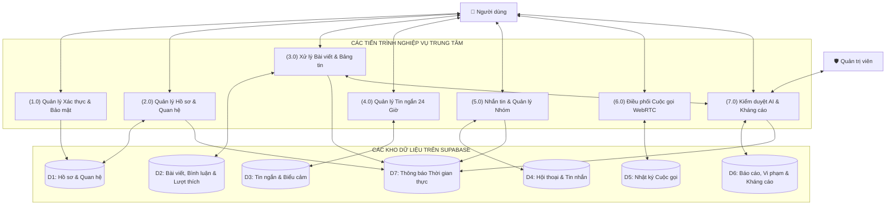

#### 🎯 Mục đích & Ý nghĩa Sơ đồ DFD Mức 1
Sơ đồ phân rã tiến trình toàn diện (0) thành **7 tiến trình nghiệp vụ chức năng độc lập (Processes 1.0 đến 7.0)** và ánh xạ luồng dữ liệu tương tác 2 chiều với **7 kho lưu trữ dữ liệu trung tâm (Data Stores D1 đến D7)** trên nền tảng Supabase PostgreSQL 15.

#### 🔄 Phân tích Chi tiết 7 Tiến trình Nghiệp vụ & Kho Dữ liệu:
1. **Tiến trình (1.0) Quản lý Xác thực & Bảo mật:**
   - *Đầu vào:* Thông tin đăng ký, thông tin đăng nhập (Email / Username / Mật khẩu), mã OTP 6 số TOTP, yêu cầu thu hồi phiên từ xa.
   - *Xử lý:* Kiểm tra hợp lệ dữ liệu, gọi RPC phân giải Username, xác thực chữ ký mật khẩu, nâng cấp cấp độ đảm bảo `aal1` -> `aal2`.
   - *Đầu ra & Kho dữ liệu:* Tạo bản ghi người dùng mới và cập nhật trạng thái hoạt động vào **Kho D1 (Hồ sơ & Quan hệ)**.
2. **Tiến trình (2.0) Quản lý Hồ sơ & Quan hệ:**
   - *Đầu vào:* Dữ liệu chỉnh sửa hồ sơ (Avatar, Ảnh bìa, Tiểu sử, Nhạc nền), yêu cầu theo dõi (`follows`), lời mời kết bạn (`friend_requests`), và danh sách chặn (`blocked_users`).
   - *Xử lý:* Cập nhật thông tin cá nhân, tính toán số liệu thống kê (Followers, Following, Friends), đối soát quan hệ bạn bè 2 chiều.
   - *Đầu ra & Kho dữ liệu:* Lưu trữ dữ liệu quan hệ vào **Kho D1**; đồng thời tự động phát sinh thông báo kết bạn/theo dõi vào **Kho D7 (Thông báo Thời gian thực)**.
3. **Tiến trình (3.0) Xử lý Bài viết & Bảng tin:**
   - *Đầu vào:* Nội dung bài viết đa phương tiện, tọa độ vị trí, lượt thích, nội dung bình luận phân cấp, yêu cầu chuyển vào thùng rác.
   - *Xử lý:* Tối ưu media, điều phối qua Tiến trình (7.0) để kiểm duyệt trước khi xuất bản. Chạy Thuật toán Gợi ý Bảng tin v2 dựa trên 5 trọng số để phân phối bài viết cá nhân hóa cho từng người dùng.
   - *Đầu ra & Kho dữ liệu:* Đọc/ghi bài viết, bình luận, lượt thích trong **Kho D2 (Bài viết, Bình luận & Lượt thích)**; kích hoạt thông báo tương tác mới vào **Kho D7**.
4. **Tiến trình (4.0) Quản lý Tin ngắn 24 Giờ:**
   - *Đầu vào:* Ảnh/video Story 9:16, nhạc nền, văn bản trang trí, lượt xem Story, biểu cảm emoji hạt bay.
   - *Xử lý:* Thiết lập thời hạn tự động `expires_at = created_at + 24 hours`. Lọc tin đang hoạt động cho Bảng tin, lưu vĩnh viễn cho Tab Kho lưu trữ (Archive Grid) trên trang cá nhân.
   - *Đầu ra & Kho dữ liệu:* Đọc/ghi danh sách tin ngắn, lượt xem và biểu cảm tương tác vào **Kho D3 (Tin ngắn & Biểu cảm)**.
5. **Tiến trình (5.0) Nhắn tin & Quản lý Nhóm:**
   - *Đầu vào:* Tin nhắn văn bản, tệp âm thanh ghi âm, ảnh kèm chú thích, trích dẫn, phản ứng emoji, tín hiệu gõ phím, thao tác quản trị nhóm (thêm/xóa thành viên, phân quyền, giải tán nhóm), và cấu hình ẩn đoạn chat mã PIN 6 số.
   - *Xử lý:* Ghi nhận tin nhắn mới, tự động cập nhật tin nhắn cuối cùng của hội thoại, tăng biến đếm tin chưa đọc, xử lý trạng thái đã xem (Read Receipts), kiểm tra quyền Trưởng nhóm/Phó nhóm qua RPC.
   - *Đầu ra & Kho dữ liệu:* Đọc/ghi dữ liệu vào **Kho D4 (Hội thoại & Tin nhắn)**; phát thông báo tin nhắn mới vào **Kho D7**.
6. **Tiến trình (6.0) Điều phối Cuộc gọi WebRTC:**
   - *Đầu vào:* Lệnh bấm gọi Thoại/Video, phản hồi Chấp nhận/Từ chối cuộc gọi, tín hiệu ngắt kết nối.
   - *Xử lý:* Phát tín hiệu báo hiệu (Signaling), tạo mã phòng họp ngẫu nhiên, cấp mã JWT Access Token tham gia phòng LiveKit Cloud, tính toán tổng thời lượng đàm thoại khi kết thúc.
   - *Đầu ra & Kho dữ liệu:* Lưu trữ lịch sử cuộc gọi, trạng thái (thành công / nhỡ / từ chối) và thời lượng vào **Kho D5 (Nhật ký Cuộc gọi)**; chèn tin nhắn nhật ký vào Kho D4.
7. **Tiến trình (7.0) Kiểm duyệt AI & Kháng cáo:**
   - *Đầu vào:* Cờ báo cáo vi phạm từ người dùng, nội dung bài viết mới cần quét kiểm duyệt tự động, quyết định xử phạt của Quản trị viên, và đơn giải trình kháng cáo từ tác giả.
   - *Xử lý:* Gửi nội dung sang Gemini AI chấm điểm rủi ro Risk Score (Pipeline 6 mức), phân loại mức độ nghiêm trọng, áp dụng điểm phạt (Strike), tạm khóa tài khoản hoặc khôi phục nội dung sau khi duyệt kháng cáo.
   - *Đầu ra & Kho dữ liệu:* Đọc/ghi các bản ghi báo cáo, quyết định xử phạt và đơn kháng cáo vào **Kho D6 (Báo cáo, Vi phạm & Kháng cáo)**; gửi thông báo kỷ luật hoặc kết quả kháng cáo vào **Kho D7**.

#### ⚙️ Cơ chế Vận hành Dữ liệu & Tính Toàn vẹn:
- **Kiến trúc Hướng Sự kiện (Event-Driven Data Pipeline):** Các kho dữ liệu D1 đến D6 khi có thay đổi trạng thái (Insert/Update) sẽ tự động kích hoạt Database Triggers để cập nhật dữ liệu liên quan và phát sinh thông báo tức thời vào Kho D7.
- **Tối ưu Hóa Truy vấn:** Các bảng dữ liệu đều được đánh chỉ mục chuyên biệt (B-Tree cho khóa ngoại/thời gian, GIN cho tìm kiếm toàn văn Full-Text và HNSW/IVFFlat cho vector embeddings), đảm bảo các tiến trình đọc/ghi hoạt động trơn tru với hàng triệu bản ghi.

---

### 3.3 Sơ đồ DFD Mức 2.1: Luồng Đăng bài, Xử lý Đa phương tiện & Kiểm duyệt AI

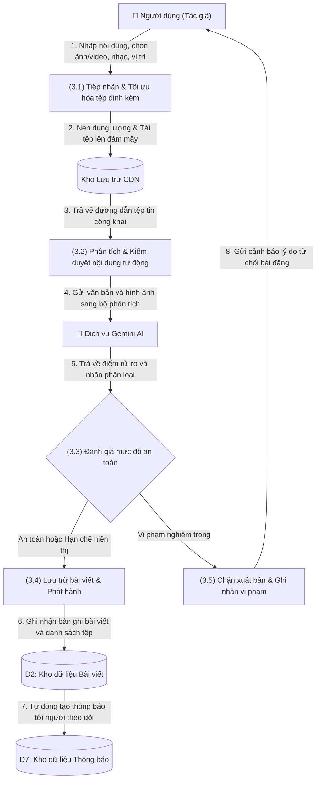

#### 🎯 Mục đích & Ý nghĩa Sơ đồ DFD Mức 2.1
Sơ đồ mô tả chi tiết đường đi của dữ liệu trong tiến trình con (3.0) — từ lúc người dùng bắt đầu nhập bài viết, nén và tải tệp media lên kho lưu trữ đám mây, kích hoạt mô hình Gemini AI phân tích an toàn, đến lúc rẽ nhánh phê duyệt hoặc chặn xuất bản và đẩy thông báo thời gian thực đến người theo dõi.

#### 🔄 Phân tích Chi tiết Các Luồng Dữ liệu (1 -> 8):
- **Luồng 1 (Tác giả ➔ Tiến trình 3.1):** Người dùng nhập nội dung văn bản, đính kèm tối đa 10 ảnh hoặc video, chọn vị trí GPS và gắn nhạc nền.
- **Luồng 2 & 3 (Tiến trình 3.1 ➔ Kho CDN ➔ Tiến trình 3.2):** Hình ảnh được nén dung lượng ở Client rồi tải lên Supabase Storage bucket `post_media`. CDN cấp phát đường dẫn truy cập công khai (Public URL) trả về cho tiến trình kiểm duyệt.
- **Luồng 4 & 5 (Tiến trình 3.2 ➔ Gemini AI ➔ Tiến trình 3.3):** Hệ thống gửi chuỗi văn bản và ảnh dạng Base64/URL sang Google Gemini 1.5 Flash. Mô hình AI quét văn bản độc hại, bạo lực, ngôn từ thù địch và nhận diện vật thể nhạy cảm, trả về chỉ số rủi ro Risk Score (0.0 đến 1.0) và nhãn an toàn.
- **Luồng rẽ nhánh Quyết định (Tiến trình 3.3):**
  - *Nếu an toàn hoặc nhạy cảm nhẹ (Risk Score < 0.8):* Chuyển sang Tiến trình (3.4). Nếu thuộc mức cảnh báo (0.2 - 0.5), bài viết được đánh dấu cờ che mờ (`is_blurred = true`).
  - *Nếu vi phạm nghiêm trọng (Risk Score ≥ 0.8):* Chuyển sang Tiến trình (3.5).
- **Luồng 6 (Tiến trình 3.4 ➔ Kho D2):** Ghi nhận bản ghi bài viết mới vào bảng `posts` và danh sách liên kết tệp vào bảng `post_media`.
- **Luồng 7 (Kho D2 ➔ Kho D7):** Database Trigger trên PostgreSQL phát hiện bản ghi bài viết mới được thêm, tự động tạo các bản ghi thông báo mới trong bảng `notifications` tương ứng với toàn bộ danh sách bạn bè và người theo dõi của tác giả.
- **Luồng 8 (Tiến trình 3.5 ➔ Tác giả):** Chặn lưu bản ghi, từ chối xuất bản bài viết và gửi cảnh báo trực tiếp về màn hình của tác giả kèm lý do vi phạm tiêu chuẩn cộng đồng.

#### ⚙️ Cơ chế Kỹ thuật & Ràng buộc:
Quá trình phân tích AI được xử lý bất đồng bộ thông qua Supabase Edge Functions (`moderate-content`), đảm bảo giao diện Client không bị đơ giật. Ràng buộc toàn vẹn cơ sở dữ liệu CASCADE đảm bảo nếu bài viết bị xóa vĩnh viễn, toàn bộ liên kết media trong `post_media` cũng tự động được dọn dẹp.

---

### 3.4 Sơ đồ DFD Mức 2.2: Luồng Nhắn tin Thời gian thực & Xác nhận Đã xem

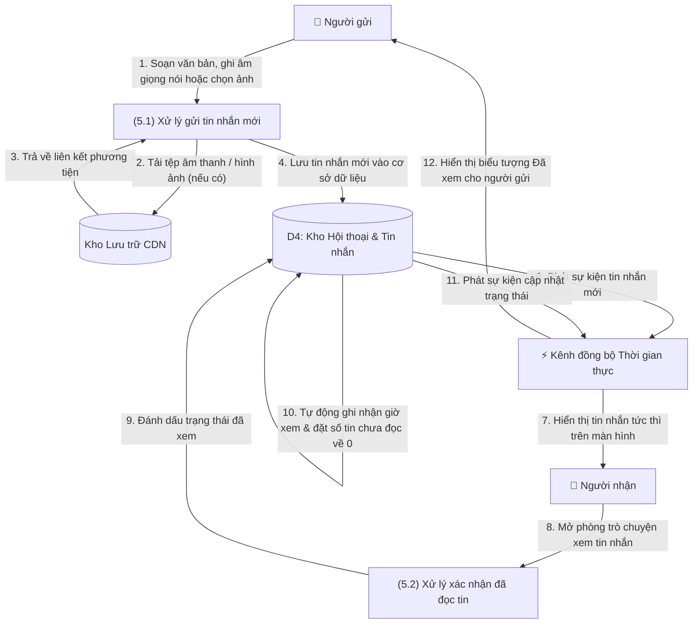

#### 🎯 Mục đích & Ý nghĩa Sơ đồ DFD Mức 2.2
Sơ đồ mô tả quy trình lưu chuyển dữ liệu khép kín tốc độ cao của tiến trình con (5.0): từ khi Người gửi soạn và gửi tin nhắn, hệ thống lưu trữ đồng bộ, phát sự kiện WebSocket đẩy tin nhắn đến Người nhận, cho đến khi Người nhận mở phòng chat và phản hồi tín hiệu "Đã xem" (Read Receipts) trở lại cho Người gửi.

#### 🔄 Phân tích Chi tiết Các Luồng Dữ liệu (1 -> 12):
- **Luồng 1, 2, 3 (Người gửi ➔ Tiến trình 5.1 ➔ Kho CDN):** Người gửi nhập văn bản, ghi âm giọng nói hoặc chọn ảnh. Nếu có tệp đa phương tiện, ứng dụng tải lên kho lưu trữ đám mây `chat_media` và nhận lại URL tệp đính kèm.
- **Luồng 4 (Tiến trình 5.1 ➔ Kho D4):** Bản ghi tin nhắn mới được chèn vào bảng `messages` với trạng thái ban đầu `is_seen = false`.
- **Luồng 5 (Cập nhật Hội thoại Nội bộ Kho D4):** Database Trigger `update_last_message` tự động ghi nhận nội dung tóm tắt và thời gian của tin nhắn cuối vào bảng `conversations`, đồng thời tăng biến đếm số tin chưa đọc (`unread_count`) của người nhận lên 1 đơn vị.
- **Luồng 6 & 7 (Kho D4 ➔ Kênh Realtime ➔ Người nhận):** Cơ chế Change Data Capture (CDC) của PostgreSQL phát hiện bản ghi mới trên bảng `messages` và broadcast ngay lập tức payload tin nhắn qua WebSocket Channel đến thiết bị Người nhận trong vòng dưới 100ms.
- **Luồng 8 (Người nhận ➔ Tiến trình 5.2):** Người nhận mở phòng trò chuyện, kích hoạt tiến trình xử lý xác nhận đã đọc.
- **Luồng 9 & 10 (Tiến trình 5.2 ➔ Kho D4):** Lệnh cập nhật thực thi trên bảng `messages`: gán `is_seen = true` và `seen_at = now()`. Đồng thời, biến đếm `unread_count` của người nhận trong bảng `conversations` được đặt lại về 0.
- **Luồng 11 & 12 (Kho D4 ➔ Kênh Realtime ➔ Người gửi):** Sự kiện `UPDATE` được kênh Realtime đẩy ngược về cho thiết bị Người gửi. Giao diện tin nhắn của Người gửi lập tức chuyển đổi biểu tượng thành dấu tích xanh hoặc ảnh đại diện nhỏ báo hiệu đối phương đã đọc tin.

#### ⚙️ Cơ chế Kỹ thuật & Ràng buộc:
Sử dụng kết nối WebSocket thường trực qua Supabase Realtime Channels. Ràng buộc cơ sở dữ liệu `CHECK (participant_1 < participant_2)` bảo đảm mỗi cặp người dùng chỉ có duy nhất một phòng chat 1-1, tránh phân mảnh lịch sử tin nhắn.

---

### 3.5 Sơ đồ DFD Mức 2.3: Luồng Tín hiệu & Đàm thoại Cuộc gọi WebRTC

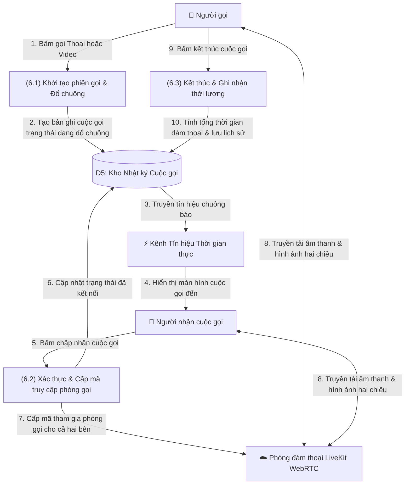

#### 🎯 Mục đích & Ý nghĩa Sơ đồ DFD Mức 2.3
Sơ đồ phân tích sự tách biệt rõ ràng và phối hợp nhịp nhàng giữa **Tầng Báo hiệu (Signaling Layer)** qua Supabase Realtime và **Tầng Đàm thoại Ngang hàng (Media Streaming Layer)** qua máy chủ LiveKit Cloud SFU của tiến trình con (6.0).

#### 🔄 Phân tích Chi tiết Các Luồng Dữ liệu (1 -> 10):
- **Luồng 1 & 2 (Người gọi ➔ Tiến trình 6.1 ➔ Kho D5):** Người gọi bấm biểu tượng gọi Thoại hoặc Video. Tiến trình tạo một bản ghi cuộc gọi mới trong bảng `calls` với trạng thái `calling`, khởi tạo một chuỗi mã phòng họp duy nhất (UUID) và lưu thời điểm bắt đầu `started_at = now()`.
- **Luồng 3 & 4 (Kho D5 ➔ Kênh Tín hiệu Realtime ➔ Người nhận):** Sự kiện tạo cuộc gọi mới được truyền qua kênh WebSocket tín hiệu đến thiết bị Người nhận, kích hoạt giao diện chuông cuộc gọi đến (`IncomingCallOverlay`) kèm nhạc chuông và rung.
- **Luồng 5 & 6 (Người nhận ➔ Tiến trình 6.2 ➔ Kho D5):** Người nhận bấm nút Chấp nhận. Tiến trình cập nhật trạng thái cuộc gọi trong bảng `calls` từ `calling` thành `connected`, đồng thời ghi nhận mốc thời gian bắt đầu đàm thoại `connected_at = now()`.
- **Luồng 7 (Tiến trình 6.2 ➔ LiveKit SFU):** Hệ thống gọi Supabase Edge Function `livekit-token` để cấp Access Token JWT cho cả Người gọi và Người nhận kết nối vào phòng họp LiveKit.
- **Luồng 8 (Đàm thoại Hai chiều qua LiveKit SFU):** Cả hai bên trao đổi trực tiếp các luồng dữ liệu âm thanh (mã hóa Opus) và hình ảnh (mã hóa VP8/H.264) thông qua LiveKit Cloud SFU với độ trễ thấp dưới 150ms và khả năng tự động thích ứng với chất lượng mạng.
- **Luồng 9 & 10 (Người gọi/Người nhận ➔ Tiến trình 6.3 ➔ Kho D5):** Khi một trong hai bên bấm nút Cúp máy, phòng họp trên LiveKit được đóng lại. Tiến trình tính toán tổng thời lượng đàm thoại thực tế (`duration_sec = ended_at - connected_at`), cập nhật trạng thái `ended` vào Kho D5 và chèn một tin nhắn lịch sử cuộc gọi vào bảng `messages`.

#### ⚙️ Cơ chế Kỹ thuật & Ràng buộc:
Nếu người nhận không phản hồi sau 60 giây đổ chuông, hệ thống tự động kích hoạt tiến trình hết hạn (Timeout), cập nhật trạng thái thành `missed` (cuộc gọi nhỡ), hủy phòng LiveKit và gửi thông báo cuộc gọi nhỡ đến người nhận.

---

### 3.6 Sơ đồ DFD Mức 2.4: Luồng Báo cáo Vi phạm, Đánh giá Rủi ro & Kháng cáo

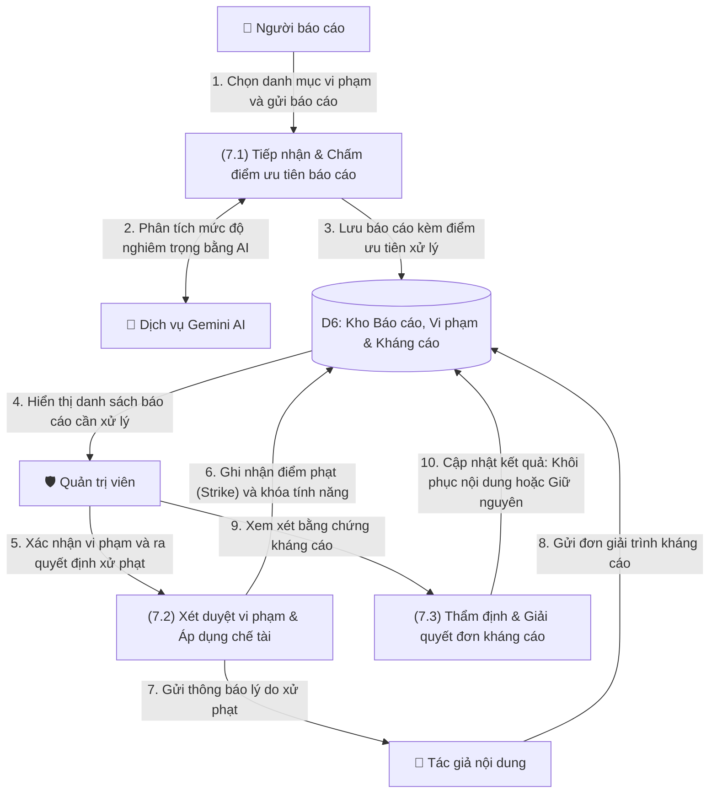

#### 🎯 Mục đích & Ý nghĩa Sơ đồ DFD Mức 2.4
Sơ đồ mô tả quy trình xử lý khép kín các tranh chấp và nội dung vi phạm của tiến trình con (7.0): từ lúc nhận diện báo cáo vi phạm, qua khâu phân loại ưu tiên tự động bằng AI, sự thẩm định công bằng của Quản trị viên, đến cơ chế bảo vệ quyền lợi người dùng qua nộp đơn giải trình và giải quyết kháng cáo.

#### 🔄 Phân tích Chi tiết Các Luồng Dữ liệu (1 -> 10):
- **Luồng 1 (Người báo cáo ➔ Tiến trình 7.1):** Người dùng phát hiện nội dung độc hại (khiêu dâm, bạo lực, lừa đảo, quấy rối) và gửi biểu mẫu báo cáo kèm lý do cụ thể.
- **Luồng 2 & 3 (Tiến trình 7.1 ➔ Gemini AI ➔ Kho D6):** Tiến trình gửi nội dung bị báo cáo sang Google Gemini AI để quét và chấm điểm mức độ nghiêm trọng. Kết hợp giữa lý do báo cáo và điểm AI, hệ thống tính toán Chỉ số Ưu tiên (Priority Score), sau đó lưu bản ghi vào bảng `reports` thuộc Kho D6.
- **Luồng 4 (Kho D6 ➔ Quản trị viên):** Danh sách các vụ việc cần xử lý được sắp xếp theo mức độ ưu tiên (nội dung nguy hiểm, bạo lực được đẩy lên đầu) hiển thị trực tiếp trên giao diện Admin Moderation Dashboard.
- **Luồng 5, 6, 7 (Quản trị viên ➔ Tiến trình 7.2 ➔ Kho D6 & Tác giả):** Quản trị viên xem xét nội dung gốc và ra quyết định. Nếu xác nhận vi phạm: tiến trình cập nhật trạng thái bài viết thành `removed`, ghi nhận 1 bản ghi vi phạm mới vào bảng `user_violations`, tăng số gậy phạt (Strike 1, 2 hoặc 3), đồng thời gửi thông báo kỷ luật chi tiết về thiết bị của Tác giả (Luồng 7).
- **Luồng 8 (Tác giả ➔ Kho D6):** Nếu cho rằng nội dung của mình không vi phạm, Tác giả viết đơn giải trình kèm hình ảnh/bằng chứng chứng minh gửi vào bảng `appeals` trong Kho D6.
- **Luồng 9 & 10 (Quản trị viên ➔ Tiến trình 7.3 ➔ Kho D6):** Quản trị viên mở hồ sơ kháng cáo, đối chiếu bằng chứng giải trình với quy chuẩn cộng đồng. Nếu chấp thuận kháng cáo: hệ thống khôi phục lại trạng thái bài viết (`moderation_status = 'published'`), xóa điểm phạt của tác giả và cập nhật trạng thái đơn thành `approved`. Nếu từ chối: trạng thái đơn chuyển thành `rejected` và giữ nguyên án phạt.

#### ⚙️ Cơ chế Kỹ thuật & Ràng buộc:
Ràng buộc cơ sở dữ liệu `UNIQUE(violation_id)` đảm bảo mỗi án phạt vi phạm chỉ được phép gửi duy nhất 1 đơn kháng cáo giải trình, tránh tình trạng spam đơn gây quá tải cho bộ phận quản trị. Quyết định thẩm định của Quản trị viên tại Bước 10 là phán quyết cuối cùng của hệ thống.

---

## 4. SƠ ĐỒ HOẠT ĐỘNG (ACTIVITY DIAGRAMS)

### 4.1 Hoạt động: Đăng ký, Đăng nhập & Xác thực Bảo mật Hai lớp (2FA)


---

### 4.2 Hoạt động: Soạn thảo Bài viết, Gợi ý Caption AI & Kiểm duyệt Xuất bản

```mermaid
flowchart TD
    Start(["Bắt đầu tạo bài viết"]) --> PickMedia["Chọn ảnh / video từ thiết bị hoặc chụp mới"]
    PickMedia --> UseAI{"Sử dụng gợi ý lời dẫn bằng AI?"}

    UseAI -- "Có" --> AnalyzeImage["Gửi ảnh lên dịch vụ Gemini AI phân tích bối cảnh"]
    AnalyzeImage --> ShowOptions["Hiển thị 3 gợi ý lời dẫn kèm Hashtag thịnh hành"]
    ShowOptions --> EditCaption["Chọn và chỉnh sửa lại nội dung bài viết"]
    UseAI -- "Không" --> EditCaption

    EditCaption --> AddMetadata["Tùy chọn: Gắn thẻ bạn bè, Vị trí địa lý, Nhạc nền"]
    AddMetadata --> PreviewPost["Mở màn hình xem trước & Chọn quyền riêng tư"]
    PreviewPost --> ClickPublish["Nhấn nút Đăng bài"]
    ClickPublish --> CompressUpload["Nén tối ưu dung lượng & Tải tệp lên đám mây"]
    CompressUpload --> RunModeration["Quét kiểm duyệt tự động qua đường ống AI"]
    RunModeration --> CheckModResult{"Kết quả đánh giá an toàn?"}

    CheckModResult -- "Vi phạm nghiêm trọng" --> BlockPublish["Chặn đăng bài & Hiển thị cảnh báo tiêu chuẩn cộng đồng"]
    BlockPublish --> EndCancel(["Hủy xuất bản"])

    CheckModResult -- "Nội dung nhạy cảm" --> SaveRestricted["Lưu bài viết kèm lớp phủ cảnh báo che mờ"]
    CheckModResult -- "Nội dung an toàn" --> SaveNormal["Lưu bài viết hiển thị công khai bình thường"]

    SaveRestricted --> NotifyFollowers["Tự động gửi thông báo tới người theo dõi"]
    SaveNormal --> NotifyFollowers
    NotifyFollowers --> EndSuccess(["Hoàn tất & Hiển thị trên Bảng tin"])
```

---

### 4.3 Hoạt động: Thiết lập & Đàm thoại Cuộc gọi Thoại / Video WebRTC

```mermaid
flowchart TD
    Start(["Người gọi nhấn nút Gọi"]) --> InitCall["Khởi tạo mã phòng duy nhất & Lưu trạng thái Đang đổ chuông"]
    InitCall --> PlayDialTone["Mở màn hình chờ cuộc gọi đi & Phát âm báo chờ"]
    InitCall --> SendSignal["Truyền tín hiệu cuộc gọi tức thời tới Người nhận"]
    SendSignal --> ShowIncoming["Người nhận hiển thị màn hình cuộc gọi đến & Đổ nhạc chuông"]

    ShowIncoming --> WaitResponse{"Phản hồi trong vòng 60 giây?"}
    WaitResponse -- "Quá 60 giây không bắt máy" --> MarkMissed["Cập nhật trạng thái Cuộc gọi nhỡ"]
    WaitResponse -- "Người gọi chủ động hủy" --> MarkCancelled["Cập nhật trạng thái Đã hủy"]
    WaitResponse -- "Người nhận bấm Từ chối" --> MarkDeclined["Cập nhật trạng thái Từ chối"]

    MarkMissed --> LogChatEnd["Đóng màn hình & Ghi nhận lịch sử vào phòng trò chuyện"]
    MarkCancelled --> LogChatEnd
    MarkDeclined --> LogChatEnd
    LogChatEnd --> EndCall(["Kết thúc"])

    WaitResponse -- "Người nhận bấm Nhấc máy" --> IssueTokens["Cấp mã truy cập phòng LiveKit cho cả hai bên"]
    IssueTokens --> ConnectWebRTC["Kết nối vào phòng đàm thoại & Truyền luồng âm thanh / hình ảnh"]
    ConnectWebRTC --> ActiveControls["Đàm thoại trực tiếp (Hỗ trợ tắt mic, tắt/đổi camera, bật loa ngoài)"]
    ActiveControls --> Hangup["Một trong hai bên nhấn nút Kết thúc cuộc gọi"]
    Hangup --> CalcDuration["Ngắt kết nối phòng & Tính tổng thời lượng cuộc gọi"]
    CalcDuration --> LogChatEnd
```

---

### 4.4 Hoạt động: Đăng Tin ngắn 24h, Thả Biểu cảm Hạt bay & Lưu trữ Trang cá nhân

```mermaid
flowchart TD
    Start(["Bắt đầu tạo Tin ngắn"]) --> SelectStoryMedia["Chọn ảnh hoặc video tỷ lệ dọc 9:16"]
    SelectStoryMedia --> DecorateStory["Chèn văn bản, nhãn dán và chọn nhạc nền"]
    DecorateStory --> PublishStory["Tải tệp lên đám mây & Thiết lập thời hạn 24 giờ"]
    PublishStory --> ShowOnFeed["Hiển thị ảnh đại diện viền sáng trên đầu Bảng tin"]

    ShowOnFeed --> ViewerOpens["Bạn bè nhấn vào xem toàn màn hình (Trình chiếu 25 giây)"]
    ViewerOpens --> SaveViewLog["Tự động ghi nhận vào danh sách người đã xem"]
    SaveViewLog --> CheckReaction{"Người xem chạm vào biểu cảm?"}

    CheckReaction -- "Có" --> TriggerParticles["Kích hoạt hiệu ứng chùm hạt biểu cảm bay lên & Rung phản hồi"]
    TriggerParticles --> SaveReaction["Lưu biểu cảm của người xem vào cơ sở dữ liệu"]
    CheckReaction -- "Không" --> CheckExpiry

    SaveReaction --> CheckExpiry{"Đã qua 24 giờ kể từ lúc đăng?"}
    CheckExpiry -- "Chưa qua 24 giờ" --> KeepOnFeed["Tiếp tục hiển thị trên thanh Tin ngắn ở Bảng tin"]
    CheckExpiry -- "Đã qua 24 giờ" --> HideFromFeed["Tự động ẩn khỏi Bảng tin chính"]
    HideFromFeed --> MoveToArchive["Chuyển vào mục Tin nổi bật & Kho lưu trữ trên Trang cá nhân"]
    MoveToArchive --> EndStory(["Lưu giữ kỷ niệm lâu dài"])
```

---

### 4.5 Hoạt động: Kiểm duyệt Nội dung Đa tầng, Xử phạt & Giải quyết Kháng cáo

```mermaid
flowchart TD
    Start(["Tiếp nhận nội dung mới hoặc Báo cáo vi phạm"]) --> Step1["Bước 1: Quét bộ lọc từ khóa cấm và mẫu câu vi phạm"]
    Step1 --> IsBlacklisted{"Vi phạm từ khóa nghiêm trọng?"}
    IsBlacklisted -- "Có" --> ActionRemove["Gỡ bỏ nội dung ngay lập tức"]
    IsBlacklisted -- "Không" --> Step2["Bước 2: Phân tích ngữ cảnh văn bản & hình ảnh bằng Gemini AI"]

    Step2 --> CalcRisk["Chấm điểm rủi ro vi phạm (Từ 0.0 đến 1.0)"]
    CalcRisk --> ClassifyRisk{"Phân loại theo ngưỡng rủi ro?"}

    ClassifyRisk -- "Dưới 0.20" --> ActionAllow["Cho phép hiển thị bình thường"] --> EndSafe(["Hoàn tất"])
    ClassifyRisk -- "Từ 0.20 đến 0.50" --> ActionWarn["Gửi thông báo nhắc nhở nhẹ tới tác giả"] --> EndSafe
    ClassifyRisk -- "Từ 0.50 đến 0.80" --> ActionBlur["Áp dụng lớp che mờ cảnh báo nội dung nhạy cảm"] --> EndSafe
    ClassifyRisk -- "Từ 0.80 trở lên" --> ActionRemove

    ActionRemove --> RecordStrike["Cộng 1 điểm phạt (Strike) vào hồ sơ vi phạm của người dùng"]
    RecordStrike --> ApplyRestriction["Áp dụng chế tài tương ứng (Hạn chế đăng bài, nhắn tin hoặc khóa tài khoản)"]
    ApplyRestriction --> SendNotice["Gửi thông báo chi tiết nguyên nhân xử phạt cho tác giả"]
    SendNotice --> WantAppeal{"Tác giả gửi đơn kháng cáo?"}

    WantAppeal -- "Không" --> EndPenalty(["Giữ nguyên quyết định xử phạt"])
    WantAppeal -- "Có" --> AdminReview["Quản trị viên thẩm định đơn giải trình và bằng chứng"]
    AdminReview --> AppealResult{"Kết quả xét duyệt?"}
    AppealResult -- "Chấp thuận" --> RestoreContent["Gỡ bỏ điểm phạt & Khôi phục lại nội dung"] --> EndSafe
    AppealResult -- "Bác bỏ" --> NotifyReject["Thông báo từ chối kháng cáo & Giữ nguyên chế tài"] --> EndPenalty
```

---

### 4.6 Hoạt động: Thuật toán Xếp hạng Bảng tin Cá nhân hóa (Recommendation v2)

```mermaid
flowchart TD
    Start(["Người dùng mở hoặc làm mới Bảng tin"]) --> FetchPool["Tập hợp các bài viết công khai và bài viết từ bạn bè gần nhất"]
    FetchPool --> ExcludeBlocked["Loại bỏ hoàn toàn bài viết từ các tài khoản đã chặn hai chiều"]
    ExcludeBlocked --> CalcScores["Tính điểm xếp hạng cho từng bài viết theo 5 tiêu chí"]

    CalcScores --> Factor1["1. Điểm kết nối: Bạn bè (+32), Đang theo dõi (+24), Khám phá (+6)"]
    Factor1 --> Factor2["2. Độ thân thiết tác giả: Tần suất thích, bình luận trong 90 ngày qua"]
    Factor2 --> Factor3["3. Độ khớp sở thích: Tương đồng chủ đề và thẻ Hashtag (+14)"]
    Factor3 --> Factor4["4. Chất lượng tương tác: Tính theo hàm logarit lượt thích và bình luận"]
    Factor4 --> Factor5["5. Độ tươi mới: Ưu tiên bài mới đăng và giảm dần theo thời gian"]

    Factor5 --> SortPosts["Sắp xếp danh sách bài viết theo tổng điểm từ cao xuống thấp"]
    SortPosts --> InsertSuggestions["Đan xen khung gợi ý Những người bạn có thể biết"]
    InsertSuggestions --> DisplayFeed(["Hiển thị danh sách bài viết lên giao diện người dùng"])
```

---

## 5. SƠ ĐỒ THỰC THỂ LIÊN KẾT (ENTITY RELATIONSHIP DIAGRAM - ERD)

### 5.1 Biểu đồ ERD Tổng thể Cơ sở dữ liệu

```mermaid
erDiagram
    PROFILES ||--o{ POSTS : "đăng bài"
    PROFILES ||--o{ LIKES : "thích bài"
    PROFILES ||--o{ COMMENTS : "bình luận"
    PROFILES ||--o{ COMMENT_LIKES : "thích bình luận"
    PROFILES ||--o{ FOLLOWS : "theo dõi"
    PROFILES ||--o{ FRIEND_REQUESTS : "kết bạn"
    PROFILES ||--o{ STORIES : "đăng story"
    PROFILES ||--o{ STORY_VIEWS : "xem story"
    PROFILES ||--o{ STORY_REACTIONS : "thả biểu cảm"
    PROFILES ||--o{ GROUP_MEMBERS : "tham gia nhóm"
    PROFILES ||--o{ MESSAGES : "gửi tin nhắn"
    PROFILES ||--o{ PINNED_MESSAGES : "ghim tin"
    PROFILES ||--o{ CONVERSATION_SETTINGS : "cài đặt hội thoại"
    PROFILES ||--o{ CALLS : "tham gia cuộc gọi"
    PROFILES ||--o{ NOTIFICATIONS : "nhận thông báo"
    PROFILES ||--o{ REPORTS : "gửi báo cáo"
    PROFILES ||--o{ USER_VIOLATIONS : "vi phạm"
    PROFILES ||--o{ APPEALS : "kháng cáo"

    POSTS ||--o{ POST_MEDIA : "đính kèm media"
    POSTS ||--o{ LIKES : "có lượt thích"
    POSTS ||--o{ COMMENTS : "có bình luận"
    POSTS ||--o{ NOTIFICATIONS : "tạo thông báo"

    COMMENTS ||--o{ COMMENTS : "trả lời bình luận"
    COMMENTS ||--o{ COMMENT_LIKES : "có lượt thích"

    STORIES ||--o{ STORY_VIEWS : "có lượt xem"
    STORIES ||--o{ STORY_REACTIONS : "có biểu cảm"

    CONVERSATIONS ||--o{ GROUP_MEMBERS : "có thành viên"
    CONVERSATIONS ||--o{ MESSAGES : "chứa tin nhắn"
    CONVERSATIONS ||--o{ PINNED_MESSAGES : "chứa tin ghim"
    CONVERSATIONS ||--o{ CONVERSATION_SETTINGS : "có cài đặt"
    CONVERSATIONS ||--o{ CALLS : "có cuộc gọi"

    MESSAGES ||--o{ MESSAGES : "trích dẫn trả lời"
    MESSAGES ||--o{ PINNED_MESSAGES : "được ghim"

    USER_VIOLATIONS ||--o| APPEALS : "được kháng cáo"

    PROFILES {
        uuid id PK
        text email
        text username UK
        text full_name
        text bio
        text avatar_url
        text cover_url
        boolean is_private
        timestamptz created_at
    }

    POSTS {
        uuid id PK
        uuid user_id FK
        text caption
        int likes_count
        int comments_count
        text privacy
        text moderation_status
        boolean is_ai_generated
        timestamptz deleted_at
        timestamptz created_at
    }

    POST_MEDIA {
        uuid id PK
        uuid post_id FK
        text url
        text type
        int order_index
        timestamptz created_at
    }

    LIKES {
        uuid id PK
        uuid post_id FK
        uuid user_id FK
        timestamptz created_at
    }

    COMMENTS {
        uuid id PK
        uuid post_id FK
        uuid user_id FK
        uuid parent_id FK
        text content
        int likes_count
        timestamptz created_at
    }

    COMMENT_LIKES {
        uuid id PK
        uuid comment_id FK
        uuid user_id FK
        timestamptz created_at
    }

    FOLLOWS {
        uuid id PK
        uuid follower_id FK
        uuid following_id FK
        timestamptz created_at
    }

    FRIEND_REQUESTS {
        uuid id PK
        uuid sender_id FK
        uuid receiver_id FK
        enum status
        timestamptz created_at
        timestamptz updated_at
    }

    STORIES {
        uuid id PK
        uuid user_id FK
        text media_url
        text media_type
        text caption
        jsonb music_track
        timestamptz expires_at
        timestamptz created_at
    }

    STORY_VIEWS {
        uuid id PK
        uuid story_id FK
        uuid user_id FK
        timestamptz viewed_at
    }

    STORY_REACTIONS {
        uuid id PK
        uuid story_id FK
        uuid user_id FK
        text reaction
        timestamptz created_at
    }

    CONVERSATIONS {
        uuid id PK
        text type
        text name
        text avatar_url
        uuid participant_1 FK
        uuid participant_2 FK
        text last_message
        timestamptz last_message_at
        uuid last_message_id FK
        int p1_unread_count
        int p2_unread_count
        timestamptz created_at
    }

    GROUP_MEMBERS {
        uuid id PK
        uuid conversation_id FK
        uuid user_id FK
        text role
        timestamptz joined_at
    }

    MESSAGES {
        uuid id PK
        uuid conversation_id FK
        uuid sender_id FK
        text content
        text media_url
        text message_type
        boolean is_seen
        timestamptz seen_at
        boolean is_recalled
        uuid reply_to_message_id FK
        timestamptz created_at
    }

    PINNED_MESSAGES {
        uuid id PK
        uuid conversation_id FK
        uuid message_id FK
        uuid pinned_by FK
        timestamptz pinned_at
    }

    CONVERSATION_SETTINGS {
        uuid user_id PK "FK"
        uuid conversation_id PK "FK"
        boolean is_pinned
        boolean is_hidden
        timestamptz pinned_at
    }

    CALLS {
        uuid id PK
        uuid conversation_id FK
        uuid caller_id FK
        uuid callee_id FK
        enum type
        enum status
        text room_name
        timestamptz started_at
        timestamptz connected_at
        timestamptz ended_at
        int duration_sec
    }

    NOTIFICATIONS {
        uuid id PK
        uuid receiver_id FK
        uuid sender_id FK
        enum type
        uuid post_id FK
        uuid comment_id FK
        text content
        boolean is_read
        timestamptz created_at
    }

    REPORTS {
        uuid id PK
        uuid reporter_id FK
        text target_type
        uuid target_id
        text reason
        text status
        timestamptz created_at
    }

    USER_VIOLATIONS {
        uuid id PK
        uuid user_id FK
        text violation_type
        int strike_count
        text penalty_action
        timestamptz expires_at
        timestamptz created_at
    }

    APPEALS {
        uuid id PK
        uuid violation_id FK
        uuid user_id FK
        text reason
        text status
        timestamptz created_at
    }
```

---

### 5.2 Bảng Đặc tả Quan hệ & Bản số (Cardinality)

| Thực thể nguồn | Thực thể đích | Bản số | Mô tả mối quan hệ nghiệp vụ |
|:---|:---|:---:|:---|
| `PROFILES` | `POSTS` | **1 : N** | Một người dùng có thể đăng nhiều bài viết; mỗi bài viết thuộc về một tác giả duy nhất. |
| `POSTS` | `POST_MEDIA` | **1 : N** | Một bài viết chứa một hoặc nhiều tệp ảnh/video được sắp xếp theo thứ tự hiển thị. |
| `POSTS` | `LIKES` | **1 : N** | Một bài viết có nhiều lượt thích; mỗi người dùng chỉ thích tối đa 1 lần trên mỗi bài. |
| `POSTS` | `COMMENTS` | **1 : N** | Một bài viết có nhiều bình luận; các bình luận trả lời tham chiếu về bình luận gốc. |
| `COMMENTS` | `COMMENT_LIKES`| **1 : N** | Mỗi bình luận có thể nhận nhiều lượt thích từ các người dùng khác nhau. |
| `PROFILES` | `FOLLOWS` | **N : M** | Quan hệ theo dõi một chiều giữa người theo dõi và người được theo dõi. |
| `PROFILES` | `FRIEND_REQUESTS`| **N : M** | Quan hệ kết bạn hai chiều kèm trạng thái (Đang chờ, Đã chấp nhận, Đã từ chối, Đã hủy). |
| `PROFILES` | `STORIES` | **1 : N** | Một người dùng có thể đăng nhiều tin ngắn 24 giờ. |
| `STORIES` | `STORY_VIEWS` | **1 : N** | Lưu danh sách người dùng đã xem tin ngắn và thời điểm xem. |
| `STORIES` | `STORY_REACTIONS`| **1 : N** | Lưu các biểu cảm mà người xem đã thả vào tin ngắn. |
| `CONVERSATIONS` | `GROUP_MEMBERS`| **1 : N** | Phòng trò chuyện nhóm bao gồm nhiều thành viên với phân cấp vai trò: Trưởng nhóm (`owner`), Phó nhóm (`admin`), Thành viên thường (`member`). |
| `CONVERSATIONS` | `MESSAGES` | **1 : N** | Một cuộc trò chuyện chứa danh sách lịch sử các tin nhắn. |
| `CONVERSATIONS` | `CALLS` | **1 : N** | Một cuộc trò chuyện lưu trữ lịch sử các cuộc gọi thoại và video giữa các thành viên. |
| `PROFILES` | `NOTIFICATIONS`| **1 : N** | Người dùng nhận danh sách các thông báo tương tác theo thời gian thực. |
| `PROFILES` | `REPORTS` | **1 : N** | Người dùng gửi các báo cáo vi phạm tiêu chuẩn cộng đồng. |
| `PROFILES` | `USER_VIOLATIONS`| **1 : N** | Lưu lịch sử các lần vi phạm và điểm phạt (Strike) của tài khoản. |
| `USER_VIOLATIONS` | `APPEALS` | **1 : 1** | Mỗi quyết định xử phạt vi phạm có thể gắn với một đơn kháng cáo từ người dùng. |

---

## 6. MÔ HÌNH QUAN HỆ DỮ LIỆU (RELATIONAL DATA MODEL - 3NF)

### 6.1 Đặc tả Chi tiết 20 Bảng Cơ sở dữ liệu PostgreSQL

Toàn bộ lược đồ cơ sở dữ liệu đạt **Dạng chuẩn 3 (3NF)**: mọi thuộc tính đều nguyên tố, phụ thuộc hoàn toàn vào khóa chính và không có phụ thuộc bắc cầu.

#### 1. Bảng `profiles` (Hồ sơ người dùng)
| Tên cột | Kiểu dữ liệu | Ràng buộc | Mô tả ý nghĩa |
|:---|:---|:---|:---|
| `id` | `uuid` | **PK, FK** | Mã định danh người dùng (liên kết tài khoản xác thực) |
| `email` | `text` | NOT NULL | Địa chỉ thư điện tử đăng ký |
| `username` | `text` | UNIQUE, NOT NULL | Tên định danh duy nhất (chữ thường, số, dấu chấm, gạch dưới) |
| `full_name` | `text` | NULLABLE | Tên hiển thị đầy đủ của người dùng |
| `bio` | `text` | NULLABLE | Tiểu sử giới thiệu bản thân (tối đa 150 ký tự) |
| `avatar_url` | `text` | NULLABLE | Đường dẫn ảnh đại diện trên kho lưu trữ đám mây |
| `cover_url` | `text` | NULLABLE | Đường dẫn ảnh bìa trang cá nhân |
| `is_private` | `boolean` | DEFAULT `false` | Cờ chế độ tài khoản riêng tư |
| `created_at` | `timestamptz` | DEFAULT `now()` | Thời điểm khởi tạo hồ sơ |

#### 2. Bảng `posts` (Bài viết)
| Tên cột | Kiểu dữ liệu | Ràng buộc | Mô tả ý nghĩa |
|:---|:---|:---|:---|
| `id` | `uuid` | **PK** | Mã định danh bài viết |
| `user_id` | `uuid` | **FK**, NOT NULL | Mã tác giả bài viết (tham chiếu `profiles.id`) |
| `caption` | `text` | NULLABLE | Nội dung văn bản của bài viết |
| `likes_count` | `integer` | DEFAULT `0` | Tổng số lượt thích (tự động cập nhật) |
| `comments_count` | `integer` | DEFAULT `0` | Tổng số bình luận (tự động cập nhật) |
| `privacy` | `text` | DEFAULT `'public'` | Phạm vi hiển thị (`public`, `friends`, `private`) |
| `moderation_status`| `text` | DEFAULT `'published'`| Trạng thái kiểm duyệt (`published`, `shadow_limited`, `removed`) |
| `is_ai_generated` | `boolean` | DEFAULT `false` | Nhãn đánh dấu nội dung có sử dụng trí tuệ nhân tạo |
| `deleted_at` | `timestamptz` | NULLABLE | Thời điểm xóa vào thùng rác (`null` nếu đang hiển thị) |
| `created_at` | `timestamptz` | DEFAULT `now()` | Thời điểm đăng bài |

#### 3. Bảng `post_media` (Phương tiện đính kèm bài viết)
| Tên cột | Kiểu dữ liệu | Ràng buộc | Mô tả ý nghĩa |
|:---|:---|:---|:---|
| `id` | `uuid` | **PK** | Mã định danh tệp phương tiện |
| `post_id` | `uuid` | **FK**, NOT NULL | Mã bài viết sở hữu (tham chiếu `posts.id`) |
| `url` | `text` | NOT NULL | Đường dẫn tệp ảnh hoặc video trên CDN |
| `type` | `text` | DEFAULT `'image'` | Phân loại tệp (`image` hoặc `video`) |
| `order_index` | `integer` | DEFAULT `0` | Thứ tự hiển thị trong băng chuyền ảnh (bắt đầu từ 0) |
| `created_at` | `timestamptz` | DEFAULT `now()` | Thời điểm tải tệp lên |

#### 4. Bảng `likes` (Lượt thích bài viết)
| Tên cột | Kiểu dữ liệu | Ràng buộc | Mô tả ý nghĩa |
|:---|:---|:---|:---|
| `id` | `uuid` | **PK** | Mã định danh lượt thích |
| `post_id` | `uuid` | **FK**, NOT NULL | Bài viết được thích (tham chiếu `posts.id`) |
| `user_id` | `uuid` | **FK**, NOT NULL | Người dùng nhấn thích (tham chiếu `profiles.id`) |
| `created_at` | `timestamptz` | DEFAULT `now()` | Thời điểm thích (Ràng buộc duy nhất cặp `post_id, user_id`) |

#### 5. Bảng `comments` (Bình luận bài viết)
| Tên cột | Kiểu dữ liệu | Ràng buộc | Mô tả ý nghĩa |
|:---|:---|:---|:---|
| `id` | `uuid` | **PK** | Mã định danh bình luận |
| `post_id` | `uuid` | **FK**, NOT NULL | Bài viết chứa bình luận (tham chiếu `posts.id`) |
| `user_id` | `uuid` | **FK**, NOT NULL | Người viết bình luận (tham chiếu `profiles.id`) |
| `parent_id` | `uuid` | **FK**, NULLABLE | Mã bình luận cha nếu là câu trả lời (tự tham chiếu `comments.id`) |
| `content` | `text` | NOT NULL | Nội dung văn bản bình luận |
| `likes_count` | `integer` | DEFAULT `0` | Tổng số lượt thích bình luận |
| `created_at` | `timestamptz` | DEFAULT `now()` | Thời điểm gửi bình luận |

#### 6. Bảng `comment_likes` (Lượt thích bình luận)
| Tên cột | Kiểu dữ liệu | Ràng buộc | Mô tả ý nghĩa |
|:---|:---|:---|:---|
| `id` | `uuid` | **PK** | Mã định danh lượt thích bình luận |
| `comment_id` | `uuid` | **FK**, NOT NULL | Bình luận được thích (tham chiếu `comments.id`) |
| `user_id` | `uuid` | **FK**, NOT NULL | Người thích bình luận (tham chiếu `profiles.id`) |
| `created_at` | `timestamptz` | DEFAULT `now()` | Thời điểm thích (Duy nhất cặp `comment_id, user_id`) |

#### 7. Bảng `follows` (Quan hệ theo dõi một chiều)
| Tên cột | Kiểu dữ liệu | Ràng buộc | Mô tả ý nghĩa |
|:---|:---|:---|:---|
| `id` | `uuid` | **PK** | Mã định danh lượt theo dõi |
| `follower_id` | `uuid` | **FK**, NOT NULL | Người đi theo dõi (tham chiếu `profiles.id`) |
| `following_id` | `uuid` | **FK**, NOT NULL | Người được theo dõi (tham chiếu `profiles.id`) |
| `created_at` | `timestamptz` | DEFAULT `now()` | Thời điểm bắt đầu theo dõi |

#### 8. Bảng `friend_requests` (Quan hệ kết bạn hai chiều)
| Tên cột | Kiểu dữ liệu | Ràng buộc | Mô tả ý nghĩa |
|:---|:---|:---|:---|
| `id` | `uuid` | **PK** | Mã định danh yêu cầu kết bạn |
| `sender_id` | `uuid` | **FK**, NOT NULL | Người gửi lời mời kết bạn (tham chiếu `profiles.id`) |
| `receiver_id` | `uuid` | **FK**, NOT NULL | Người nhận lời mời kết bạn (tham chiếu `profiles.id`) |
| `status` | `enum` | DEFAULT `'pending'` | Trạng thái (`pending`, `accepted`, `rejected`, `cancelled`) |
| `created_at` | `timestamptz` | DEFAULT `now()` | Thời điểm gửi lời mời |
| `updated_at` | `timestamptz` | DEFAULT `now()` | Thời điểm cập nhật trạng thái gần nhất |

#### 9. Bảng `stories` (Tin ngắn 24 giờ)
| Tên cột | Kiểu dữ liệu | Ràng buộc | Mô tả ý nghĩa |
|:---|:---|:---|:---|
| `id` | `uuid` | **PK** | Mã định danh tin ngắn |
| `user_id` | `uuid` | **FK**, NOT NULL | Tác giả đăng tin (tham chiếu `profiles.id`) |
| `media_url` | `text` | NOT NULL | Đường dẫn ảnh hoặc video của tin ngắn |
| `media_type` | `text` | DEFAULT `'image'` | Loại phương tiện (`image` hoặc `video`) |
| `caption` | `text` | NULLABLE | Văn bản đính kèm trên tin ngắn |
| `music_track` | `jsonb` | NULLABLE | Thông tin bài hát nhạc nền đính kèm |
| `expires_at` | `timestamptz` | NOT NULL | Thời điểm hết hạn trên Bảng tin (24 giờ sau khi tạo) |
| `created_at` | `timestamptz` | DEFAULT `now()` | Thời điểm đăng tin |

#### 10. Bảng `story_views` & 11. Bảng `story_reactions` (Lượt xem & Biểu cảm Story)
| Bảng | Tên cột | Kiểu dữ liệu | Ràng buộc | Mô tả ý nghĩa |
|:---|:---|:---|:---|:---|
| `story_views` | `id` | `uuid` | **PK** | Mã định danh lượt xem |
| `story_views` | `story_id` | `uuid` | **FK**, NOT NULL | Tin ngắn được xem (tham chiếu `stories.id`) |
| `story_views` | `user_id` | `uuid` | **FK**, NOT NULL | Người đã xem tin (tham chiếu `profiles.id`) |
| `story_views` | `viewed_at` | `timestamptz` | DEFAULT `now()` | Thời điểm mở xem tin |
| `story_reactions`| `id` | `uuid` | **PK** | Mã định danh biểu cảm |
| `story_reactions`| `story_id` | `uuid` | **FK**, NOT NULL | Tin ngắn nhận biểu cảm (tham chiếu `stories.id`) |
| `story_reactions`| `user_id` | `uuid` | **FK**, NOT NULL | Người thả biểu cảm (tham chiếu `profiles.id`) |
| `story_reactions`| `reaction` | `text` | NOT NULL | Ký tự biểu cảm (ví dụ: `❤️`, `🔥`, `😂`, `😮`) |

#### 12. Bảng `conversations` (Cuộc trò chuyện)
| Tên cột | Kiểu dữ liệu | Ràng buộc | Mô tả ý nghĩa |
|:---|:---|:---|:---|
| `id` | `uuid` | **PK** | Mã định danh cuộc trò chuyện |
| `type` | `text` | DEFAULT `'direct'` | Loại phòng chat (`direct` 1-1 hoặc `group` nhiều người) |
| `name` | `text` | NULLABLE | Tên nhóm trò chuyện (dành cho nhóm) |
| `avatar_url` | `text` | NULLABLE | Ảnh đại diện của nhóm trò chuyện |
| `participant_1` | `uuid` | **FK**, NULLABLE | Thành viên thứ nhất (dành cho chat 1-1) |
| `participant_2` | `uuid` | **FK**, NULLABLE | Thành viên thứ hai (dành cho chat 1-1) |
| `last_message` | `text` | NULLABLE | Nội dung tóm tắt của tin nhắn cuối cùng |
| `last_message_at` | `timestamptz` | NULLABLE | Thời gian gửi tin nhắn cuối cùng |
| `last_message_id` | `uuid` | **FK**, NULLABLE | Tham chiếu đến tin nhắn cuối (`messages.id`) |
| `p1_unread_count` | `integer` | DEFAULT `0` | Số tin chưa đọc của thành viên 1 |
| `p2_unread_count` | `integer` | DEFAULT `0` | Số tin chưa đọc của thành viên 2 |
| `created_at` | `timestamptz` | DEFAULT `now()` | Thời điểm tạo cuộc trò chuyện |

#### 13. Bảng `group_members` (Thành viên nhóm chat)
| Tên cột | Kiểu dữ liệu | Ràng buộc | Mô tả ý nghĩa |
|:---|:---|:---|:---|
| `id` | `uuid` | **PK** | Mã định danh bản ghi thành viên |
| `conversation_id`| `uuid` | **FK**, NOT NULL | Mã phòng chat nhóm (tham chiếu `conversations.id`) |
| `user_id` | `uuid` | **FK**, NOT NULL | Mã thành viên (tham chiếu `profiles.id`) |
| `role` | `text` | DEFAULT `'member'` | Phân cấp vai trò: `'owner'` (Trưởng nhóm), `'admin'` (Phó nhóm), `'member'` (Thành viên thường) |
| `joined_at` | `timestamptz` | DEFAULT `now()` | Thời điểm tham gia nhóm |

#### 14. Bảng `messages` (Tin nhắn)
| Tên cột | Kiểu dữ liệu | Ràng buộc | Mô tả ý nghĩa |
|:---|:---|:---|:---|
| `id` | `uuid` | **PK** | Mã định danh tin nhắn |
| `conversation_id` | `uuid` | **FK**, NOT NULL | Thuộc cuộc trò chuyện (tham chiếu `conversations.id`) |
| `sender_id` | `uuid` | **FK**, NOT NULL | Người gửi tin nhắn (tham chiếu `profiles.id`) |
| `content` | `text` | NULLABLE | Nội dung văn bản hoặc chú thích ảnh |
| `media_url` | `text` | NULLABLE | Đường dẫn tệp hình ảnh hoặc tệp âm thanh giọng nói |
| `message_type` | `text` | DEFAULT `'text'` | Phân loại (`text`, `image`, `voice`, `system`) |
| `is_seen` | `boolean` | DEFAULT `false` | Trạng thái người nhận đã xem hay chưa |
| `seen_at` | `timestamptz` | NULLABLE | Thời điểm người nhận đọc tin nhắn |
| `is_recalled` | `boolean` | DEFAULT `false` | Cờ đánh dấu tin nhắn đã bị thu hồi hai chiều |
| `reply_to_message_id`| `uuid` | **FK**, NULLABLE | Mã tin nhắn gốc được trích dẫn trả lời |
| `created_at` | `timestamptz` | DEFAULT `now()` | Thời điểm gửi tin nhắn |

#### 15. Bảng `pinned_messages` & 16. Bảng `conversation_settings`
| Bảng | Tên cột | Kiểu dữ liệu | Ràng buộc | Mô tả ý nghĩa |
|:---|:---|:---|:---|:---|
| `pinned_messages` | `id` | `uuid` | **PK** | Mã định danh lượt ghim tin nhắn |
| `pinned_messages` | `conversation_id`| `uuid` | **FK**, NOT NULL | Phòng chat có tin ghim |
| `pinned_messages` | `message_id` | `uuid` | **FK**, NOT NULL | Tin nhắn được ghim |
| `pinned_messages` | `pinned_by` | `uuid` | **FK**, NOT NULL | Người thực hiện ghim tin |
| `conversation_settings`| `user_id` | `uuid` | **PK, FK** | Người dùng cài đặt |
| `conversation_settings`| `conversation_id`| `uuid` | **PK, FK** | Cuộc trò chuyện được cài đặt |
| `conversation_settings`| `is_pinned` | `boolean` | DEFAULT `false` | Ghim cuộc trò chuyện lên đầu danh sách |
| `conversation_settings`| `is_hidden` | `boolean` | DEFAULT `false` | Ẩn cuộc trò chuyện vào mục bảo mật bằng mã PIN |

#### 17. Bảng `calls` (Nhật ký cuộc gọi WebRTC)
| Tên cột | Kiểu dữ liệu | Ràng buộc | Mô tả ý nghĩa |
|:---|:---|:---|:---|
| `id` | `uuid` | **PK** | Mã định danh cuộc gọi |
| `conversation_id`| `uuid` | **FK**, NOT NULL | Phòng trò chuyện diễn ra cuộc gọi |
| `caller_id` | `uuid` | **FK**, NOT NULL | Người khởi tạo cuộc gọi (tham chiếu `profiles.id`) |
| `callee_id` | `uuid` | **FK**, NOT NULL | Người nhận cuộc gọi (tham chiếu `profiles.id`) |
| `type` | `enum` | DEFAULT `'voice'` | Loại cuộc gọi (`voice` hoặc `video`) |
| `status` | `enum` | DEFAULT `'ringing'`| Trạng thái (`ringing`, `accepted`, `declined`, `ended`, `missed`, `cancelled`) |
| `room_name` | `text` | NOT NULL | Mã định danh phòng LiveKit duy nhất |
| `started_at` | `timestamptz` | DEFAULT `now()` | Thời điểm bắt đầu đổ chuông |
| `connected_at` | `timestamptz` | NULLABLE | Thời điểm người nhận nhấc máy kết nối |
| `ended_at` | `timestamptz` | NULLABLE | Thời điểm kết thúc cuộc gọi |
| `duration_sec` | `integer` | NULLABLE | Tổng thời lượng đàm thoại tính bằng giây |

#### 18. Bảng `notifications` (Thông báo thời gian thực)
| Tên cột | Kiểu dữ liệu | Ràng buộc | Mô tả ý nghĩa |
|:---|:---|:---|:---|
| `id` | `uuid` | **PK** | Mã định danh thông báo |
| `receiver_id` | `uuid` | **FK**, NOT NULL | Người nhận thông báo (tham chiếu `profiles.id`) |
| `sender_id` | `uuid` | **FK**, NOT NULL | Người tạo tương tác (tham chiếu `profiles.id`) |
| `type` | `enum` | NOT NULL | Phân loại (`like`, `comment`, `reply`, `follow`, `friend_request`, `friend_accept`) |
| `post_id` | `uuid` | **FK**, NULLABLE | Bài viết liên quan (để điều hướng khi nhấn thông báo) |
| `comment_id` | `uuid` | **FK**, NULLABLE | Bình luận liên quan |
| `content` | `text` | NULLABLE | Nội dung trích dẫn ngắn gọn |
| `is_read` | `boolean` | DEFAULT `false` | Trạng thái đã đọc thông báo |
| `created_at` | `timestamptz` | DEFAULT `now()` | Thời điểm phát sinh thông báo |

#### 19. Bảng `reports`, 20. Bảng `user_violations` & `appeals` (An toàn & Kiểm duyệt)
| Bảng | Tên cột | Kiểu dữ liệu | Ràng buộc | Mô tả ý nghĩa |
|:---|:---|:---|:---|:---|
| `reports` | `id` | `uuid` | **PK** | Mã báo cáo vi phạm |
| `reports` | `reporter_id` | `uuid` | **FK**, NOT NULL | Người gửi báo cáo |
| `reports` | `target_type` | `text` | NOT NULL | Đối tượng bị báo cáo (`post`, `comment`, `message`, `profile`) |
| `reports` | `target_id` | `uuid` | NOT NULL | Mã định danh của đối tượng bị báo cáo |
| `reports` | `reason` | `text` | NOT NULL | Lý do báo cáo vi phạm |
| `reports` | `status` | `text` | DEFAULT `'pending'` | Trạng thái xử lý (`pending`, `resolved`, `dismissed`) |
| `user_violations` | `id` | `uuid` | **PK** | Mã bản ghi vi phạm |
| `user_violations` | `user_id` | `uuid` | **FK**, NOT NULL | Tài khoản bị ghi nhận vi phạm |
| `user_violations` | `strike_count` | `integer` | DEFAULT `1` | Số điểm phạt tích lũy |
| `user_violations` | `penalty_action`| `text` | NOT NULL | Hình thức chế tài áp dụng |
| `appeals` | `id` | `uuid` | **PK** | Mã đơn kháng cáo |
| `appeals` | `violation_id` | `uuid` | **FK**, NOT NULL | Tham chiếu bản ghi vi phạm bị khiếu nại |
| `appeals` | `user_id` | `uuid` | **FK**, NOT NULL | Người dùng gửi đơn kháng cáo |
| `appeals` | `reason` | `text` | NOT NULL | Nội dung giải trình khiếu nại |
| `appeals` | `status` | `text` | DEFAULT `'pending'` | Kết quả duyệt (`pending`, `approved`, `rejected`) |

---

### 6.2 Ma trận Ràng buộc Khóa Ngoại & Toàn vẹn Tham chiếu

| Bảng chứa khóa ngoại | Cột khóa ngoại | Bảng đích tham chiếu | Quy tắc khi xóa | Ý nghĩa bảo toàn dữ liệu |
|:---|:---|:---|:---:|:---|
| `profiles` | `id` | `auth.users(id)` | **CASCADE** | Xóa hồ sơ cá nhân khi tài khoản gốc bị hủy. |
| `posts` | `user_id` | `profiles(id)` | **CASCADE** | Tự động xóa các bài viết khi tài khoản tác giả bị xóa. |
| `post_media` | `post_id` | `posts(id)` | **CASCADE** | Xóa danh sách tệp đính kèm khi bài viết bị xóa vĩnh viễn. |
| `likes` | `post_id` | `posts(id)` | **CASCADE** | Xóa các lượt thích khi bài viết không còn tồn tại. |
| `comments` | `post_id` | `posts(id)` | **CASCADE** | Xóa toàn bộ bình luận thuộc về bài viết bị xóa. |
| `comments` | `parent_id` | `comments(id)` | **CASCADE** | Xóa các câu trả lời con khi bình luận cha bị xóa. |
| `stories` | `user_id` | `profiles(id)` | **CASCADE** | Xóa các tin ngắn của người dùng khi xóa tài khoản. |
| `story_views` | `story_id` | `stories(id)` | **CASCADE** | Xóa lịch sử người xem khi tin ngắn bị xóa. |
| `story_reactions` | `story_id` | `stories(id)` | **CASCADE** | Xóa các biểu cảm khi tin ngắn bị xóa. |
| `conversations` | `last_message_id` | `messages(id)` | **SET NULL** | Giữ nguyên cuộc trò chuyện nếu tin nhắn cuối cùng bị xóa. |
| `group_members` | `conversation_id` | `conversations(id)` | **CASCADE** | Giải phóng danh sách thành viên khi nhóm trò chuyện bị giải tán. |
| `messages` | `conversation_id` | `conversations(id)` | **CASCADE** | Xóa lịch sử tin nhắn khi cuộc trò chuyện bị xóa. |
| `messages` | `reply_to_message_id`| `messages(id)` | **SET NULL** | Giữ lại tin nhắn trả lời ngay cả khi tin nhắn gốc được trích dẫn bị xóa. |
| `calls` | `conversation_id` | `conversations(id)` | **CASCADE** | Xóa nhật ký cuộc gọi khi cuộc trò chuyện bị xóa. |
| `notifications` | `post_id` | `posts(id)` | **CASCADE** | Thu hồi thông báo tương tác nếu bài viết gốc đã bị xóa. |

---

### 6.3 Phụ lục: Mô hình Lưu trữ Cục bộ (Định hướng Offline-First Tương lai)

Để chuẩn bị cho giai đoạn nâng cấp tính năng hoạt động ngoại tuyến trong tương lai, dự án định nghĩa sẵn các cấu trúc lưu trữ cục bộ trên thiết bị:

| Tên bảng cục bộ | Mục đích lưu trữ trong lộ trình tương lai |
|:---|:---|
| `LocalPosts` | Lưu đệm danh sách bài viết trên Bảng tin để đọc nhanh khi mất kết nối mạng. |
| `LocalMessages` | Lưu đệm lịch sử tin nhắn gần nhất và các tin nhắn đang chờ gửi. |
| `LocalConversations`| Lưu danh sách cuộc trò chuyện, trạng thái ghim và ẩn. |
| `LocalProfiles` | Lưu thông tin hồ sơ cá nhân của bản thân và bạn bè thường xuyên tương tác. |
| `LocalPostDrafts` | Lưu bản nháp bài viết đang soạn dở (văn bản, đường dẫn ảnh trên máy, vị trí). |
| `LocalSearchHistory`| Lưu danh sách các từ khóa tìm kiếm gần đây trên thiết bị. |
| `LocalSyncQueue` | Hàng đợi lưu các thao tác phát sinh khi mất mạng để tự động đồng bộ lên máy chủ khi có mạng trở lại. |

---
*Tài liệu thiết kế hệ thống Viora (MiniSocial) — Design_System_V2 — Chuẩn hóa phục vụ báo cáo kỹ thuật và phát triển sản phẩm.*
